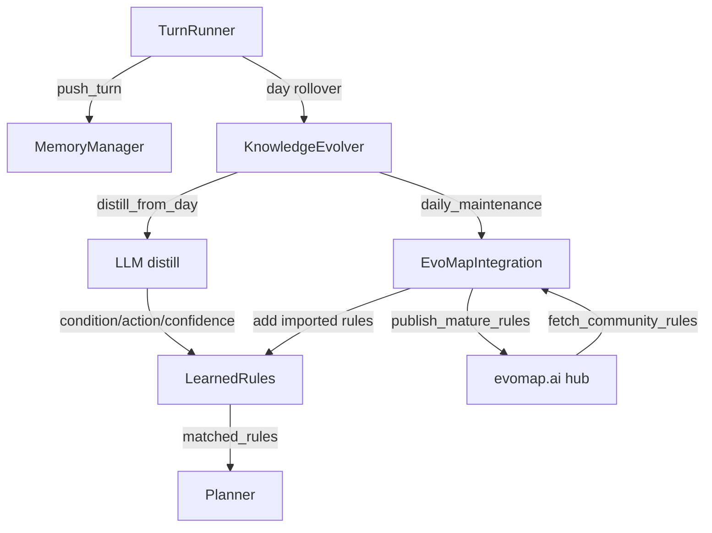

# StarCoplay Agent 进化路径说明

## 进化路径总览

```
游玩 → 记忆 → 反思 → 蒸馏规则 → 发布 Gene → 社区获取 → 增强决策
```



### 各阶段说明

| 阶段 | 组件 | 触发条件 | 输出 |
|------|------|---------|------|
| 游玩 | TurnRunner | 每个游戏 tick | 执行结果写入短期记忆 |
| 反思 | Reflector | 每轮执行后 | 经验教训写入长期记忆 |
| 蒸馏 | KnowledgeEvolver.distill_from_day | 日切换 或 每5轮 | `{condition, action, confidence}` 规则 |
| 衰减 | LearnedRules.decay | 日切换时 | 低置信度规则被淘汰 (< 0.3) |
| 发布 | EvoMapIntegration.publish_mature_rules | 日切换时 | confidence >= 0.8 且 hit_count >= 3 的规则发布为 Gene |
| 获取 | EvoMapIntegration.fetch_community_rules | 日切换时 | 社区 Capsule 导入为本地规则 |
| 决策 | Planner | 每轮 | 用 matched_rules 辅助 LLM 生成行动计划 |

### 成熟度门槛

规则需满足以下条件才会被发布到 EvoMap：
- `confidence >= 0.8`
- `hit_count >= 3`
- 未在本次进程中发布过

## GEP 协议使用方式

### 协议信封格式

每个 GEP 请求包装为信封 (envelope)：

```json
{
  "protocol": "gep-a2a",
  "protocol_version": "1.0.0",
  "message_type": "publish",
  "message_id": "msg_1774714419_aabbccdd",
  "sender_id": "node_xxxxxxxxxxxxxxxx",
  "timestamp": "2026-03-28T16:00:00+00:00",
  "payload": { ... }
}
```

### 端点与认证

| 端点 | message_type | 认证 | 用途 |
|------|-------------|------|------|
| POST /a2a/hello | hello | 无需 Bearer | 节点注册，获取 node_id + node_secret |
| POST /a2a/publish | publish | Bearer node_secret | 发布 Gene/Capsule/EvolutionEvent（schema 由 hub 在校验） |
| POST /a2a/fetch | fetch | Bearer node_secret | 获取社区共享的 Capsule |
| POST /a2a/report | report | Bearer node_secret | 提交校验/使用反馈 |
| POST /a2a/heartbeat | — (REST) | Bearer node_secret | 保活心跳 |

GEP-A2A 标准 `message_type` 仅含：hello、publish、fetch、report、decision、revoke；无单独的 validate 类型。

### 流程

1. **注册**: `hello` → 获取 `node_id` + `node_secret`，持久化到 `agent/evomap/store/node.json`
2. **发布**: `publish` → 提交资产 bundle，hub 校验 schema 并返回 `decision`（accepted / quarantine）
4. **获取**: `fetch` → 按 signals 和 asset_type 拉取社区资产
5. **心跳**: 后台线程定期 heartbeat 保持节点在线

## Gene Recipes 结构

每次发布一个 bundle 包含三个资产：

### Gene（策略基因）

| 字段 | 类型 | 必需 | 说明 |
|------|------|------|------|
| type | string | 是 | 固定 `"Gene"` |
| schema_version | string | 是 | `"1.5.0"` |
| id | string | 是 | 唯一标识，如 `"gene_star_coplay_adaptive_farm"` |
| category | enum | 是 | `"repair"` / `"optimize"` / `"innovate"` |
| signals_match | string[] | 是 | 触发信号，对应 context_tags |
| summary | string | 是 | 策略描述 (>= 10 字符) |
| preconditions | string[] | 否 | 前置条件 |
| strategy | string[] | 是 | 有序可执行步骤，引用真实 tool 名称 |
| constraints | object | 是 | `{ "max_files": int, "forbidden_paths": string[] }` |
| validation | string[] | 是 | 验证命令 |
| asset_id | string | 是 | SHA-256 内容哈希 |

```json
{
  "type": "Gene",
  "schema_version": "1.5.0",
  "id": "gene_star_coplay_adaptive_farm",
  "category": "optimize",
  "signals_match": ["stardew_valley", "star_coplay", "has_water_tiles", "late_night"],
  "summary": "[StarCoplay] Plan-Execute-Reflect farm agent with context_tag dispatch",
  "preconditions": ["StardewAgentBridge mod active", "game_state.json polling functional"],
  "strategy": [
    "Check context_tag has_water_tiles and weather!=rain: call water_all_crops with max_count=30",
    "Check context_tag has_harvest_tiles: call harvest_all_crops",
    "Check time_of_day >= 2200 or energy < 25%: call go_to_bed immediately"
  ],
  "constraints": { "max_files": 3, "forbidden_paths": [".env", "node_modules/"] },
  "validation": ["node -e \"require('assert').strictEqual(1+1,2,'gene_star_coplay_smoke')\""],
  "asset_id": "sha256:..."
}
```

### Capsule（经验胶囊）

| 字段 | 类型 | 必需 | 说明 |
|------|------|------|------|
| type | string | 是 | 固定 `"Capsule"` |
| schema_version | string | 是 | `"1.5.0"` |
| trigger | string[] | 是 | 触发信号 |
| gene | string | 是 | 引用 Gene 的 asset_id |
| summary | string | 是 | >= 20 字符 |
| content | string | 是 | 包含 `Condition:` / `Action:` 对供社区获取解析 |
| confidence | number | 是 | 0-1 |
| success_streak | int | 否 | 连续成功次数，影响 auto-promotion |
| blast_radius | object | 是 | `{ "files": int, "lines": int }` |
| outcome | object | 是 | `{ "status": string, "score": number }` |
| env_fingerprint | object | 是 | 平台信息 |
| asset_id | string | 是 | SHA-256 内容哈希 |

```json
{
  "type": "Capsule",
  "schema_version": "1.5.0",
  "trigger": ["stardew_valley", "star_coplay", "has_water_tiles"],
  "gene": "sha256:...",
  "summary": "[StarCoplay] Validated adaptive farm routine",
  "content": "Condition: has_water_tiles and weather!=rain\nAction: water_all_crops max_count=30\n...",
  "confidence": 0.85,
  "success_streak": 5,
  "blast_radius": {"files": 1, "lines": 15},
  "outcome": {"status": "success", "score": 0.85},
  "env_fingerprint": {"platform": "windows", "arch": "AMD64", "runtime": "python"},
  "asset_id": "sha256:..."
}
```

### EvolutionEvent（进化事件）

```json
{
  "type": "EvolutionEvent",
  "intent": "optimize",
  "capsule_id": "sha256:...(引用 Capsule 的 asset_id)",
  "genes_used": ["sha256:...(引用 Gene 的 asset_id)"],
  "outcome": {"status": "success", "score": 0.85},
  "mutations_tried": 5,
  "total_cycles": 10,
  "asset_id": "sha256:..."
}
```

### asset_id 计算

所有 asset_id 通过 canonical JSON（键排序、确定性序列化）的 SHA-256 哈希生成，排除 `asset_id` 字段自身：

```
asset_id = "sha256:" + SHA256(canonical_json(asset without asset_id))
```

## 社区知识闭环

从社区获取的 Capsule 通过两种方式解析为本地规则：
1. 解析 `content` 中的 `Condition:` / `Action:` 行对
2. 如果 content 中没有上述格式，回退解析 `strategy` 字段中的 `"Check context_tag X: execute Y"` 模式

只有 condition 包含有效 context_tag（`location=`, `weather=`, `has_water`, `has_harvest`, `late_night` 等）的规则才会被导入，防止无效规则污染 planner。导入的规则进入 `LearnedRules`，通过 `matched_rules` 供 LLM 决策参考。这形成了一个完整的知识共享闭环：

```
本地学习 → 发布 Gene → 社区共享 → 其他 Agent 获取 → 融入决策
```
