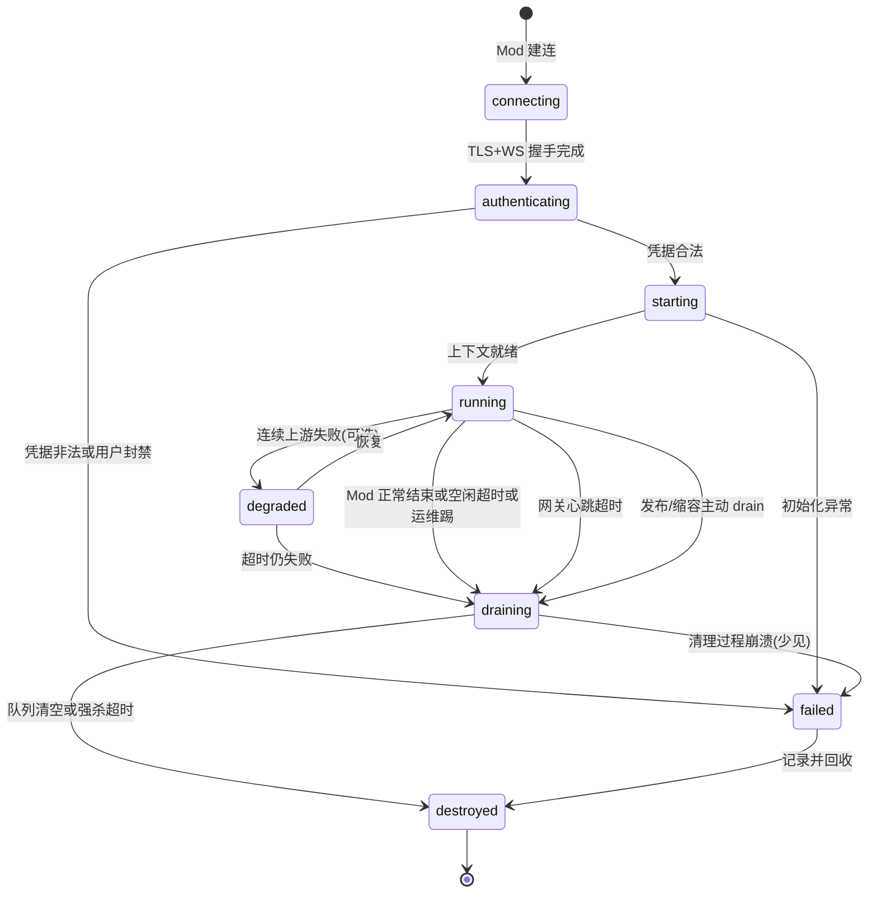

# 云端 Agent + WebSocket 控制管道 — 实施计划

2026-04-16 起草 · 修订（废弃文件桥、Cloud Agent 与 Platform 同机、遥测内部写库）

---

## 0. 关键事实：云上 Agent 与 Platform 同机

上云后 **Agent 进程与 Platform 数据面（Postgres / 服务库访问）部署在同一云侧**（同一集群或同一 VPC 内可达）。因此：

- **遥测**不再等价于「Mod → 云端的一条网络遥测通道」，而是 **Agent → Platform DB 的内部调用**（进程内函数 / 本机 SQL / 内网服务），**不经公网、不经 WebSocket**。
- **Mod 对外唯一需要的长连接**：**一条 WebSocket**，作为 **游戏控制** 的传输管道；WS 存在的理由就是这条控制链路。

**Supabase Realtime**：仍仅适合 Waitlist、轻量广播等；**不**作为本方案中 Mod↔Agent 控制管道。

---

## 1. 当前 vs 目标（数据路径）

### 1.1 旧形态（本地双进程 + setup_ui）

```
Mod ←──[文件桥]──→ Agent（本地）  ←──[HTTP POST]──→ Platform（云端）
                ↑
        玩家手动启动 setup_ui 写 config / 看本地看板
```

### 1.2 当前形态（无 setup_ui，全部收敛到云）

```
Mod (GMCM 内填 Token) ──[ WebSocket :8765 ]──→ Cloud Server
                                                  ├── Agent 实例（处理游戏指令）
                                                  └── Platform DB（Agent 内部写库）
                       ──[ HTTP/SSE :8766 ]──→ platform/web Dashboard
                                                  └── BFF 代理 → Gateway HTTP
```

**玩家路径**：装 Mod → `/register` 拿 Token → 游戏内 GMCM 粘贴 → 打开「启用 AI 控制」即开即用。
**运维路径**：浏览器 `/dashboard` 用同一 Token 查看实时会话、SSE 日志、7/30 日聚合。

### 1.3 「双通道」的真实含义（逻辑分离，不是两条公网 WS）

| | **控制** | **遥测** |
|--|----------|----------|
| **谁 ↔ 谁** | **Mod ↔ Cloud Agent** | **Agent → Platform DB**（Mod 不直连 DB 写遥测） |
| **传输** | **WebSocket**（Mod **唯一**对外长连接） | **无独立传输层**：云上 **内部写库**（或等价内网 RPC，对 Mod 不可见） |
| **需要独立遥测 WS？** | **需要 WS 的理由只在这里** | **不需要**；不是「再拉一条遥测专线」。 |

**洞察**：遥测从「跨公网的 HTTP 上报」退化为 **Agent 侧本地写 DB**；WebSocket 只服务 **控制消息** 的实时性。

---

## 2. WebSocket 的定位：纯管道 + 其上消息类型

### 2.1 连接层（管道自身）

WebSocket **只负责**：传输字节、**自己的**生命周期（心跳、重连、认证）、帧大小与背压；**不**把「写 `events` 表」绑在 WS 帧上作为默认路径。

### 2.2 消息层（管道里跑的内容）

在 **同一条** WS 上按 **消息类型** 路由（实现时统一 `type` 或 `op` 字段）：

```
┌─────────────────────────────────────────┐
│  WebSocket 连接层（传输 + 生命周期）        │
│  心跳 · 重连 · 认证 · 消息路由             │
├─────────────────────────────────────────┤
│  消息类型路由                              │
│  ├── command          (Agent → Mod)      │
│  ├── command_result   (Mod → Agent)      │
│  ├── state_snapshot   (Mod → Agent)      │
│  ├── game_event       (Mod → Agent)      │
│  ├── agent_status     (Agent → Mod)      │
│  └── telemetry        (Mod → Platform)   │  ← 可选：搭控制便车，非默认遥测主路径
└─────────────────────────────────────────┘
```

- **主路径**：运营/会话级遥测由 **Agent 在决策循环内** 调平台 DAO **直接写 `events`**（与现有 `telemetry.py` 语义对齐，只是 IO 从 HTTP 变为内网）。
- **可选 `telemetry` 消息**：若未来要让 **Mod** 上报与 Agent 无关的指标（Mod 版本、客户端性能等），可在 **同一条 WS** 上增加类型，由 **接入层转给平台入库**；语义是 **「遥测搭控制的便车」**，不是「控制搭遥测的便车」——**控制消息仍是管道主要内容**。

---

## 3. 协议替换：文件桥 → WS 消息

| 原文件/流 | WS 消息（建议类型） | 方向 |
|-----------|---------------------|------|
| `commands.jsonl` | `command` | Agent → Mod |
| `results.jsonl` | `command_result` | Mod → Agent |
| `game_state.json` | `state_snapshot` | Mod → Agent（seq/版本防乱序） |
| `events.jsonl`（游戏侧） | `game_event` | Mod → Agent |
| 能力协商 | 握手或 `agent_status` | 双向 |

**与遥测表的关系**：`game_event` 供 Agent **推理**；是否再异步写 `events` 由 Agent 策略决定，**默认仍走 Agent 内部写库**，不强制每帧经公网。

---

## 4. HTTP 路径（保留用途）

| 路径 | 用途（目标架构下） |
|------|---------------------|
| **`POST /api/v1/events`** | **过渡期** 本地 Agent 上报、运维补录、无 WS 的批处理工具；云上主路径以 **Agent 内部写库** 为准。 |
| **`POST /api/v1/system/chat/completions`** | Cloud Agent 调 **relay**（可仍走公网 URL 或同 VPC 内网，实现定）。 |
| **`POST .../functions/v1/events`** 等 | 与现有 Supabase Edge 对齐；云 Agent 亦可 **直连内网等价接口** 省略 Edge。 |
| **`POST /api/validate-token`** | 安装向导等。 |

**禁止**对外再挂 `/api/events`；统一 **`/api/v1/events`**（见历史迁移任务）。

---

## 5. 稳定 WebSocket 基础设施（单管道）

| 要求 | 说明 |
|------|------|
| 单连接职责 | **仅**承载 Mod↔Cloud Agent **控制面**（+ 可选 `telemetry` 便车帧）。 |
| 扩展与粘性 | 入口网关 **粘性** 到持有该会话的 worker；**不**用 Supabase Realtime 替代该层。 |
| 运维 | 每连接 metrics、断线原因、与 `mod_version` / `protocol_version` 关联。 |

---

## 6. Cloud Agent 与 **Agent 实例管理**

### 6.1 标识符（管理器必须能索引）

| 标识 | 生命周期 | 用途 |
|------|----------|------|
| `connection_id` | **一次 TCP/WebSocket 连接**；断线即废 | 网关、负载均衡日志、排障；**不**持久化为业务主键。 |
| `agent_instance_id` | **一次 Agent 逻辑实例**；从创建到 `destroyed` | 与遥测 `session_id`、看板、LLM 调用链关联；**业务主键**。 |
| `worker_id` / `pod_name` | 进程/容器存活期 | 粘性路由、迁移、定位僵尸实例。 |
| `user_id` | 用户账号级 | 配额、踢线、审计。 |
| `farm_session_id`（建议） | 一局联机/一存档会话 | **多联机**下多 Mod 或多实例协同的聚合键；无联机可与 `agent_instance_id` 1:1。 |
| `resume_token`（可选） | 短 TTL（如 5～30 min），一次性或可旋转 | Mod **断线重连**时换取「挂回旧实例」或「冷恢复上下文」。 |

**不变量**：任意时刻，**至多一条**「已认证且 `running`」的 Mod 控制连接 **绑定** 到同一 `agent_instance_id`（除非显式设计「主备双连接」——不推荐 MVP）。

---

### 6.2 状态全集与含义

| 状态 | 含义 |
|------|------|
| `connecting` | TCP/WS 已接受，**尚未**完成应用层鉴权与协议握手。 |
| `authenticating` | 已收到首包凭据，正在校验 `platform_token` / JWT、拉用户配额、可选拉存档元数据。 |
| `starting` | 鉴权已通过，正在 **分配内存上下文**（工作记忆句柄、配置、`DeliberativeLoop` 等价物）、注册到管理器、可能预热线程池。 |
| `running` | 正常收发 **控制消息**；可发起 **内部写库** 与 **relay** LLM 调用。 |
| `degraded`（可选） | LLM 或 DB 连续失败时 **限功能运行**（只收状态、不下发复杂 command），便于自动恢复而非直接杀实例。 |
| `draining` | **不再接新工作**：拒绝新 command 或仅允许 `command_result` / 收尾；消化队列内已派发命令或超时强关。 |
| `suspended`（可选） | 运维或计费冻结；与 `draining` 区别：**可恢复**到 `running` 而不销毁内存（产品需要时再做）。 |
| `destroyed` | 资源已释放；仅保留 **不可变审计记录**（实例起止时间、结束原因码）。 |
| `failed` | **不可恢复**错误（代码崩溃、数据损坏、鉴权根失败）；**不**再经 `draining`，直接记录后进入清理路径，等价于「快速 destroyed」。 |

---

### 6.3 状态转移图（主路径）



**`connecting` → `authenticating` 拆分**：便于单独设 **握手超时**（如 10s）；超时未收到 `hello` → `failed` 或静默关连，**不**创建 `agent_instance_id`（避免垃圾实例号）。

---

### 6.4 触发器与转移表（实现查表用）

| 触发 | 源状态（典型） | 目标状态 | 说明 |
|------|----------------|----------|------|
| WS 接受 | — | `connecting` | 仅分配轻量 socket 上下文。 |
| 首包 `hello` + token | `connecting` | `authenticating` | 可要求 **首包内** 带 `protocol_version`、`mod_version`。 |
| 校验通过 | `authenticating` | `starting` | 生成 **`agent_instance_id`**（UUID）；写 DB 或 Redis **实例行**：`state=starting`。 |
| 校验失败 | `authenticating` | `failed` | 回 `auth_error` 帧后关 WS；**无**实例号或标记实例号为 aborted。 |
| 初始化完成 | `starting` | `running` | 发 `hello_ok`（含 `agent_instance_id`、服务端 `proto`、可选 `resume_token`）。 |
| 初始化抛错 | `starting` | `failed` | 关连；Mod 可重试建连得到 **新** 实例。 |
| Mod 发 `session.end` 或正常 Close | `running` / `degraded` | `draining` | 优雅路径。 |
| **应用层心跳**超时（大于 WS ping） | `running` | `draining` | 阈值应大于网络抖动；建议 **2～3 倍** 心跳间隔。 |
| **空闲**（无 `game_event` / 无双向业务帧）超时 | `running` | `draining` | 与「游戏暂停菜单」产品策略对齐，避免误杀。 |
| 上游 LLM 连续 N 次失败或熔断打开 | `running` | `degraded` 或 `draining` | 产品选「降级」还是「结束会话」。 |
| 运维 **强制踢线** | 除 `destroyed/failed` 外 | `draining` | 带原因码 `admin_kick`。 |
| **滚动发布** / 缩容 | `running` | `draining` | `SIGTERM` 等价；进入 `draining` 后 **停止接新 command**。 |
| `draining` 内队列空 + 资源释放完毕 | `draining` | `destroyed` | 写 `session.end` 类遥测（若尚未写）。 |
| `draining` **超过** `T_drain_max`（如 30～120s） | `draining` | `destroyed` | **强杀**剩余任务；记 `drain_timeout`。 |
| 未捕获异常 | 任意 | `failed` → `destroyed` | 进程级 handler 统一收尾。 |

---

### 6.5 `draining` 期行为细则（易踩坑）

1. **入站**：可配置为 **(A)** 仅允许 `command_result`、`ping`；**(B)** 允许只读类 `state_snapshot`；**禁止**新 `command` 从调度器下发（已在飞的 command 除外）。  
2. **出站**：已派发给 Mod 的 command 若超时未回 `command_result`，记 **`command_lost`**，**不**无限等。  
3. **LLM**：不再发起 **新** relay 请求；已在途的可 **取消** 或等到自然结束（二选一写死）。  
4. **遥测**：允许 **刷写** 缓冲区（内部写库）；**禁止**再开新长事务阻塞回收。  
5. **多联机**：若存在 `farm_session_id`，`draining` 时应 **通知**（经 Redis 等）同会话其他实例「本节点即将消失」，避免另一半仍向已死实例发跨节点消息。

---

### 6.6 重连与 `resume_token`（与状态机衔接）

| 场景 | 行为建议 |
|------|----------|
| **闪断**（同一 `worker_id`、实例仍在 `running`） | 新 `connection_id` 挂到 **同一** `agent_instance_id`；可选 **无** `resume_token`，仅靠 token + 存档键匹配。 |
| **worker 已死** 或实例已进入 `destroyed` | **新** `agent_instance_id`；Mod 带 **`resume_token`**（若曾签发）换 **checkpoint**（游戏日、摘要指针等）恢复 **业务状态**；状态机从 `starting` 起。 |
| **`resume_token` 过期或一次性已用** | 走 **冷启动** `starting`，逻辑等同首次进房。 |
| **重复连接**（旧 WS 未关、新 WS 又来） | 策略二选一并写死：**(A)** 新踢旧；**(B)** 旧踢新。默认推荐 **新踢旧**（用户显式重开游戏）。 |

---

### 6.7 持久化与观测（每个实例行建议字段）

除 §6.1 外，建议表或 Redis Hash 至少含：`state`、`state_changed_at`、`ended_reason`（枚举：`user_close` / `idle_timeout` / `heartbeat_timeout` / `drain_complete` / `drain_timeout` / `auth_failed` / `panic` / `admin_kick` / `deploy`）、`command_inflight_count`、`last_game_event_at`。

**补充**：实例内写遥测用 **服务角色 / 内网凭证**；**禁止**把 DB 凭证下发到 Mod。

---

## 7. `client_event_id`（幂等）

- 每条写入 `events` 的行仍建议带 **`client_event_id`**，由 **Agent 生成**（或 Mod 在可选 `telemetry` 便车帧中携带），**`UNIQUE (user_id, client_event_id)`**。  
- **内部写库** 与 HTTP 上报 **共用** 同一套幂等语义，便于迁移期双写或重试。

---

## 8. 分阶段落地（建议）

| 阶段 | 交付物 |
|------|--------|
| P0 | Mod ↔ 云 **单 WS** + Agent 实例生命周期最小闭环；文件桥 deprecated。 |
| P1 | 全量消息类型映射文件桥；Agent 侧 **内部写 `events`** 替代对外的遥测 HTTP（保留 HTTP 作降级/工具）。 |
| P2 | `client_event_id`、看板接实例指标；可选 Mod `telemetry` 便车帧。 |
| P3 | `resume_token` / checkpoint；移除文件桥代码路径。 |

---

## 9. 与现有仓库的衔接（已落地）

- **本地 setup_ui 已删除**：`v2/tools/setup_ui*`、`v2/tools/bridge_ui.py`、`v2/entry.py`、`v2/start.{sh,bat}`、PyInstaller 打包脚本与对应 GitHub workflow 全部移除。
- **Mod 入口收敛到 GMCM**：`v2/mod/StarCoPlay/Integrations/GmcmIntegration.cs` 现仅暴露 `平台 Token / 启用 AI 控制 / 目标玩家 ID`（高级里才能改 WsUrl）；首次进存档没填 Token 会在聊天框提示一次。
- **Gateway 增加 HTTP/SSE 端**：`v2/platform_ws/http_api/server.py` 提供 `GET /api/v1/sessions/current`、`/sessions/{id}/stream`、`/agent/logs/stream`，复用 `TokenAuthenticator`；与 WS 同进程、默认端口 `8766`，由 `scripts/run_local.py` 同时启动。
- **Platform 看板**：`platform/web/src/app/(platform)/dashboard/page.tsx` + BFF `/api/me/session/{current,stream}` 把 Gateway HTTP 代理到浏览器；历史聚合仍走 `/api/me/summary`（Agent 内部写库的副产物）。
- 事件 **语义** 仍以 `v2/agent/report/events.py` 等为参考；**传输**上控制用 WS 消息类型、遥测以 Agent 写库为主。

---

## 10. 文档维护

- WS 首包认证字段、各 `type` 的 JSON Schema **定稿后**写入附录表。  
- 若产品坚持「Mod 必须直连写 `events` 而无 Agent」，则与本章 **「遥测 = Agent 内部写库」** 冲突，需另开文档修订本架构前提。
