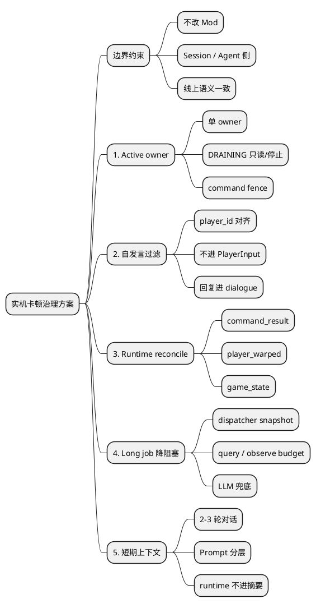

# 技术方案：实机验收反馈卡顿问题治理方案



---

## 0. 元信息

| **字段** | **内容** |
| --- | --- |
| **文档状态** | 🟡 Draft |
| **作者** | @Codex |
| **创建日期** | 2026-05-07 |
| **最后更新** | 2026-05-12 |
| **Reviewers** | @项目维护者 |
| **关联链接** | `.local/logs/ws-gateway.err.log`、`docs/agent-async-onboarding-stability-roadmap.md` |

---

## 1. 一页结论：问题、来源、目标分开看

本次要解决的不是“某一个 timeout”，而是实机验收中暴露出的三条 Session / Agent 侧边界不稳：谁有控制权、Agent 当前运行状态以谁为准、下一轮决策继承什么上下文。

### 1.1 要解决哪些问题

| 优先级 | 问题 | 玩家看到的现象 | 本文的修复目标 |
| --- | --- | --- | --- |
| P0 | Owner 不唯一 | 跑了两次对话、旧 agent 还在发命令 | 同一个 owner 同一时刻只有一个 ACTIVE agent runtime；旧实例进入 DRAINING 后不能再接收事件、运行 LLM 或下发命令 |
| P0 | AI 自发言回灌 | AI 自己说的话又被当成玩家输入，重复触发慢循环 | Agent `EventRelay` 基于 `chat_received.player_id` 与 `bridge.target_player_id` 过滤 AI 控制角色发言 |
| P1 | Agent runtime 结果不一致 | 角色看起来到了酒吧，但 agent 收到 `NAVIGATION_TIMEOUT` | Agent 侧用 `command_result`、近期 `player_warped`、`game_state` 和 dispatcher job 状态做 reconcile，不要求 Mod 改返回结构 |
| P1 | 慢循环被查询/LLM 等待拖住 | 玩家追问后长时间无解释等待 | Agent 侧区分 direct query 与 L3 observe；active long job 期间优先 runtime snapshot，减少阻塞查询；LLM 超时按运行快照兜底 |
| P2 | 短期上下文主要靠文本回填 | 追问接不上、后台任务状态和对话上下文混在一起 | 建立短期 session buffer，并让 PromptAssembler 固定分层注入 |

### 1.2 证据来源是什么

| 来源类型 | 本文直接使用的证据 | 能证明什么 | 不能直接证明什么 |
| --- | --- | --- | --- |
| 日志事实 | `.local/logs/ws-gateway.err.log` 中的 `new-kicks-old`、旧实例继续 `say/move_to`、`NAVIGATION_TIMEOUT`、`player_warped -> Saloon`、LLM/query timeout | 实机验收时确实出现双 session、结果不一致、超时叠加 | 最终代码应该怎么改 |
| 代码事实 | `gateway/server.py`、`agent_session_worker.py`、`session_subprocess.py`、`session_runner.py`、`ws_bridge.py`、`game_monitor.py`、`deliberative_loop.py`、`action_dispatcher.py`、`prompt_assembler.py` | 当前 Session / Agent 实现是否有对应风险点 | 日志里每一条异常的唯一根因 |
| 系统推断 | owner / runtime / context 三条边界互相污染 | 为什么这些症状会互相放大 | 不替代后续 PR 设计和测试报告 |

### 1.3 本文目标和非目标

| 类型 | 内容 |
| --- | --- |
| 本文目标 | 给出本次卡顿的事实链路、Session / Agent 侧治理线、落地顺序、需要验证的代码路径和 DoD |
| 修复目标 | 先做最小一致性修复：session ownership、自发言过滤、Agent runtime reconcile、query/LLM 降阻塞、短期上下文分层 |
| 非目标 | 不修改 Mod 侧实现；不要求 Mod 新增 passthrough、BUSY 或 partial 字段；不直接推翻 async dispatcher；不把本地验收改成一套和线上不同的 session 语义；不从摘要里恢复运行中任务 |

### 1.4 核心判断

本次“不能及时反馈”不是单点问题。更准确的判断是：

```text
owner 不唯一
  -> 旧 runtime 继续产生命令
  -> AI 自发言回灌污染 PlayerInput
  -> 每次 trigger 又靠文本重建上下文
  -> Agent 侧 query / LLM 等待放大
  -> 玩家看到重复、卡顿、走到了但不反馈
```

因此当前优先级不是先重构整个 dispatcher，也不是改 Mod。应先在 Session / Agent 侧把 owner、runtime、context 三条边界收紧，让后续问题可以稳定复现和验证。

---

## 2. 背景与问题

### 2.1 验收场景

本地实机验收时，玩家与 AI 在游戏内聊天，并要求 AI 执行跨地图移动与后续任务：

- 玩家先进行了两轮闲聊。
- 玩家要求 AI 去镇上酒吧/酒店一类地点。
- 游戏里观察到角色移动到了目标地点附近或目标场景。
- 随后玩家继续提问或下达“回农场清理杂物”等指令，但 AI 长时间没有给出有效反馈。

### 2.2 当前观察到的问题

从 `.local/logs/ws-gateway.err.log` 看，问题主要表现为：

- 同一时间窗口内有两个 agent instance 继续发命令。
- AI 自己发送的聊天内容被 EventRelay 识别为玩家输入。
- Agent 收到的长动作 `move_to` 结果和近期位置事件状态不一致。
- 同步 query action 和 LLM 调用发生超时，慢循环被拖住。
- 主 trigger 仍以重建 prompt 为主，最近几轮对话、后台任务进度和近期事实更多依赖 `PromptAssembler` / 记忆文本回填，连续性成本高。
- LLM provider 健康检查和 429 日志较多，增加了排障噪音。

---

## 3. 目标与非目标 ⭐

### Goals（必达）

- 明确这次“不能反馈”的事实链路，区分日志事实、代码事实和系统推断。
- 给出 Session / Agent 侧五条治理线：active owner、自发言过滤、runtime reconcile、query/observe/LLM 降阻塞、短期上下文分层。
- 标出每条治理线复用的现有模块、新增或收紧的边界、落地顺序和验收标准。
- 明确“不修改 Mod 侧实现”的边界，避免把方案扩散到 Mod 返回字段、BUSY/passthrough 或 partial success。
- 作为后续修复前的方案基线，便于 PR、测试和实机验收逐条对齐。

### Non-Goals（明确不做）

- ❌ 本文不要求修改 Mod 侧实现，不要求新增 Mod passthrough、BUSY、partial success 或返回字段。
- ❌ 本文不直接给出 PR diff；但明确后续代码修复的 Session / Agent 侧边界、顺序和准入标准。
- ❌ 本文不把当前异步执行方案整体推翻或重构。
- ❌ 本文不覆盖所有线上稳定性问题，只聚焦本次实机验收卡顿。
- ❌ 本文不替代后续 PR 说明和测试报告。

---

## 4. 最终方案概述

**核心一句话**：不改 Mod，先在 Session / Agent 侧收敛五条边界：active owner、AI 自发言、runtime reconcile、query/LLM 等待策略、短期上下文连续性。目标不是把所有异步执行推翻，而是让同一时刻只有一个 Agent 能决策，Agent 能正确区分“玩家输入、自己回复、后台任务状态、游戏状态事件”，并在长动作期间给出及时、可解释的反馈。

### 4.1 治理线一：Active owner fence

| 项 | 内容 |
| --- | --- |
| 要解决的问题 | `new-kicks-old` 后旧 agent 仍继续 `say/move_to`，导致两个 agent 同时处理事件和发命令 |
| 依据 | 日志中旧实例进入 DRAINING 后仍继续发 `say/move_to`；代码上 duplicate login 只 `transition(displaced, DRAINING)`，旧 `session_runner` 到 `_drain_and_destroy()` 才会被 `on_session_end` stop |
| 复用 | `InstanceRegistry` 的状态机、`AgentSessionWorker.on_session_end()`、`AgentSubprocessHandle.stop()`、`session_runner` 的 `__stop__` 控制帧、现有 `user_id` 绑定 |
| 新增/收紧 | 明确 DRAINING 不再是业务态：旧实例不能接收新 game_event/state_snapshot，不能运行新的 LLM，不能下发 command；command 输出前做 active-owner 二次校验 |
| 为什么不是新架构 | 仍保留 session registry、resume、drain、worker 隔离，只收紧状态语义 |
| 验收 | 同一 `user_id` 重连后，日志中只允许新 active instance 下发业务 command；旧实例只 stop 或只读 drain |

### 4.2 治理线二：AI 自发言过滤，但保留 Agent 回复上下文

| 项 | 内容 |
| --- | --- |
| 要解决的问题 | AI 的 `say` 被 `chat_received -> EventRelay -> PlayerInput` 回灌，形成自触发 |
| 依据 | `EventRelay` 当前对所有 `chat_received` 都转 `PlayerInput`；事件中已有 `player_id`，`WSBridge/session_runner` 已持有 `target_player_id` |
| 复用 | `chat_received.data.player_id`、`bridge.target_player_id`、`MemorySystem.append_conversation("agent", message)`、WorkingMemory 的 `agent_replied` |
| 新增/收紧 | `EventRelay` 只过滤“AI 发言进入 PlayerInput”这条链路：`player_id == target_player_id` 时丢弃；Agent 自己的回复仍写入短期对话窗口，作为 assistant/agent 角色进入后续上下文 |
| 为什么必须做 | 不过滤会把 Agent 回复当成玩家新指令；过滤不等于丢上下文，因为 Agent 回复已有独立记录路径 |
| 验收 | AI 控制角色发出的 `say` 不触发新的 PlayerInput；真人玩家聊天仍正常触发；Prompt 中最近对话仍包含 Agent 上一次回复 |

### 4.3 治理线三：Agent runtime reconcile

| 项 | 内容 |
| --- | --- |
| 要解决的问题 | `move_to` 返回 `NAVIGATION_TIMEOUT`，但近期事件显示 `player_warped -> Saloon`，Agent follow-up 容易误判为“完全没到” |
| 依据 | 日志中 command_result 和 player_warped 同时出现；`ActionDispatcher` 记录 job action/params/action_id；`EventRelay` 已把 `player_warped` 写入 WorkingMemory；Prompt 已注入 `dispatcher_snapshot` 和当前 `game_state` |
| 复用 | `TaskCompleted`、`ActionDispatcher` job snapshot、WorkingMemory 近期事件、当前 `game_state`、`PromptAssembler` 的 dispatcher snapshot 注入 |
| 新增/收紧 | Agent 侧新增 reconcile 规则：long action failed/timeout 时，先结合 job params、近期 `player_warped`、当前 game_state 判断“位置是否已变化”；对玩家解释“位置已变化但动作未完整确认”，而不是简单失败 |
| 为什么不改 Mod | 本方案不改变 Mod 成功/失败定义，不要求 partial success 或新返回字段，只改 Agent 的解释、记忆和下一步策略 |
| 验收 | command_result failed/timeout 但近期位置已变化时，follow-up 不误报“完全没到”，并能说明当前看到的位置状态 |

### 4.4 治理线四：长任务期间 query/observe/LLM 降阻塞

| 项 | 内容 |
| --- | --- |
| 要解决的问题 | 长 job 运行期间，direct query、L3 observe 子查询和 LLM timeout 叠加，玩家长时间没有及时反馈 |
| 依据 | `QUERY_TIMEOUT_S = 10.0` 只覆盖 direct `QUERY_ACTIONS`；`observe` 已走 `L3_BACKED_CORE_TOOLS -> v2_skills/builtin/observe`，会 fan-out 多个 `ctx.query()`；`ActionDispatcher.snapshot()` 和 `query_action_jobs` 已能提供本地 runtime 状态 |
| 复用 | `dispatcher_snapshot`、`query_action_jobs`、`ActionDispatcher.snapshot()`、L3 observe 分层结构、`game_state` 本地快照、LLM timeout telemetry |
| 新增/收紧 | active long job 存在时优先用 runtime snapshot 回答；限制同一 FC turn 的 direct query 次数；observe 子查询设置局部 budget；LLM timeout 兜底带上当前 active job/位置快照 |
| 为什么不直接 10s -> 2s | direct query、L3 observe、LLM timeout 是不同链路；统一砍 timeout 会掩盖根因，也可能让必要查询误失败 |
| 验收 | 长动作期间玩家追问时，Agent 能先回复“正在做什么/已运行多久/当前已知位置”，不因 full observe 或 query timeout 长时间沉默 |

### 4.5 治理线五：短期 session buffer 与 Prompt 分层

| 项 | 内容 |
| --- | --- |
| 要解决的问题 | `_process_trigger()` 每次重建 prompt，跨 trigger 对话主要靠 `memory_context` / WorkingMemory 文本回填，追问和改口容易漂移 |
| 依据 | `conversation = list(messages)` 只在当前 FC 多轮内存活；`PromptAssembler` 已有 `dialogue_history` 参数和格式化函数，但主链路未正式传入独立 recent dialogue |
| 复用 | `MemorySystem.append_conversation("player"/"agent")`、`PromptAssembler.dialogue_history`、`dispatcher_snapshot`、WorkingMemory、当前 `game_state` |
| 新增/收紧 | 建立短期 session buffer：保底最近 2 个 player-agent exchange，最多 3 轮或 500-800 token；只放自然语言对话，不放 active job / command result / runtime 状态 |
| 为什么是 2-3 轮 | 1 轮不够覆盖“下命令 -> 已开始 -> 追问/改口”；很多轮会污染最新意图并增加 prompt 成本。2-3 轮是最小验收窗口，最终由 token budget 控制 |
| 验收 | 最近 2-3 轮自然语言往返稳定进入 `dialogue_history`；后台任务仍来自 dispatcher snapshot，不从对话摘要中恢复 runtime |

### 4.6 推荐落地顺序

| 阶段 | 内容 | 原因 |
| --- | --- | --- |
| 第 1 步 | Active owner fence + 旧 session stop/只读 drain | 先消除两个 agent 同时决策，否则后续现象不可稳定复现 |
| 第 2 步 | EventRelay 自发言过滤 + Agent 回复保留到 dialogue buffer | 先消除自触发噪音，同时保留上下文连续性 |
| 第 3 步 | Runtime reconcile | 修正“到了但失败”的解释和下一步策略 |
| 第 4 步 | long job 下 query/observe/LLM 降阻塞 | 解决长动作期间追问无反馈 |
| 第 5 步 | session buffer + PromptAssembler 分层预算 | 固化边干活边聊的上下文连续性 |

---

## 5. 诊断详解

### 5.1 日志事实：同一用户出现两个 agent session

关键日志：

| 时间 | 事实 |
| --- | --- |
| 21:53:54 | `ai_41541ca0f5114ce694767048cf849bd3` 建立连接并启动 session_runner |
| 21:54:38 | 新连接 `ai_c26bf6b454e542d795c058ec24503b19` 建立 |
| 21:54:38 | gateway 打印 `new-kicks-old`，新实例踢旧实例 |
| 21:55:28 | 旧实例继续发送 `say` 和 `move_to` |
| 21:56:03 | 旧实例继续发送 `say` |
| 21:57:49 | 旧实例继续发送 LLM 超时兜底 `say` |
| 22:00:56 | 新实例退出 |
| 22:00:59 | 旧实例才退出 |

结论：

- `new-kicks-old` 只把旧实例状态切到了 `DRAINING`，但旧 session 仍然保留连接和子进程。
- 旧 agent 在 drain 期间继续处理事件和发送命令。
- 这会直接导致“跑了两次对话”的现象。
- 当前代码事实是：`platform/ws/gateway/server.py` 在 duplicate login 时调用 `registry.transition(displaced, DRAINING)`，但旧 session 的 `on_session_end` 只在 `_drain_and_destroy()` 里触发；`AgentSessionWorker` 的旧 `session_runner` 因此不会立即收到 `__stop__`。
- `InstanceRegistry.bind_user()` 当前按 `user_id` 绑定 active instance，还没有正式 owner_key；短期修复应先保证现有 `user_id` 语义下旧实例不再产生命令，owner_key 可以作为后续 Session/Agent 侧增强。

相关代码路径：

- `platform/ws/gateway/server.py`
- `platform/ws/instance_registry/registry.py`
- `platform/ws/workers/agent_session_worker.py`
- `platform/ws/workers/session_subprocess.py`
- `agent/session_runner.py`

需要进一步确认：

- `new-kicks-old` 语义到底是“立即 stop 旧 session_runner”，还是“旧 session 只保留 command_result drain，不再运行业务”。
- 如果保留 DRAINING，Gateway 是否应停止 fanout 新 `game_event/state_snapshot` 到旧 session，并通知 worker 对旧子进程进入只读/停止态。
- Agent 侧 command 输出前是否需要 active-owner fence，防止旧慢循环已经拿到 LLM 结果后继续下发 `say/move_to`。

### 5.2 日志事实：AI 自己的聊天被当成 PlayerInput

关键日志：

| 时间 | 日志 | 判断 |
| --- | --- | --- |
| 21:55:21 | `PlayerInput player=test-1 msg=走去镇上酒吧玩玩` | 玩家输入 |
| 21:55:28 | `PlayerInput player=test msg=move_to queued: job_id=job_aece516b` | AI 自己的反馈被回灌 |
| 21:56:03 | `PlayerInput player=test msg=哈哈，我其实么酒都喜...` | AI 自己的回复被回灌 |
| 21:56:32 | `PlayerInput player=test msg=让我想想...` | 兜底消息被回灌 |
| 21:57:49 | `PlayerInput player=test msg=想了久没想出来，稍等我再试试...` | LLM 超时兜底被回灌 |

结论：

- 当前 `EventRelay` 对所有 `chat_received` 都转 `PlayerInput`。
- `chat_received` 事件数据里已经有 `player_id`；`WSBridge` / `session_runner` 已经持有 `target_player_id`。
- 因此自发言过滤可以纯 Agent 侧完成：当 `data.player_id == bridge.target_player_id` 时，`EventRelay` 应丢弃该聊天，不转成 `PlayerInput`。
- 这不要求修改 Mod。Mod 侧只作为现有事件字段来源。

相关代码路径：

- `agent/game_monitor.py`
- `agent/bridge/ws_bridge.py`
- `agent/session_runner.py`

需要进一步确认：

- 实机环境中 `chat_received.data.player_id` 与 `bridge.target_player_id` 类型是否一致，比较前需要统一转成整数或字符串。
- 本地非 WS bridge 是否也提供 `target_player_id`；如果没有，应保持向后兼容，只在字段存在时过滤。

### 5.3 日志事实：Agent runtime 对 command_result 和位置事件缺少统一判断

关键日志：

| 时间 | 事实 |
| --- | --- |
| 21:55:28 | `move_to queued: job_id=job_aece516b` |
| 21:55:28 | gateway 下发 `cap=move_to action_id=act_0012_29a1` |
| 21:55:58 | `command_result action_id=act_0012_29a1 success=False status=failed err=NAVIGATION_TIMEOUT` |
| 21:55:58 | `player_warped -> ReportEvent to=Saloon` |

结论：

- 从玩家视角看，角色可能已经到达 Saloon。
- 从 command result 看，dispatcher 收到的是失败。
- 失败的 `TaskCompleted` 会触发慢循环继续处理，可能导致后续回答偏离真实状态。
- 在“不修改 Mod”的边界下，这里不要求 `move_to` 返回新字段，也不把 `NAVIGATION_TIMEOUT` 改成 partial success。
- Agent 侧可以用已有输入做 reconcile：`ActionDispatcher` 记录 job action/params/action_id，`EventRelay` 已把 `player_warped` 写入 WorkingMemory，`PromptAssembler` 已注入 dispatcher snapshot 和当前 `game_state`。缺的是一个明确的 Agent runtime 判定规则：当 long action 失败时，结合近期位置事件和最新 game_state 解释“动作失败但位置可能已改变”。

需要进一步确认：

- `TaskCompleted` 触发 follow-up 前，Agent 是否应先读取当前 `game_state` 或 WorkingMemory 中最近的 `player_warped`，再决定对玩家怎么解释。
- `go_to/move_to` 的 params 中是否足够提取目标地点，用于和近期 `player_warped.to_location` 做弱匹配。
- 这个 reconcile 只改变 Agent 的解释、记忆和下一步策略，不改变 Mod 的成功/失败定义。

### 5.4 日志事实 + 代码复核：Agent 慢循环被 query/observe 和 LLM 等待拖住

关键日志：

| 时间 | 事实 |
| --- | --- |
| 21:55:03 | `observe` 等待结果超时 |
| 21:55:30 | `query_time` 等待结果超时 |
| 21:56:13 | `EscalateRequest rounds=4 actions=[observe,query_farm_summary,query_time,observe] 耗时=80.3s` |
| 21:57:00 | 玩家输入“先回农场清理下杂物吧” |
| 21:57:49 | `openai.APITimeoutError: Request timed out` |
| 21:57:49 | 发送兜底 `想了太久没想出来，稍等我再试试...` |

结论：

- 不能把这里简单归因成“query 统一等 10 秒，所以直接改成 2 秒”。当前项目里至少有三条不同链路：
  - direct query：`deliberative_loop.py` 中命中 `QUERY_ACTIONS` 的工具会同步等待结果，使用 `QUERY_TIMEOUT_S = 10.0`。例如当前的 `query_time` 属于这条链路。
  - L3 observe：当前 `observe` 已从 `QUERY_ACTIONS` 移出，经 `L3_BACKED_CORE_TOOLS` 路由到 `v2_skills/builtin/observe`。它不是单次 10 秒 direct query，而是由 observe skill 读取 `game_state`，再通过 `ctx.query()` fan-out 调用 `query_inventory`、`find_targets(crop/animal/object/npc)`、`query_containers` 等。
  - Agent dispatcher/runtime：`ActionDispatcher.snapshot()` 已能暴露 active/pending/recent jobs；`PromptAssembler` 已注入 `dispatcher_snapshot`；`DeliberativeLoop` 也已有 `query_action_jobs`。但当前工具策略仍允许 active long job 期间反复 full observe/direct query，从玩家视角会叠加等待。
- 因此，在“不修改 Mod”的边界下，不把根因写成 Mod handler 慢，也不要求 Mod passthrough。Agent 侧应先避免在已知 active long job 期间发起低价值阻塞查询。
- LLM 自身超时是第二层放大器：当 query/observe 已经消耗一轮等待后，再遇到 LLM provider timeout，玩家看到的就是更长时间没有解释性反馈。

当前不应直接采用“10s 降到 2s”作为主方案。合理顺序应该是：

1. 先加 Agent 侧耗时与结果归因：记录 write_command、read_command_result、query timeout、observe 子查询失败、LLM timeout、active_job 状态。只观测 Agent 可见链路，不要求 Mod 新增日志。
2. active long job 存在时，优先用 `dispatcher_snapshot` / `query_action_jobs` / 最新 `game_state` 回答“正在做什么”，避免反复 full observe。
3. 对 L3 observe 做 Agent 侧局部 budget：`game_state` 先返回，非关键子 query 失败或超时只导致部分观察，不阻塞整个 observe。
4. 对 direct query 做策略限流：同一 FC turn 限制查询次数；active long job 期间只允许白名单查询或直接返回“当前任务运行中，先基于快照回答”。
5. 最后再按实测 p50/p95/p99 调 direct query、observe 子 query、LLM provider timeout，不能统一拍成 2 秒。

需要进一步确认：

- 实机日志里的 `observe` timeout 发生时，代码版本是否已经切到 L3 observe；如果是当前版本，需要看 observe skill 总 timeout 与每个 `ctx.query()` 的耗时。
- active long job 期间哪些玩家问题必须查询，哪些可以直接用 dispatcher snapshot / game_state 快照回答。
- `QUERY_TIMEOUT_S = 10.0` 对 direct query 是否过长，需要在有分段耗时数据后再决定，不能作为第一刀。

### 5.5 代码事实：当前仍以 trigger 级 Prompt 重建为主，对话历史主要退化为文本

从当前代码看，这个问题确实存在，而且和本次卡顿属于同一类“决策运行时边界”问题：

- `agent/slow_loop/deliberative_loop.py` 的 `_process_trigger()` 每次收到 trigger 都会重新调用 `PromptAssembler.assemble()` 生成新的 `messages`。
- 同文件里的 `conversation = list(messages)` 只在当前一次 FC 多轮续轮中存活；当前 turn 结束后不会自然延续到下一个 trigger。
- 虽然现在已经有 `_drain_mid_turn_player_inputs(conversation)`，可以把 FC 续轮中的中途玩家输入补进当前会话，但它只覆盖单次 FC 多轮，不覆盖跨 trigger 的连续性。
- `agent/slow_loop/prompt_assembler.py` 已经具备 `dialogue_history` 分段能力，也已接入 `dispatcher_snapshot`、`WorkingMemory`、`memory_context`；但当前 `_process_trigger()` 尚未把 `dialogue_history` 作为独立入参传入，最近对话主要还是通过 `memory_context` 和 WorkingMemory 文本进入 prompt。

因此，这不是“双 session / 自发言回灌”的直接根因，但它和前者是同源的：都说明当前系统在 active owner、runtime state、short-term context continuity 三条边界上还不够收敛。

更具体地说，问题不是“要不要变成完全状态化无限对话”，而是当前 trigger 级重建模式的代价还过高：

- 最近几轮玩家追问和 Agent 回复更容易退化成文本摘要，而不是稳定的短期上下文窗口。
- 后台任务进度虽然已有 `dispatcher_snapshot`，但和最近对话、近期事实之间还缺少正式的短期上下文分层。
- 一旦出现双 session、self-chat 回灌、query 超时等噪音，文本重建路径更容易把上下文进一步污染。

相关代码路径：

- `agent/slow_loop/deliberative_loop.py`
- `agent/slow_loop/prompt_assembler.py`

---

## 6. 备选方案 ⭐

| **方案** | **描述** | **优势** | **劣势** | **为什么没选/当前建议** |
| --- | --- | --- | --- | --- |
| 方案 A：Session/Agent 最小一致性修复 | 先修 active owner fencing、旧 session_runner 停止/只读 drain、Agent 自发言过滤、Agent runtime reconcile、短期上下文分层 | 范围可控，符合“不改 Mod”边界，能同时收敛本次卡顿与近期追问漂移 | 不能一次性解决所有异步体验问题 | 当前建议优先采用 |
| 方案 B：Agent runtime 策略增强 | 在 DeliberativeLoop / ActionDispatcher / observe skill 层增加 active long job 查询限流、局部 budget、LLM runtime snapshot 兜底 | 能减少玩家等待和误解释 | 依赖方案 A 先消除双 agent 和自触发噪音 | 作为方案 A 后续阶段 |
| 方案 C：重构异步 dispatcher | 重新设计任务状态机、取消、回调、查询调度 | 理论上更完整 | 风险大，容易掩盖当前真实 bug | 当前不建议 |
| 方案 D：只调 LLM/provider | 更换模型、增大 timeout、减少健康检查 | 能减少 LLM 超时噪音 | 解决不了双 session、自发言回灌和 runtime 解释偏差 | 只能作为辅助项 |

---

## 7. 风险与权衡 ⭐

| **风险** | **影响范围** | **触发条件** | **缓解措施** |
| --- | --- | --- | --- |
| 旧 session drain 期间继续发命令 | 单用户实机验收、线上重复连接 | WS 重连、双开、网络抖动 | 明确 kick 语义；旧实例进入 DRAINING 后停止接收新事件、停止 LLM、禁止 command 输出，或直接 stop session_runner |
| AI 自发言回灌 | 聊天体验、慢循环上下文 | AI 控制角色发聊天，当前本机不是该 farmer | Agent EventRelay 基于 `chat_received.player_id == bridge.target_player_id` 过滤 |
| move_to 失败结果与位置事件不一致 | 跨地图移动任务 | 已 warp 到目标地图，但 command_result 是 timeout/failed | Agent 侧用近期 `player_warped` + 最新 `game_state` + job params 做 reconcile；对玩家解释“位置已变化但动作未完整确认” |
| query / observe 等待拖慢 FC | 玩家即时反馈 | active long job、observe 子查询 fan-out、连接不稳定 | Agent 侧先加可见链路耗时；active long job 时优先 runtime snapshot；observe 子查询设置局部 budget；再按实测调整 direct query timeout |
| trigger 级 Prompt 重建导致近期上下文退化为文本 | “边干活边聊”、追问衔接、后台任务 follow-up | 多次 trigger、长动作期间插话、后台事件较多 | 保留 trigger 级重建，但增加短期 session buffer；PromptAssembler 固定分层 latest input / background tasks / recent facts / long-term memory |
| LLM provider 健康检查噪音 | 日志排障、provider 配额 | 本地启用大量 provider 健康检查 | 本地验收模式降低健康检查频率或只启用选定 provider |

**关键权衡**：

当前不建议先做大规模架构重构。日志已经显示基础一致性层有明确问题：同一用户两个 agent 同时跑、AI 自己输入被回灌。如果这些不先收敛，后续任何 async dispatcher、prompt 或 LLM 调优都很难稳定复现和验证。

---

## 8. 失败模式与容错

| **组件** | **失败场景** | **影响** | **降级/容错策略** | **监控指标** |
| --- | --- | --- | --- | --- |
| Gateway session registry | `new-kicks-old` 后旧实例继续活跃 | 重复对话、命令交错 | 旧实例立即 stop 或禁止 worker 继续投递业务消息 | active sessions per user、draining session command count |
| AgentSessionWorker / session_runner | 子进程未及时停止 | 旧 agent 继续发命令 | kick 时主动 stop；或向旧 runtime 发只读/停止信号并阻断 command 输出 | session_runner lifetime、post-drain command count |
| EventRelay | AI 自发言转 PlayerInput | 自触发循环 | 按 `player_id == target_player_id` 过滤 | self-chat dropped count |
| ActionDispatcher / DeliberativeLoop | command_result 失败但 game_state/事件显示位置已变化 | 错误 follow-up | Agent runtime reconcile：结合 job params、近期 `player_warped`、最新 game_state 生成解释和下一步策略 | reconcile count、failed-but-moved count |
| DeliberativeLoop | query/observe/LLM 等待叠加 | 玩家无反馈 | 分路径治理 direct query 与 L3 observe；active long job 时减少 full observe；LLM 超时用 runtime snapshot 兜底 | FC duration、query visible latency、observe partial count、LLM timeout count |
| PromptAssembler / WorkingMemory | 跨 trigger 连续性主要靠文本注入，短期对话和后台任务状态混在一起 | 追问漂移、重复解释、prompt 成本上升 | 增加短期 session buffer，分层注入 latest input / background tasks / recent facts / long-term memory | recent-turn continuity、prompt size、memory injection hit rate |

---

## 9. 测试计划 + DoD

### 测试计划

| **测试类型** | **覆盖范围** | **关键用例** |
| --- | --- | --- |
| 单元测试 | EventRelay 过滤逻辑 | `chat_received.player_id == bridge.target_player_id` 不进入 PlayerInput；真人玩家 chat 正常进入 |
| 单元测试 | gateway kick 语义 | 同一 user 新连接后旧 session 不再发 command |
| 单元测试 | PromptAssembler 分层 | 最新玩家输入、当前后台任务、近期事实、长期记忆按固定层次注入，不能互相覆盖 |
| 集成测试 | session worker 生命周期 | `new-kicks-old` 后旧 session_runner 在限定时间内退出 |
| 集成测试 | Agent runtime reconcile | command_result 失败但近期有 `player_warped`/game_state 位置变化时，follow-up 不直接误报“完全没到” |
| 集成测试 | recent-turn continuity | 连续 2-3 次 trigger 后，最近玩家追问和上一轮 agent 回复不只依赖压缩摘要，还能稳定重建 |
| E2E 测试 | 本地双开实机 | 玩家说“去酒吧”；AI 只回复一次；只存在一个 active agent |
| E2E 测试 | 长动作期间追问 | move_to 过程中玩家追问，AI 不自触发、不重复处理 |
| E2E 测试 | 导航 timeout | 已到目标地图但 timeout 时，Agent 基于现有事件/快照解释当前位置和未完成原因 |

### Definition of Done

- 同一 `user_id` 在日志中不会出现两个 agent instance 同时向 Mod 下发业务 command。
- AI 控制角色发出的 `say` 不再被记录为 `PlayerInput`。
- 玩家连续 3 次输入时，每条输入最多触发一个主 FC 决策。
- `move_to` 超时时，Agent follow-up 能结合当前 game_state / 最近 `player_warped` 说明位置状态；不要求 Mod 返回新字段。
- 最近 2-3 轮玩家/Agent 自然语言往返不再只依赖单段 summary 注入；存在短期 session buffer 或等价结构层。
- Prompt 中“最新玩家输入 / 当前后台任务 / 近期关键事实 / 长期记忆”具备稳定分层，而不是全部退化到 WorkingMemory 或摘要文本。
- 本地实机验收中“去酒吧/回农场/清理杂物”链路可连续跑通，不出现 60 秒以上无解释等待。

---

## 10. 上线计划

### 阶段划分

| **阶段** | **范围** | **验证内容** | **回滚条件** |
| --- | --- | --- | --- |
| 阶段 1：本地验收 | Windows 本地 stack + 双开游戏 | session 唯一性、自发言过滤、move_to 日志 | 出现旧实例继续发命令 |
| 阶段 2：小范围联机 | 1-2 个真实用户/开发账号 | 重连、断线、重复登录 | 玩家输入丢失或 agent 不启动 |
| 阶段 3：线上灰度 | ECS gateway 小流量 | active session、LLM timeout、command timeout | 重复对话率升高或 session 泄漏 |

### 数据迁移

暂无数据迁移。若修复涉及 Supabase instance/session 表字段，需要单独补迁移计划。

### 回滚方案

优先保持改动在 gateway/agent 运行时逻辑，不改变 DB schema。若上线后出现 session 无法恢复或误杀正常连接，回滚到上一版 gateway 与 agent worker。

---

## 11. 影响评估

| **维度** | **评估** |
| --- | --- |
| **业务影响** | 直接影响实机可验收性和线上玩家对 AI 搭子的信任感 |
| **用户范围** | 使用联机/双开/重连场景的用户优先受影响 |
| **工程工时** | 诊断已完成初步链路；最小修复预计 1-2 人天，完整验收 2-4 人天 |
| **长期维护成本** | 若先修一致性，维护成本低；若直接重构 dispatcher，维护成本高 |
| **依赖人/团队** | Agent、Platform WS；Mod 只作为现有事件/状态/结果的外部事实来源，不作为本方案改造对象 |

---

## 12. 线上优先的 Session、运行时上下文与记忆边界补充

本节补充当前讨论中的架构判断：后续修复应以线上服务器长期运行语义为主，本机验收只作为复现和验证入口。不能为了本地快速跑通，把线上需要的会话隔离、恢复、排水、观测能力简化掉。

### 12.1 Session 设计是否过重

当前 session 设计本身不一定是“过度设计”。线上环境确实需要：

- platform token 鉴权，区分真实用户、开发账号、异常连接。
- 每条 WS 连接拥有独立 `agent_instance_id`，便于追踪进程、日志、命令来源。
- resume token 或等价恢复凭据，支持断线重连而不是每次都创建全新 agent。
- heartbeat、drain、worker 子进程隔离和 session registry，避免线上长进程互相污染。
- 线上可观测性：active/draining/closed 状态、命令归属、LLM 超时、command timeout 都需要能被定位。

真正的问题不是“有没有 session”，而是当前 owner 边界不够清楚。当前代码实际通过 `InstanceRegistry._by_user` / `bind_user()` 按 `user_id` 互斥；这能解决一部分重复连接，但不足以表达“同一用户控制哪个游戏角色”。更合理的所有权应至少考虑：

```text
owner_key = user_id + game_session_id/save_id + target_player_id
```

在“不修改 Mod”的边界下，当前 hello 已有 `target_player_id`，但没有稳定 `game_session_id/save_id`。短期可以在 Session / Agent 侧退化为：

```text
owner_key = user_id + target_player_id
```

如果连这一步也暂不落地，至少必须先让现有 `user_id` 互斥真正生效：旧实例转 DRAINING 后不能继续产生命令。`owner_key` 只能作为 Session / Agent 侧增强，不能要求 Mod 新增字段作为本方案前置条件。

### 12.2 Active 与 Draining 的边界

线上需要 drain，但 drain 不能等同于“旧 agent 继续正常工作”。建议语义如下：

| **状态** | **允许行为** | **禁止行为** |
| --- | --- | --- |
| ACTIVE | 接收新游戏事件、运行 LLM、下发命令、发送聊天反馈 | 无 |
| DRAINING | 收集已发命令结果、写必要遥测、释放子进程和连接资源 | 接收新玩家输入、处理新 game_state、运行新的 LLM 决策、下发新命令、发送新的 `say` |
| CLOSED | 只保留审计日志和最终状态 | 所有业务行为 |

核心原则是：同一个 `owner_key` 同一时刻只能有一个 active decision maker。旧实例进入 `DRAINING` 后，如果还允许继续思考、说话或移动角色，就会复现本次“两个 agent 同时跑”的问题。

### 12.3 Reconnect 与 Duplicate 的区分

线上不能简单把所有新连接都当成“踢旧连接”，否则断线重连会丢上下文；也不能简单恢复旧实例，否则重复登录或脏连接会造成双 agent。

建议区分：

- 同一 `owner_key` 且 resume token 匹配：优先恢复旧实例或旧上下文。
- 同一 `owner_key` 但没有 resume token，或 token 不匹配：创建新 active owner，旧实例转入 `DRAINING`。
- 只有当前 active owner 可以下发业务命令。
- 命令下发前需要二次校验 `agent_instance_id` 是否仍是该 `owner_key` 的 active owner，防止旧慢循环在状态切换后继续输出。

本地脚本也应复用这套语义。区别只应体现在环境变量、日志路径、超时时间、启动/停止便利性上，而不是另写一套本地专用 session 行为。

### 12.4 记忆压缩与新对话重建边界

记忆压缩和新对话重建也有类似风险：如果所有内容都压成一段“AI 记忆”，新 session 可能会恢复错误任务、错误玩家输入或旧 agent 的自发言。

建议把记忆分层：

| **记忆类型** | **是否可跨 session 恢复** | **规则** |
| --- | --- | --- |
| 长期偏好 | 可以 | 玩家偏好、关系、长期目标，可作为稳定画像 |
| 游戏事实 | 可以，但必须被当前 observe 覆盖 | 农场布局、箱子位置、动物名、常去地点等 |
| 对话上下文 | 短窗口恢复 | 必须带 source，只恢复最近有效玩家对话和必要 agent 回复 |
| 运行时任务状态 | 不应从压缩记忆恢复 | active job、pending job、command result、导航状态应来自 dispatcher/session runtime |

所有记忆写入都应带来源信息，至少包括：

```text
source = player_input | agent_reply | mod_event | command_result | inference
session_id / agent_instance_id
owner_key
timestamp
confidence
```

新对话重建时，不能因为摘要里写着“正在去酒吧”就自动恢复旧任务。只有 runtime 仍确认 job active，或者当前 game_state 能证明任务仍可继续，才允许恢复执行态。否则只能把它当成历史上下文，而不是待执行命令。

### 12.5 Trigger 级 Prompt 重建模式的边界

当前代码事实是：`DeliberativeLoop._process_trigger()` 每次 trigger 都会重新调用 `PromptAssembler.assemble()` 组装一套新的 `messages`；只有本次 FC 多轮内部的 `conversation = list(messages)` 会在内存里短暂延续。

这意味着虽然现在已有 `_drain_mid_turn_player_inputs()` 这样的补丁，FC 续轮里的中途玩家输入可以被吸进当前 turn，但跨 trigger 的连续性仍主要依赖文本回填：

- `memory_context` 承载长期或压缩记忆，并在当前实现中包含最近对话文本；
- `WorkingMemory` 承载近期事件；
- `dispatcher_snapshot` 承载后台任务快照；
- `dialogue_history` 是 `PromptAssembler` 已预留的独立对话分段，但主链路尚未正式接线。

这比“所有历史只压成一段摘要”更进了一步，但对话独立分层还没有完全落地，本质上仍是 trigger 级重建架构。它的代价是：

- 最近几轮玩家追问、Agent 回复和后台任务进展容易退化为文本注入。
- 一旦同一时间窗里噪音事件较多，上下文更容易漂移。
- “边干活边聊”的连续性成本很高，尤其是在玩家中途改口、追问、补充条件时。

因此这里不建议走两个极端：

- 不建议改成完全状态化、无限连续会话，让 runtime 无边界膨胀并降低可恢复性。
- 也不建议继续维持“纯重建 + 纯摘要文本”模式，把所有短期连续性都交给 WorkingMemory 或压缩记忆。

更稳妥的是混合连续模式：

- 保留 trigger 级重建，确保异常恢复、线上重连和 owner 切换时仍可控。
- 增加短期 session buffer，承接最近几轮玩家/Agent 自然语言往返。
- 后台任务状态继续保留在 dispatcher/runtime 的结构化快照里，不被压成普通摘要文本。
- `PromptAssembler` 固定分层：最新玩家输入、当前后台任务、近期关键事实、长期人格/记忆。
- 对每层单独做预算与淘汰规则，而不是把 runtime 真状态和历史摘要混成一层。

这和前面的 session / draining 讨论是同源的：不是另起一套新架构，而是把 owner continuity 与 context continuity 的边界一起收紧。

### 12.6 当前设计取舍

因此，后续方向不是把 session、drain、resume、记忆压缩都砍掉，而是收窄边界：

- 线上保留 session registry、agent instance、resume/drain、worker 隔离。
- 短期让现有 `user_id` 互斥真正阻断旧 runtime；中期在 Session / Agent 侧明确 `owner_key`，避免只按 `user_id` 粗暴互斥。
- `DRAINING` 只做收尾，不再做业务决策。
- command 输出前检查 active owner。
- AI 自发言按 `chat_received.player_id == bridge.target_player_id` 在 Agent EventRelay 侧过滤，不进入玩家输入链路。
- 记忆写入带 source/session 标签，运行时任务状态不靠摘要复活。
- 本地验收脚本镜像线上语义，只提供启动、日志、停止和 timeout 便利。

这个方向比“本地先强行 kill 全部旧进程”复杂一些，但更贴合线上服务器会长期运行、会重连、会多用户并发、会需要恢复上下文的现实。

---

## 13. 未解问题 Open Questions

| **问题** | **需要谁输入** | **决定截止日期** |
| --- | --- | --- |
| `new-kicks-old` 是否应立即 stop 旧 session_runner，还是进入只读 drain？ | Platform WS + Agent | 修复前 |
| Agent EventRelay 是否统一用 `chat_received.player_id == bridge.target_player_id` 判定自发言？ | Agent | 修复前 |
| `move_to` failed/timeout 后，Agent reconcile 规则如何组合 command_result、近期 `player_warped` 与最新 game_state？ | Agent | 修复前 |
| 本地验收是否默认禁用大量 provider health check？ | Platform + 运维 | 本地脚本下一版 |
| query action 在 long action 期间是否允许同步等待？ | Agent | 修复前 |
| 线上 `owner_key` 应采用 `user_id + game_session_id/save_id + target_player_id`，还是先在 Session / Agent 侧退化为 `user_id + target_player_id`？ | Platform + Agent | session 修复前 |
| `DRAINING` 期间是否允许旧实例接收 command result 以外的任何游戏事件？ | Platform WS + Agent | session 修复前 |
| resume token 的生成、存储和过期策略由 platform 还是 agent session registry 负责？ | Platform WS | session 修复前 |
| command 下发前是否需要按 `agent_instance_id` 做 active owner 二次校验？ | Platform WS + Agent | session 修复前 |
| 记忆写入 schema 是否需要统一加入 `source`、`owner_key`、`session_id/agent_instance_id`、`confidence`？ | Agent + Platform | 记忆修复前 |
| 新对话重建是否允许从摘要中恢复未完成任务，还是必须依赖 runtime job 状态确认？ | Agent | 记忆修复前 |
| 短期 session buffer 是否应成为正式 runtime 组件，而不是继续隐含在 `dialogue_history` / `WorkingMemory` 里？ | Agent | 上下文修复前 |
| PromptAssembler 是否应强制固定“最新玩家输入 / 当前后台任务 / 近期关键事实 / 长期记忆”四层结构并独立做 budget？ | Agent | 上下文修复前 |

---

## 14. Action Items

| 阶段 | Owner | Action | 验收口径 |
| --- | --- | --- | --- |
| 1 | Platform-WS + Agent | 收紧 `new-kicks-old` 后旧 session 生命周期：stop 或只读 drain；旧实例不再接收新业务事件、不运行 LLM、不下发 command | 重连后同一 owner 只有一个 active instance 能下发业务 command；旧实例 post-drain command count 为 0 |
| 1 | Platform-WS + Agent | command 输出前增加 active owner 二次校验，防止旧慢循环拿到迟到结果后继续输出 | 旧 `agent_instance_id` 在失去 active owner 后无法发送 `say/move_to` |
| 2 | Agent | 在 `EventRelay` 侧按 `chat_received.player_id == bridge.target_player_id` 过滤 AI 自发言进入 `PlayerInput` | AI 控制角色发出的 `say` 不触发新 PlayerInput；真人玩家 chat 不受影响 |
| 2 | Agent | 将 Agent 回复保留到短期 dialogue buffer，作为 assistant/agent 角色注入后续 prompt | 自发言过滤后，Prompt 中仍能看到上一轮 Agent 回复 |
| 3 | Agent | 设计 `move_to` timeout/failed 后的 runtime reconcile 规则，基于现有 command_result、player_warped、game_state 和 job params，不要求 Mod 改返回 | failed/timeout 但位置已变化时，Agent 不误报“完全没到”，能解释当前位置和未确认部分 |
| 4 | Agent | 为 long job 期间的 direct query、L3 observe 子查询、LLM timeout 分路径降阻塞；先用 `dispatcher_snapshot` / `query_action_jobs` / `game_state` 快照回应追问 | 长动作期间玩家追问时，Agent 先给出当前任务和已知位置，不因 full observe 或 query timeout 长时间沉默 |
| 5 | Agent | 设计短期 session buffer 与 PromptAssembler 分层注入，明确 recent turns / background tasks / recent facts / long-term memory 的来源和预算 | 最近 2-3 轮自然语言对话进入 `dialogue_history`；runtime 任务状态仍来自 dispatcher snapshot |
| 横向 | Agent + Platform-WS | 补本地实机验收与线上语义一致性 checklist，确保本地脚本只改变启动便利性，不改变 session 语义 | “去酒吧 -> 追问 -> 回农场清理”链路可按同一套 Session / Agent 语义验收 |
| 横向 | Platform-WS | 评估本地模式 provider health check 降噪配置 | 本地排障日志不被无关 provider 健康检查淹没 |

---

## 15. 参考资料

- `.local/logs/ws-gateway.err.log`
- `docs/agent-async-onboarding-stability-roadmap.md`
- `agent/session_runner.py`
- `agent/bridge/ws_bridge.py`
- `agent/game_monitor.py`
- `agent/slow_loop/deliberative_loop.py`
- `agent/slow_loop/action_policy.py`
- `agent/slow_loop/prompt_assembler.py`
- `agent/slow_loop/action_dispatcher.py`
- `agent/v2_skills/context.py`
- `agent/v2_skills/builtin/observe/collectors.py`
- `agent/v2_skills/builtin/observe/layer0_modules.py`
- `platform/ws/gateway/server.py`
- `platform/ws/instance_registry/registry.py`
- `platform/ws/workers/agent_session_worker.py`
- `platform/ws/workers/session_subprocess.py`

---

## 提交评审前自检清单

- 一页结论已把问题、来源、目标拆开。
- Goals/Non-Goals 已明确边界。
- 已区分日志事实、推断和待确认问题。
- 已列出至少 2 个备选方案。
- 已列出主要风险与缓解措施。
- DoD 可通过日志和实机验收勾选。
- Action Items 有 owner、阶段和验收口径。
- 本文没有声明已经完成代码修复。

---

## 变更历史

| **日期** | **修改人** | **变更内容** |
| --- | --- | --- |
| 2026-05-12 | @Codex | 将方案重写为 Session / Agent 侧五条治理线，补充每条线的依据、复用模块、新增边界、验收口径和落地顺序 |
| 2026-05-12 | @Codex | 按“不修改 Mod”边界重新 review：方案收敛到 Session / Agent 侧 ownership、EventRelay 过滤、runtime reconcile、query policy 和 context continuity |
| 2026-05-12 | @Codex | 重新复核 query/observe/Mod command gate 链路，撤回“直接将 10s 降到 2s”的主方案口径，改为先观测、再调度边界、再分路径调 timeout |
| 2026-05-12 | @Codex | 重写文档开头，增加 PlantUML 总览图，并将问题、证据来源、修复目标拆分成独立表格 |
| 2026-05-11 | @Codex | 合并补充 trigger 级 Prompt 重建/短期上下文退化问题，并校正文档中的当前代码路径引用 |
| 2026-05-08 | @Codex | 补充线上优先的 session、drain、resume、记忆压缩与新对话重建边界讨论 |
| 2026-05-07 | @Codex | 初版：沉淀实机验收反馈卡顿诊断 |
