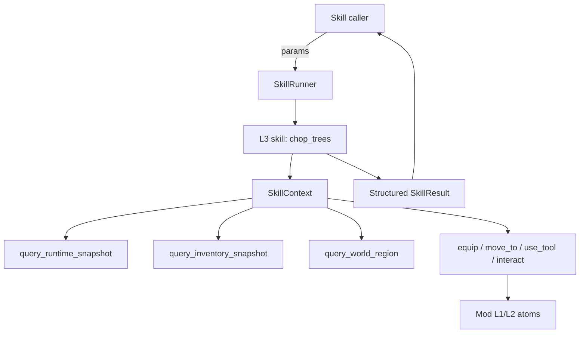
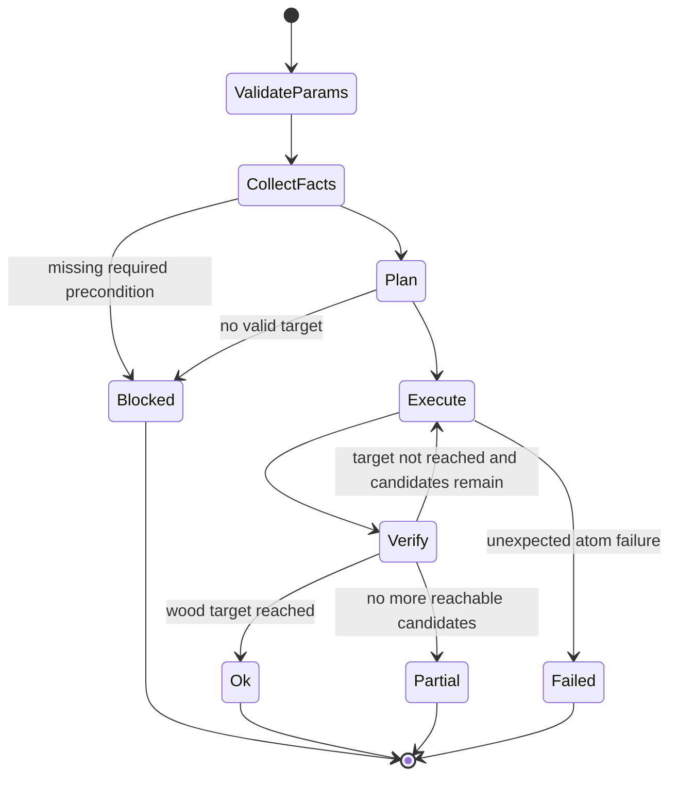

# 技术方案：Agent L3 Skill 编排边界与砍树 MVP

---

## 0. 元信息

| 字段 | 内容 |
| --- | --- |
| 文档状态 | Draft |
| 作者 | @Codex |
| 创建日期 | 2026-06-21 |
| 最后更新 | 2026-06-21 |
| Reviewers | 待定 |
| 关联链接 | `docs/模版.md`、`agent/v2_skills/`、`agent/v2_skills/builtin/chop_trees/`、分支 `feat/l3-chop-trees-atomic-mvp` |

---

## 1. TL;DR

本方案只定义 L3 skill 层：用 Python 规则把 L1/L2 原子能力拼成一个可测试的游戏任务。

L3 不负责用户对话、模型调用、聊天展示或任务生命周期调度；本文档不规划这些内容。

第一阶段只收敛 `chop_trees`：输入参数、事实收集、规则计划、原子调用、停止条件、结构化返回和模块测试。基于 `agent/knowledge/wiki` 的游戏规则，后续可优先验证 3 个同类 L3 skill：浇水、收割、动物抚摸。

---

## 2. 背景与问题

### 2.1 当前 L3 已经存在什么

仓库里已经有 L3 skill 的基础组件：

- `SkillRegistry`：加载 `skill.md + script.py`，生成 function-calling schema。
- `SkillRunner`：创建 `SkillContext`，执行 skill async 函数，处理超时和异常。
- `SkillContext`：向 skill 提供 query/action 能力访问。
- `agent/v2_skills/builtin/*`：每个目录是一个 L3 skill。

当前 L3 的实际形态是：Agent 侧 Python async 函数，通过 `SkillContext` 编排 Mod 暴露出的 L1/L2 能力，完成一个明确游戏任务。

### 2.2 砍树 MVP 暴露出的 L3 问题

本地实测确认 `chop_trees` 可以被调用并完成动作，但 L3 内部还不够稳：

- 信息收集散：runtime、inventory、world region 查询没有形成清晰的 skill 输入事实集。
- 执行规则不够稳：站位选择和可达性判断还需要收敛。
- 拾取逻辑偏粗：存在盲扫式拾取，后续应改成基于事实的交互。
- 停止条件不够紧：默认目标是新增 5 wood，但可能超过目标后才停。
- 结构化结果不够明确：需要稳定返回 `wood_before`、`wood_after`、`wood_gained`、`trees_chopped`、`trees_skipped`、`stopped_reason`。

### 2.3 为什么先只处理 L3

Mod 侧 L1/L2 原子能力已经具备，当前最小闭环是把一个 L3 skill 编排稳定。

先把 L3 做干净，可以得到一个确定性的能力边界：同样参数和同样游戏事实下，skill 发出的查询和动作序列稳定，返回结果稳定，测试也能脱离真实模型运行。

---

## 3. 目标与非目标

### Goals

- 明确 L3 skill 的职责：编排 L1/L2，返回结构化结果。
- 收敛 `chop_trees` 的输入参数、事实收集、执行规则、停止条件和输出字段。
- 建立 L3 模块测试要求：不依赖真实 LLM、不依赖用户聊天、不依赖完整外部服务链路。
- 让 `chop_trees` 在默认场景下新增 5 个 wood 即停止，请求目标上限为 50。
- 为后续浇水、收割、动物抚摸等 skill 复用同一类 L3 编排规范，但本阶段只实现砍树。

### Non-Goals

- 不在 L3 内做用户意图理解或对话管理。
- 不在 L3 内做模型调用。
- 不在 L3 内设计用户可见反馈。
- 不修改 Mod 侧 L1/L2 原子实现。

---

## 4. 方案概述

**核心一句话**：L3 skill 保持现有 Python async 形态，但收敛为“结构化输入 + 事实查询 + 规则计划 + L1/L2 原子调用 + 结构化结果”的任务编排层。

**系统图**：



L3 边界：

- 输入：明确参数 + 当前游戏事实。
- 处理：规则化编排 query/action。
- 输出：机器可读的 skill result。
- 禁止：在 skill 内决定用户话术、调用模型、直接发送聊天消息。

---

## 5. 方案详解

### 5.1 L3 skill 输入边界

**子问题**：L3 skill 应该接收什么，不应该接收什么。

**关键决策**：L3 接收明确参数，不接收对话状态。

`chop_trees` 第一版参数：

```yaml
target_wood:
  type: integer
  default: 5
  max: 50
radius:
  type: integer
  default: 16
include_stumps:
  type: boolean
  default: false
```

要求：

- `target_wood` 在 L3 内做最后防线，归一化到 1-50。
- L3 不解析复杂用户话术。
- L3 可以基于当前游戏事实返回 `blocked`，例如没斧头、没树、体力不足。

### 5.2 L3 事实收集

**子问题**：skill 内部需要哪些事实才能稳定编排。

**关键决策**：第一版只在 `chop_trees` 内定义最小事实集，不提前抽跨 skill 公共结构。

`chop_trees` 必需事实：

- 当前玩家位置、地图、体力。
- 背包中的 wood 数量。
- 背包中是否有 axe，以及 axe slot。
- 当前地图附近 mature tree / stump 候选。
- 候选树周围 tile 是否可站、是否可达。

查询策略：

- 开始时查询 runtime + inventory。
- 查询 world region 时尽量一次性拿到树和 tile 信息。
- 每棵树后只做必要核验：目标树状态、wood delta。
- 不在每次 swing 后无条件大范围 re-query。

### 5.3 L3 规则计划

**子问题**：L3 如何生成稳定动作序列。

**关键决策**：使用可测试的规则代码生成计划，不把每一步动作选择交给模型。

砍树计划逻辑：

1. 校验 `target_wood`，默认 5，上限 50。
2. 查询初始背包，记录 `wood_before`。
3. 找 axe；没有 axe 则 `blocked`。
4. 查询附近树和 tile。
5. 为每棵树选择可达邻格。
6. equip axe。
7. move adjacent。
8. swing 有限次数。
9. 核验树状态和 wood delta。
10. 达到 `wood_gained >= target_wood` 后立即停止。

计划必须可测试、可复现。同样输入下，候选树排序和动作序列应稳定。

### 5.4 L3 原子调用约束

**子问题**：L3 可以调用哪些能力。

**关键决策**：L3 只通过 `SkillContext` 调用 query/action。

允许调用：

- `ctx.query_runtime_snapshot`
- `ctx.query_inventory_snapshot`
- `ctx.query_world_region`
- `ctx.equip`
- `ctx.move_adjacent`
- `ctx.use_tool`
- `ctx.interact`，但只在确有可拾取/可交互事实时使用

不应在 `chop_trees` 里调用：

- `ctx.say(...)`
- 模型接口
- 外部会话接口
- 用户输出接口

### 5.5 L3 结构化输出

**子问题**：调用方如何可靠消费 L3 结果。

**关键决策**：L3 返回机器可读字段，避免调用方从自然语言里反推结果。

`chop_trees` 返回示例：

```json
{
  "success": true,
  "status": "ok",
  "observation": "chop_trees completed: wood_gained=5 stopped_reason=wood_target_reached",
  "data": {
    "wood_before": 76,
    "wood_after": 81,
    "wood_gained": 5,
    "target_wood": 5,
    "trees_chopped": 1,
    "trees_skipped": 0,
    "stopped_reason": "wood_target_reached",
    "warnings": []
  }
}
```

`status` 约定：

- `ok`：达到目标或无需执行。
- `partial`：完成了一部分，但因体力、时间、可达性、背包等原因停止。
- `blocked`：前置条件不满足，没有开始执行。
- `failed`：执行中出现非预期错误。

### 5.6 接口契约

| 接口 | 输入 | 输出 | 错误码 | 幂等性 |
| --- | --- | --- | --- | --- |
| `chop_trees(ctx, target_wood, radius, include_stumps)` | 明确参数 + `SkillContext` | 标准 skill result dict | `NO_AXE`, `NO_TREES`, `NO_REACHABLE_TREES`, `TIMEOUT`, `EXECUTION_FAILED` | 非幂等，会改变游戏状态 |
| `ctx.query_*` | proto query params | dict payload | `TIMEOUT`, `INVALID_PARAMS` | 只读，幂等 |
| `ctx.equip/move/use_tool/interact` | 原子动作参数 | action result dict | Mod 原子错误码 | 非幂等 |

### 5.7 L3 状态机



### 5.8 后续 3 个可行 L3 skill 候选

**子问题**：基于 `agent/knowledge/wiki`，哪些游戏任务适合继 `chop_trees` 后做成 L3 skill。

**关键决策**：优先选择规则稳定、可查询、可验证、动作原子已具备的农场日常任务；不优先选择钓鱼、战斗、送礼、长距离购物这类变量更多或依赖菜单/实时交互更多的任务。

筛选标准：

- wiki 能提供明确游戏规则，而不是只提供背景知识。
- 当前 `SkillContext` 能通过 query/action 完成闭环。
- skill 可以用 deterministic rule 编排，不需要模型参与每一步决策。
- 结果可以通过 inventory/world/target state 核验。
- 模块测试可以用 fake context 覆盖主要分支。

| 候选 skill | wiki 规则依据 | L3 输入 | L3 必需事实 | L3 编排方式 | 结构化结果 |
| --- | --- | --- | --- | --- | --- |
| `water_crops` | `Crops.md`：作物每天浇水才会继续生长；`Tools.md`：Watering Can 用于浇水，雨天会自动浇作物 | `max_count=0`、`stamina_below=20`、`time_after=1400`、`radius` | 天气、时间、体力、未浇水作物、喷壶是否可用、目标可达性 | 查询未浇水作物；雨天或无目标早返回；装备喷壶；按距离批量 `use_tool`；按体力/时间停止 | `watered`、`skipped`、`total`、`stopped_reason`、`energy_before/after` |
| `harvest_crops` | `Crops.md`：成熟作物可收割，部分作物收割后会再生；收割结果由游戏本体决定 | `max_count=0`、`time_after=0`、`crop_filter` | 可收割作物、背包空位、目标可达性、收割前 inventory | 查询可收割作物；按距离 `do(intent="harvest")`；跳过不可达目标；收割后核验 crop state 和 inventory delta | `harvested`、`skipped`、`total`、`items_gained`、`stopped_reason` |
| `pet_animals` | `Animals.md`：每日抚摸动物会提升 friendship/mood；动物状态包含当天是否已抚摸 | `max_count=0`、`include_pet_bowl=false` | 未抚摸动物、动物 target_ref、位置、可达性；可选宠物碗状态和喷壶 | 查询未抚摸动物；逐个导航到目标；`do(intent="pet")`；不调用 `ctx.say()`；可选扩展为给宠物碗浇水 | `petted`、`skipped`、`total`、`already_petted`、`stopped_reason` |

这 3 个候选的共同点是：L3 只把 wiki 规则落成执行条件和停止条件，不在 skill 内解释规则、不生成用户话术。比如 `water_crops` 只判断“是否雨天、是否存在未浇水作物、喷壶是否可用、何时停止”；“为什么浇水重要”来自 wiki，但不需要在执行时进入 skill 输出。

落地顺序建议：

1. `water_crops`：和砍树同属工具使用任务，规则最稳定，已有雏形，适合作为第二个 L3 编排样本。
2. `harvest_crops`：不消耗体力，动作更简单，但要把 inventory delta 和多产作物结果做成结构化核验。
3. `pet_animals`：现有雏形里有 `ctx.say()`，正好用于验证“L3 静默执行 + 结构化返回”的边界。

---

## 6. 备选方案

| 方案 | 描述 | 优势 | 劣势 | 为什么没选 |
| --- | --- | --- | --- | --- |
| 方案 A：收敛 L3 skill 编排边界（采用） | 保持现有 skill 方式，只规范输入、事实、规则、原子调用、结构化结果 | 改动小、贴合现有架构、模块测试清晰 | 不解决 L3 以外的问题 | 当前阶段目标就是先把一个 L3 skill 做稳 |
| 方案 B：每个 skill 自由实现 | 不新增规范，每个 skill 自己组织查询和动作 | 短期最快 | 停止条件、查询策略、输出结构会持续分裂 | 砍树实测已经证明需要收敛 |
| 方案 C：先抽通用 L3 基类 | 先设计所有 skill 共用的 facts/planner/result 抽象 | 后续复用可能更好 | 当前共性还不够明确，容易过度设计 | 先用砍树跑出稳定规则，再抽公共结构 |

---

## 7. 风险与权衡

| 风险 | 影响范围 | 触发条件 | 缓解措施 |
| --- | --- | --- | --- |
| L3 规范过窄 | 后续 skill 复用有限 | 第一版只看砍树 | 接受该权衡，先把一个 skill 做稳，再抽共性 |
| 结构化字段设计不稳定 | 调用方消费成本上升 | `data` 字段随意变化 | 为 `chop_trees` 固定 result schema 并写测试 |
| 规则计划不够聪明 | 执行动作多、失败多 | tile 可达性判断不足 | 用 fake context 和本地 Mod 手测补齐规则 |
| 过早抽象 | 代码复杂度上升 | 还没验证浇水/收获等 skill | 当前只收敛 `chop_trees`，不先建大框架 |

**关键权衡**：

本方案选择“先做窄而稳的 L3 编排”，而不是先做通用框架。原因是当前只有砍树经过本地真实验证，直接抽象整套 skill framework 风险更高。等砍树、浇水等 2-3 个 skill 都稳定后，再判断哪些结构值得上提。

---

## 8. 失败模式与容错

| 组件 | 失败场景 | 影响 | 降级/容错策略 | 监控指标 |
| --- | --- | --- | --- | --- |
| 参数校验 | `target_wood` 非法或过大 | 执行范围失控 | clamp 到 1-50，记录 warning | invalid param count |
| 事实查询 | inventory/runtime/world query 超时 | 无法计划 | 返回 `failed` 或 `blocked`，不执行动作 | query timeout count |
| 工具校验 | 没有 axe | 无法砍树 | 返回 `blocked: NO_AXE` | blocked reason |
| 目标选择 | 无可达树 | 无动作可做 | 返回 `partial` 或 `blocked` | skipped tree count |
| 原子执行 | move/use_tool 失败 | 部分完成 | 跳过当前树或返回 partial，保留错误摘要 | atom failure count |
| 停止条件 | wood delta 已达标但继续执行 | 过度砍树 | 每次有意义核验后立即判断 stop | overrun wood count |

---

## 9. 测试计划 + DoD

### 测试计划

| 测试类型 | 覆盖范围 | 关键用例 |
| --- | --- | --- |
| 单元测试 | 参数归一化、axe 识别、wood 计数、树候选排序、站位选择 | 默认 +5、上限 50、Pickaxe 不被识别成 Axe |
| 模块测试 | fake `SkillContext` 驱动完整 `chop_trees` | 无斧头 blocked、无树 blocked、不可达树 skipped、达标即停 |
| 集成测试 | `SkillRunner` + fake bridge | skill result schema 稳定，异常被 `SkillRunner` 标准化 |
| 本地手测 | 本地 agent + Mod | 砍树动作稳定，wood 达标后停止 |

### Definition of Done

- [ ] `chop_trees` 不调用 `ctx.say()`。
- [ ] `chop_trees` 返回固定结构化 `data` 字段。
- [ ] 默认“砍树”参数为 `target_wood=5`，请求超过 50 时 clamp 到 50。
- [ ] 没有 axe 时返回 `blocked`，不发 move/use_tool。
- [ ] 不可达树会跳过并计入 `trees_skipped`。
- [ ] `wood_gained >= target_wood` 后立即停止。
- [ ] 相关模块测试不依赖真实 LLM。

---

## 10. 落地计划

### 阶段划分

| 阶段 | 范围 | 验证内容 | 回滚条件 |
| --- | --- | --- | --- |
| 阶段 1：L3 文档收敛 | 仅文档 | L3 边界、输入、规则、输出达成一致 | 文档仍混入 L3 以外规划 |
| 阶段 2：砍树 L3 规则修正 | `agent/v2_skills/builtin/chop_trees/` | 模块测试全部通过 | 规则测试不稳定 |
| 阶段 3：本地手测 | 本地 agent + Mod | 砍树动作稳定、停止准确 | 过度砍树、无效移动过多 |

### 数据迁移

无数据库迁移。

### 回滚方案

- 保留当前 skill 加载方式。
- 若新砍树规则不稳定，回滚 `agent/v2_skills/builtin/chop_trees/` 改动即可。
- L3 文档不影响运行时。

---

## 11. 影响评估

| 维度 | 评估 |
| --- | --- |
| 业务影响 | 只影响 agent 侧砍树 L3 skill 的稳定性和可测性 |
| 用户范围 | 第一阶段仅本地测试 |
| 工程工时 | 预计 1-2 人日修正砍树 L3 规则和测试 |
| 长期维护成本 | 增加 L3 编排规范，减少后续 skill 重复踩查询、停止条件、输出结构问题 |
| 依赖团队 | agent 侧为主；Mod 侧基础原子不在本方案范围内 |

---

## 12. 未解问题 Open Questions

| 问题 | 需要谁输入 | 决定截止日期 |
| --- | --- | --- |
| L3 result schema 是否需要统一基类 | agent 设计评审 | 修砍树规则前 |
| `blocked` 是否作为独立 status，还是用 `failed` + error code 表达 | agent 设计评审 | 修砍树规则前 |
| 可达 tile 信息是否足够支持稳定选站位 | agent + Mod 本地测试 | 本地手测前 |

---

## 13. Action Items

- @Codex 修订 L3 文档，去除 L3 以外规划，DDL：2026-06-21。
- @Codex 基于本文档修正 `chop_trees` L3 规则和模块测试，DDL：待定。

---

## 14. 参考资料

- 内部文档：`docs/模版.md`
- 内部代码：`agent/v2_skills/guide/README.md`
- 内部代码：`agent/v2_skills/runner.py`
- 内部代码：`agent/v2_skills/context.py`
- 内部代码：`agent/v2_skills/builtin/chop_trees/script.py`
- 内部代码：`agent/knowledge/game_knowledge.py`
- 游戏知识：`agent/knowledge/wiki/Crops.md`
- 游戏知识：`agent/knowledge/wiki/Tools.md`
- 游戏知识：`agent/knowledge/wiki/Animals.md`

---

## 提交评审前自检清单

- [x] TL;DR 不超过 5 行，第一段说明要做什么。
- [x] Goals 可量化，Non-Goals 不少于 2 条。
- [x] 方案概述包含系统图。
- [x] 第 5 节代码片段、文件路径、目录树占比低于 30%。
- [x] Alternatives 不少于 2 个，并说明为什么没选。
- [x] Risks 不少于 3 条，并包含负面后果。
- [x] DoD 可勾选验证。
- [ ] 陌生人测试：找 1 个不在本项目的同事读 5 分钟并复述结论。

---

## 变更历史

| 日期 | 修改人 | 变更内容 |
| --- | --- | --- |
| 2026-06-21 | @Codex | 初版：收敛为 L3 skill 编排边界 |
| 2026-06-21 | @Codex | 移除 L3 以外规划，仅保留 L3 输入、规则、原子调用、输出和测试 |
