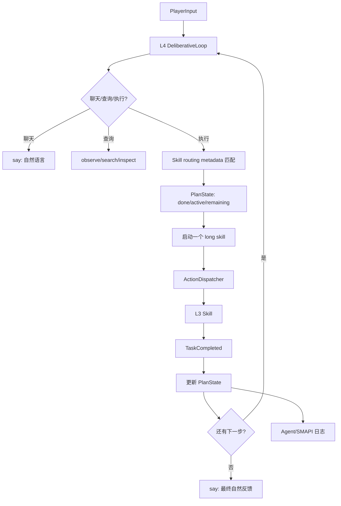
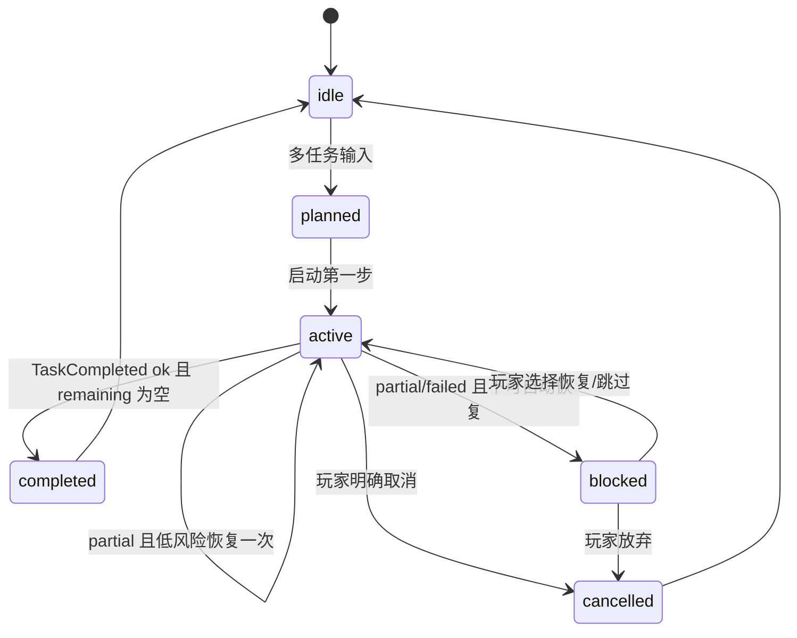

# 技术方案：Agent L4 编排、PlanState 与玩家可见反馈边界

---

## 0. 元信息

| 字段 | 内容 |
| --- | --- |
| 文档状态 | Draft |
| 作者 | @Codex |
| 创建日期 | 2026-06-25 |
| 最后更新 | 2026-06-25 |
| Reviewers | @待定 |
| 关联链接 | `agent/slow_loop/deliberative_loop.py`、`agent/slow_loop/action_dispatcher.py`、`agent/slow_loop/prompts/`、`agent/v2_skills/`、`docs/agent-l3-skill-composition-design.md` |

---

## 1. TL;DR

本方案为 Agent L4 增加轻量任务编排层：用通用 prompt 原则、结构化 skill routing metadata 和 PlanState，让模型先理解并维护玩家计划，再串行调度 L3 skill。

当前系统已有异步 job 队列，但它只能执行单个 job，不知道“玩家原始计划、完成了哪些、还剩哪些、失败后是否继续”。因此多任务容易退化成模型靠历史上下文猜下一步，且 queued/job_id/skill 名称会被自动反馈泄漏到游戏聊天。

第一阶段优先改 prompt、skill metadata 和 L4 编排状态；代码只做必要护栏：单轮最多启动一个 long skill、TaskCompleted 驱动计划续接、内部状态不进入 `say`。

---

## 2. 背景与问题

### 2.1 当前链路已经有什么

Agent 当前已经有几块基础能力：

- `ActionDispatcher`：支持 instant/long/skill job 入队、串行执行 long job、完成后发送 `TaskCompleted`。
- `DeliberativeLoop`：接收 `PlayerInput`、`TaskCompleted`、`ReportEvent` 等触发，调用 LLM 产生 tool calls。
- `SkillRegistry`：从 `agent/v2_skills/builtin/*/skill.md` 生成 function-calling schema。
- L3 daily skills：`water_crops`、`harvest_crops`、`pet_animals`、`chop_trees`、`go_bed` 等已经封装了目标发现、执行和结构化结果的一部分能力。

这些能力能支撑“一个明确任务 -> 一个 skill -> 一个结果”的基本闭环。

### 2.2 当前问题是什么

本轮实测暴露的问题集中在 L4 编排层：

- **只有 job-level async，没有 plan-level orchestration**：Dispatcher 不知道一个 job 属于哪个多步骤计划，也不知道后续任务。
- **TaskCompleted 续接弱**：完成后只根据 `success/needs_followup` 决定是否再次调用模型，没有结构化计划状态。
- **模型上下文不够结构化**：L4 主要依赖 system prompt、skill 文本和历史消息，缺少“当前计划 done/active/remaining”的稳定输入。
- **提示词职责混杂**：system prompt 中既有通用原则，又有“先 say 再行动”等可能和 skill 路由冲突的规则。
- **内部状态进入游戏聊天**：`skill-* queued`、`job_id`、`做完了（skill_xxx）` 等内部调度状态被自动反馈通过 `say` 发给玩家。
- **observe/skill 路由不稳定**：明确执行请求有时被模型处理成 observe 后直接口头确认，而不是调用高层 skill。

### 2.3 为什么现在解决

L3 skill 已经开始承担可测试的游戏任务执行边界。如果 L4 继续只靠临时 tool calls 和自然语言历史续接，多任务、阶段反馈和失败恢复都会不稳定。此时补齐 L4 编排协议，可以让后续新增 skill 自动继承同一套路由和反馈规则，避免每个 skill 都在 prompt 里写一次特殊说明。

---

## 3. 目标与非目标

### Goals

- 100% 阻断内部调度状态进入游戏聊天：`skill-*`、`job_id`、`queued`、`TaskCompleted`、raw tool name 不得通过 `say` 出现。
- 支持多任务请求的串行计划：L4 能记录 `done/active/remaining/last_result/blocked_reason`。
- 明确执行请求优先匹配高层 skill；当 skill 声明自己负责发现、预检、执行和复查时，L4 不重复 observe。
- 玩家执行中普通聊天不取消当前任务；明确取消、修改计划或紧急指令才影响 active/pending plan。
- TaskCompleted 能根据 PlanState 启动下一步、反馈阶段结果、在 partial/failed 时暂停或恢复。
- 为至少 6 个关键场景补测试：单任务、双任务串行、执行中聊天、partial 暂停、计划修改、内部状态不进聊天。

### Non-Goals

- 不在本方案中重写 L3 skill 的具体执行逻辑，例如 harvest 只能收边缘、water 复查半径等问题另行修复。
- 不把 L4 做成完整自动规划器；第一版只维护玩家显式任务序列和必要状态。
- 不让 L4 直接读取或解析地图低层事实来替代 skill 内部 precheck/postcheck。
- 不改变 Mod 的游戏聊天语义；`say` 仍然代表玩家可见聊天。
- 不引入复杂持久化数据库；第一版 PlanState 可以是进程内 session 状态。

---

## 4. 方案概述

**核心一句话**：把 L4 从“每轮临时 tool call 决策”收敛为“结构化计划状态 + 高层 skill 路由 + TaskCompleted 驱动续接”的轻量编排层。



---

## 5. 方案详解

### 5.1 Prompt 原则收敛

**子问题**：system prompt 需要长期稳定，不能靠枚举具体 skill 来修某次误判。

**关键决策**：system prompt 只写通用原则，具体技能能力由结构化 metadata 注入。

L4 prompt 应表达以下长期规则：

- `say` 是玩家可见聊天，只用于自然语言反馈、询问和角色表达。
- tool/job/skill 调度状态是内部状态，只能进入 Agent 日志或 SMAPI 日志。
- 明确执行请求先找高层 skill/tool；如果高层 skill 声明自己负责目标发现、预检、执行和复查，直接调用该 skill。
- 只有意图、范围、前置条件或安全性不确定时，才先 observe 或 ask。
- 不能凭 observe、记忆或模型猜测宣称任务完成；完成反馈必须来自执行结果、TaskCompleted 或明确 postcheck。
- 多任务请求先形成计划，然后一次只启动一个 long skill。

### 5.2 Skill routing metadata

**子问题**：只靠 `skill.md` 自然语言，模型可能漏读或曲解“这个 skill 会自己查询目标”。

**关键决策**：给 skill 增加轻量 routing 字段，供 L4 注入稳定摘要。

建议 metadata：

```yaml
routing:
  owns_discovery: true
  handles_precheck: true
  verifies_result: true
  execution_scope: current_map
  ambiguity_policy: ask_if_scope_missing
  user_intents:
    - water crops
    - harvest crops
```

字段含义：

| 字段 | 含义 |
| --- | --- |
| `owns_discovery` | skill 内部负责查找目标，L4 不需要先 observe 找目标 |
| `handles_precheck` | skill 内部负责工具、地图、天气、体力等前置检查 |
| `verifies_result` | skill 完成后会复查并返回 remaining/partial 信息 |
| `execution_scope` | 默认执行范围，如 `current_map`、`farm`、`specified_targets` |
| `ambiguity_policy` | 范围不清时是直接执行、先问玩家还是先 observe |
| `user_intents` | 用于生成 LLM 可见摘要，不作为硬编码路由表 |

第一阶段不要求所有 skill 一次补全复杂字段，但 daily skills 至少需要前三个布尔字段和 scope。

### 5.3 PlanState

**子问题**：多任务不能只存在聊天历史里，否则 TaskCompleted 回来时模型只能猜下一步。

**关键决策**：新增轻量 PlanState，表达玩家显式计划和执行进度。

建议结构：

```json
{
  "plan_id": "plan_20260625_001",
  "source_input": "先浇水，再收菜，最后睡觉",
  "status": "active",
  "done": [],
  "active": {
    "label": "浇水",
    "tool": "skill-water_crops",
    "job_id": "job_xxx"
  },
  "remaining": [
    {"label": "收菜", "tool": "skill-harvest_crops"},
    {"label": "睡觉", "tool": "skill-go_bed"}
  ],
  "last_result": null,
  "blocked_reason": null,
  "recovery_attempts": 0,
  "user_visible_summary_sent": true
}
```

状态机：



### 5.4 多任务调度规则

**子问题**：当前 L4 可以一轮吐多个 async tool calls，但这不是可靠编排。

**关键决策**：多任务串行执行，一次只启动一个 long skill。

规则：

- 玩家给出多个任务时，L4 拆成有序 `remaining`。
- 本轮只启动第一个可执行 long skill。
- 计划摘要只在多步骤、耗时、高风险或玩家询问计划时发送。
- 每个 TaskCompleted 后更新 PlanState，再决定是否启动下一步。
- 玩家普通聊天不取消 active job。
- 玩家明确修改计划时，只改 remaining；是否取消 active 取决于指令强度。
- 玩家明确取消、紧急、睡觉等高优先级输入时，取消 pending，并尽量停止 active。

### 5.5 玩家可见反馈边界

**子问题**：内部状态泄漏会导致体验割裂，也会被 chat capture 回流为 PlayerInput。

**关键决策**：玩家可见文本只能来自自然语言反馈，不允许 raw dispatcher/tool 状态。

允许：

- “我按顺序来：先浇水，再收菜，最后去睡觉。”
- “水浇完了，接下来去收菜。”
- “收菜只完成了一半，背包满了。还剩 8 株成熟作物没收。”

禁止：

- `skill-water_crops queued: job_id=job_xxx`
- `做完了（skill-pet_animals）`
- `TaskCompleted success=true`
- `query_action_jobs`

内部状态如果需要在 SMAPI 中可见，应走非聊天日志通道，例如后续新增 `agent_log` / `mod_log` protocol frame，由 Mod 调用 `Monitor.Log` 或 `ModLogger`，不得调用 `SendChat`。

### 5.6 失败与 partial 恢复策略

**子问题**：失败后继续执行后续任务可能造成更大偏差，但完全不恢复也会降低自动化价值。

**关键决策**：默认只允许一次低风险、同范围自动恢复。

规则：

- `ok`：继续下一步。
- `partial`：
  - 如果是等待动画、重新定位、短暂不可移动等低风险问题，可自动恢复一次。
  - 如果是背包满、体力不足、时间太晚、缺工具、目标不可达，暂停计划并询问玩家。
- `failed/blocked`：默认不继续依赖它的后续任务。
- 玩家明确说“能做多少做多少”时，可以跳过失败项继续。
- `recovery_attempts` 达到上限后必须停下反馈。

### 5.7 接口契约

| 接口 | 输入 | 输出 | 错误码 | 幂等性 |
| --- | --- | --- | --- | --- |
| Skill routing metadata | `skill.md` frontmatter | L4 可见 skill 摘要 | schema 缺字段时降级为 legacy 文本 | 是 |
| PlanState create/update | PlayerInput、TaskCompleted、用户修改指令 | 当前计划状态 | `PLAN_AMBIGUOUS`、`PLAN_BLOCKED` | 按 `plan_id` 幂等 |
| ActionDispatcher submit_skill | 当前 PlanState active item | `job_id` | queue full、unknown skill | 否，需由 PlanState 防重复启动 |
| TaskCompleted handler | job result、PlanState active item | 更新后的 PlanState、下一步决策 | orphan completion、stale job | 对同一 `job_id` 应幂等 |
| visible feedback | PlanState delta、skill result | `say` 自然语言 | 无；失败写日志 | 不要求幂等，但需防重复发送 |

---

## 6. 备选方案

| 方案 | 描述 | 优势 | 劣势 | 为什么没选 |
| --- | --- | --- | --- | --- |
| 方案 A：轻量 PlanState + prompt/metadata（采用） | 在 L4 维护小型计划状态，继续复用现有 Dispatcher 和 SkillRunner | 改动小，先修最影响体验的编排和反馈问题 | 不是完整自动规划器，复杂依赖仍需模型判断 | 符合当前问题规模，能优先补结构化信息 |
| 方案 B：只改 prompt | 不加 PlanState，仅通过 system prompt 和 skill 描述约束模型 | 最快，代码改动最少 | TaskCompleted 仍无稳定计划状态，多任务续接靠猜 | 无法可靠回答“还差什么”，也难测试 |
| 方案 C：重写完整 planner/executor | 引入显式 DAG、依赖分析、恢复策略和持久化 | 长期能力最强 | 工程量大，容易过度设计，和现有 L3/Dispatcher 重叠 | 当前只需要显式多任务串行和反馈边界 |
| 方案 D：允许一轮排多个 async job | 让模型一次吐多个 skill，Dispatcher 排队执行 | 表面简单，现有代码已有部分支持 | 失败中断、玩家修改、阶段反馈都不可靠 | 这是当前问题来源之一，不应继续扩大 |

---

## 7. 风险与权衡

| 风险 | 影响范围 | 触发条件 | 缓解措施 |
| --- | --- | --- | --- |
| PlanState 与真实 Dispatcher 状态不一致 | 多任务续接、玩家进度反馈 | job 被取消、超时、重复 TaskCompleted、进程重启 | TaskCompleted 按 `job_id` 幂等更新；prompt 注入 dispatcher snapshot 辅助校验 |
| metadata 填错导致误路由 | 单个 skill 或一类任务 | skill 声明 owns_discovery 但实际没有 precheck/postcheck | 给 daily skills 加测试；metadata 缺失时保守降级 |
| prompt 过度约束模型 | 聊天自然度、特殊场景理解 | system prompt 写成具体任务枚举或规则太死 | system prompt 只写通用原则；具体能力由 schema 注入 |
| 计划摘要刷屏 | 游戏聊天体验 | 每个阶段都重复长计划 | 只在多步骤/耗时/高风险时发摘要；每步只发 delta |
| 自动恢复误操作 | 游戏状态 | partial 原因判断不清仍自动重试 | 只允许一次低风险同范围恢复；其他情况问玩家 |

**关键权衡**：本方案选择“结构化信息 + 轻代码护栏”，而不是把模型能力替换成硬编码 planner。这样能保留 L4 对玩家自然语言的理解能力，同时给它足够稳定的状态和边界，减少靠历史上下文猜测导致的误判。

---

## 8. 失败模式与容错

| 组件 | 失败场景 | 影响 | 降级/容错策略 | 监控指标 |
| --- | --- | --- | --- | --- |
| PlanState | active job 丢失或和 Dispatcher 不一致 | 后续任务无法续接或重复执行 | 查询 dispatcher snapshot；不确定时暂停并询问玩家 | orphan completion 数、stale plan 数 |
| Skill metadata | routing 字段缺失 | L4 无法判断是否直接 skill | 降级到现有 skill schema 描述；必要时 observe/ask | metadata_missing 计数 |
| TaskCompleted | 成功结果未触发 followup | 后续计划停住 | PlanState active job 完成时强制进入续接逻辑 | plan_stalled 时间 |
| visible feedback | 内部状态被发到 chat | 体验割裂、可能回流 PlayerInput | denylist + 测试断言；内部状态走日志 | chat_internal_leak 计数 |
| LLM 调用 | 续接轮返回纯正文或无 tool_calls | 兜底话术误发 | 非玩家触发下不发“让我想想”；只记录日志或根据 PlanState 保守处理 | fallback_on_task_completed 数 |

---

## 9. 测试计划 + DoD

### 测试计划

| 测试类型 | 覆盖范围 | 关键用例 |
| --- | --- | --- |
| 单元测试 | PlanState 更新、routing metadata 解析、反馈过滤 | metadata 缺失降级；TaskCompleted ok/partial/failed；denylist 拦截 `job_id` |
| 集成测试 | DeliberativeLoop + mock LLM + mock Dispatcher | 多任务只启动第一个 skill；第一项完成后启动第二项；普通聊天不取消 active |
| E2E 测试 | 本地 Agent + Mod smoke | 玩家输入“先浇水再收菜”；游戏聊天只出现自然语言；SMAPI/Agent log 有内部状态 |
| 回归测试 | 现有 async/fc 原子性 | assistant tool_calls 后都有 tool response；fallback 不在 TaskCompleted 场景刷聊天 |

### Definition of Done

- [ ] system prompt 去掉“明确执行先 say 再行动”的冲突指令，改为通用 L4 路由原则。
- [ ] daily skill 至少补齐 `routing.owns_discovery/handles_precheck/verifies_result/execution_scope`。
- [ ] L4 prompt 注入结构化 skill routing 摘要。
- [ ] 新增 PlanState，并能在 PlayerInput、TaskCompleted、取消/修改计划时更新。
- [ ] 单轮最多启动一个 async long/skill，除非后续显式设计批处理例外。
- [ ] 游戏聊天中不会出现 `skill-`、`job_id`、`queued`、`TaskCompleted`。
- [ ] TaskCompleted 续接可以启动 remaining 中的下一项。
- [ ] partial/failed 会暂停或按规则恢复，不会误报“做完了”。
- [ ] 执行中普通聊天不取消 active job，明确取消才触发 cancel。

---

## 10. 上线计划

### 阶段划分

| 阶段 | 范围 | 验证内容 | 回滚条件 |
| --- | --- | --- | --- |
| 阶段 1：文档与测试草案 | 仅文档、测试用例设计 | 方案评审通过，测试用例覆盖关键路径 | 评审认为 PlanState 过重或边界不清 |
| 阶段 2：prompt + metadata | system prompt、skill metadata、routing 摘要 | 明确任务优先 skill；无内部状态聊天泄漏 | LLM 明显更频繁误路由 |
| 阶段 3：PlanState MVP | L4 进程内计划状态、TaskCompleted 续接 | 多任务串行执行、阶段反馈正确 | 计划状态导致重复执行或卡死 |
| 阶段 4：本地 smoke | 本地全栈 + SMAPI | 浇水/收菜/睡觉多任务链路可跑通 | 游戏聊天出现内部状态或无法取消 |

### 数据迁移

无数据库迁移。PlanState 第一版为进程内 session 状态；如果后续要跨重启恢复，再单独设计持久化。

### 回滚方案

每阶段独立提交。若 PlanState 引入运行时问题，可回滚 PlanState 相关提交，保留 prompt/metadata 文档和内部状态过滤测试；若 prompt 导致误路由，可回滚 prompt 文案并保留代码护栏。

---

## 11. 影响评估

| 维度 | 评估 |
| --- | --- |
| 业务影响 | 直接改善玩家对多任务执行的可理解性，减少“说浇好了但没做”“skill/job_id 出现在聊天”的体验问题 |
| 用户范围 | 使用 Agent 游戏聊天触发日常任务的所有本地/内测用户 |
| 工程工时 | 设计与实现预计 3-5 人天：prompt/metadata 0.5-1 天，PlanState 1-2 天，测试与 smoke 1-2 天 |
| 长期维护成本 | 每个新增高层 skill 需要维护 routing metadata，但可减少重复 prompt 特判 |
| 依赖团队 | Agent/L3 skill 维护者；若做 SMAPI 非聊天日志通道，需要 Mod 维护者配合 |

---

## 12. 未解问题 Open Questions

| 问题 | 需要谁输入 | 决定截止日期 |
| --- | --- | --- |
| PlanState 是否需要持久化到磁盘以支持 Agent 重启恢复 | Agent 维护者 | 实现阶段前 |
| SMAPI 内部日志通道是否复用现有 protocol frame，还是新增 `agent_log` | Agent + Mod 维护者 | 阶段 2 前 |
| 哪些 skill 第一批必须补 routing metadata | 产品/Agent 维护者 | 阶段 2 前 |
| “能做多少做多少”这类 continuation policy 是否需要显式参数 | Agent 维护者 | 阶段 3 前 |

---

## 13. Action Items

- @Codex 完成本文档初稿并提交评审（DDL：2026-06-25）
- @待定 评审 L4 prompt 原则是否过度约束模型（DDL：2026-06-26）
- @待定 确认第一批 routing metadata 覆盖的 skill 列表（DDL：2026-06-26）
- @待定 根据评审结果拆实现任务：prompt/metadata、PlanState、feedback filter、tests（DDL：2026-06-27）

---

## 14. 参考资料

- `docs/模版.md`
- `docs/agent-l3-skill-composition-design.md`
- `agent/slow_loop/deliberative_loop.py`
- `agent/slow_loop/action_dispatcher.py`
- `agent/slow_loop/prompts/system_prompt.txt`
- `agent/v2_skills/builtin/*/skill.md`

---

## 提交评审前自检清单

- TL;DR 小于 5 行，且第一段说明了要做什么。
- Goals 可验证，Non-Goals 至少 2 条。
- 方案概述包含系统图。
- 第 5 节以设计解释为主，没有堆代码。
- Alternatives 至少 2 个，并说明为什么没选。
- Risks 至少 3 条，包含负面后果和缓解措施。
- DoD 可勾选验证。
- 陌生读者能在 5 分钟内复述：L4 需要 PlanState，因为 Dispatcher 只是 job 队列，不是计划器。

---

## 变更历史

| 日期 | 修改人 | 变更内容 |
| --- | --- | --- |
| 2026-06-25 | @Codex | 初版 |
