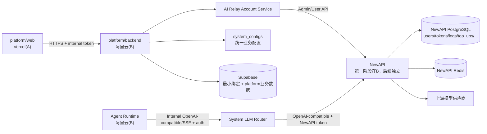
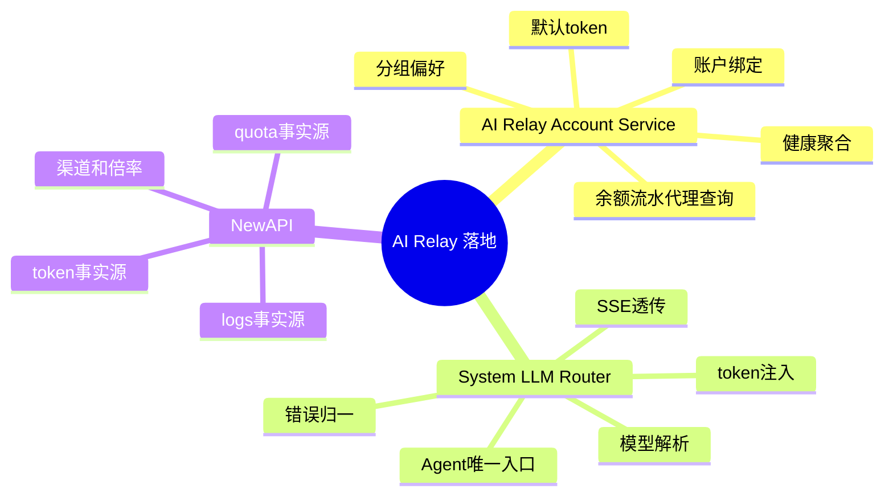
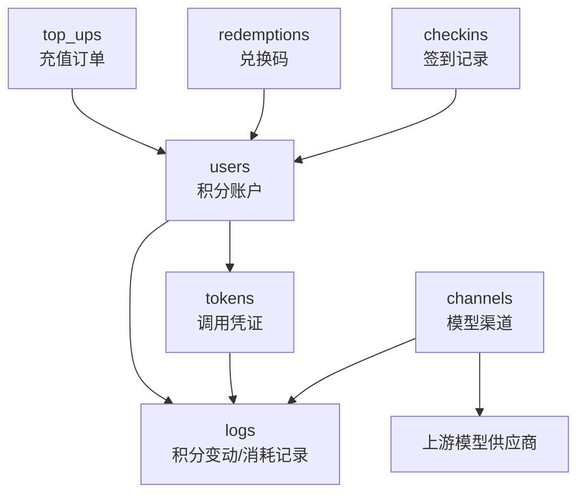
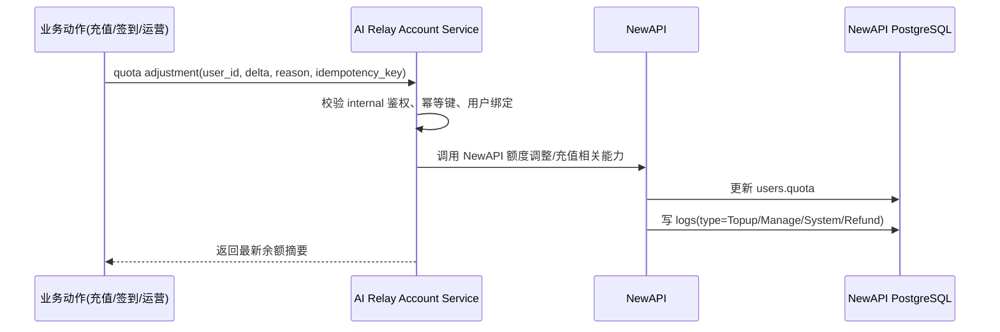
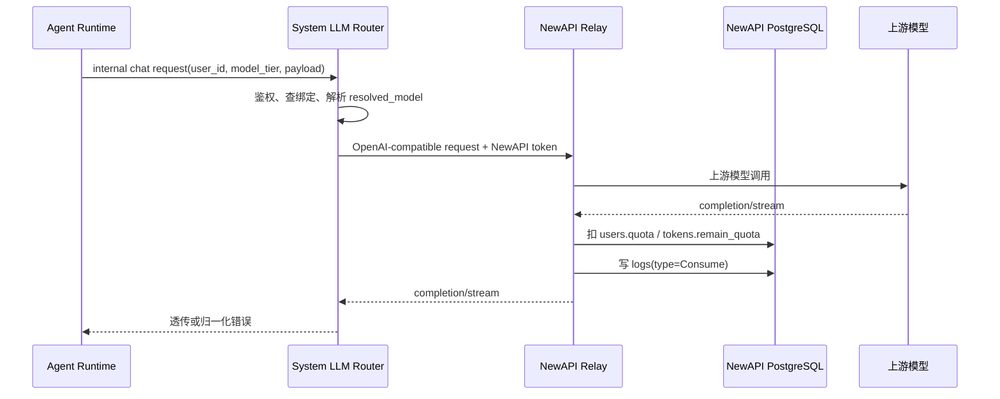

# 技术方案：AI Relay 与 NewAPI 中转计费落地方案

---

## 0. 元信息

| **字段** | **内容** |
| --- | --- |
| **文档状态** | 🟡 Draft |
| **作者** | Codex |
| **创建日期** | 2026-05-22 |
| **最后更新** | 2026-05-22 |
| **Reviewers** | 待补充 |
| **关联链接** | 飞书方案评论：BTmzdXnWiogCnixw39tcmweknwg；代码库：`D:\PROJECT\star-coplay` |

---

## 1. TL;DR

本方案用 NewAPI 作为模型中转、额度扣减、倍率换算、积分流水和调用日志的事实源。
`platform/backend` 只新增两个业务模块：`AI Relay Account Service` 和 `System LLM Router`。
Supabase 不再重复保存积分流水、模型调用日志、同步 job；只保存平台用户与 NewAPI relay 账户/token 的最小绑定和用户偏好。
所有 Web/Agent 调 backend 的 internal 接口都复用现有 internal token 鉴权，参考 `/internal/configs/{domain}/{config_key}`。
NewAPI 独立使用自己的 PostgreSQL，第一阶段随 Docker 部署在 B 服务器并做宿主机持久化，后续可迁到独立服务器。

---

## 2. 背景与问题

当前平台已有 Agent Runtime、Vercel 上的 Web/Admin、阿里云上的 `platform/backend`，并已将原 `platform/ws` 升级为 `platform/backend` 的三层结构：`app` 管启动和生命周期，`common` 管配置/认证/数据库/错误，`modules` 放业务模块。

旧的 `platform/ws/llm_router.py` 以多供应商池和直连模型端点为核心，不适合继续承担用户级额度、模型分组、token 绑定和 NewAPI 中转计费。NewAPI 已经提供用户、token、分组、模型 relay、倍率计费、quota 扣减、日志和渠道健康能力，因此平台侧不应重复实现这些账务与日志实体。

评论中需要修正的关键问题如下：

- 用户创建与默认 token 创建要考虑一致性，不能出现业务绑定已写但 NewAPI token 不存在，或 NewAPI 用户已创建但平台绑定缺失的长期脏状态。
- `points_quota_rate` 不由平台控制，模型倍率、分组倍率、quota 与 token 消耗映射由 NewAPI 负责。
- 不设计 `POST /internal/ai/points/checkin` 这类耦合业务的接口；签到、手动发放等业务动作后续都调用通用 quota 调整接口。
- 积分流水、模型调用消耗日志、小时/日/月统计都从 NewAPI 查询，不在 Supabase 另建 `ai_points_ledger`、`ai_llm_call_logs`、`ai_profile_sync_jobs`。
- `profile_service` 命名容易和用户个人资料混淆，正式命名改为 `AI Relay Account Service`。
- NewAPI 的数据库不是 Supabase；使用 NewAPI 自己的 PostgreSQL，并在宿主机持久化。
- NewAPI 宿主机端口不要继续占用 `3000`，生产建议使用五位数端口并由 Nginx 内网反代。

---

## 3. 目标与非目标 ⭐

### Goals（必达）

- 新用户注册后、老用户补齐时，一比一创建或确认 NewAPI relay 用户，并确保默认 token 可用。
- Agent Runtime 的 LLM 调用统一经过 `System LLM Router`，运行态不直接访问外部模型端点，也不直接持有 NewAPI token。
- 用户余额、积分流水、模型调用消耗明细、小时/日/月统计全部以 NewAPI DB/API 为事实源。
- Web 调 backend internal 接口、Agent 调 backend internal 接口全部鉴权，复用 `INTERNAL_API_TOKEN` 能力。
- NewAPI PostgreSQL、Redis 不对公网暴露；NewAPI 数据持久化在宿主机或 Docker volume，支持备份和迁移。

### Non-Goals（明确不做）

- ❌ 不把 NewAPI 的渠道、模型池、供应商密钥管理做成平台对外接口；这些由 NewAPI 管理后台或 SSH 后台运维处理。
- ❌ 不在 Supabase 自建积分流水、LLM 调用日志、同步任务表来复制 NewAPI 数据。
- ❌ 不把 NewAPI token 返回给终端用户；token 只在服务端由 LLM Router 注入。
- ❌ 不设计签到专用的 AI 积分接口；签到只是业务调用方，AI 侧只提供通用额度调整。
- ❌ 不维护 `points_quota_rate`；quota、倍率、模型计费换算由 NewAPI 配置和结算逻辑负责。

---

## 4. 方案概述

**核心一句话**：平台只做用户绑定、模型偏好和运行态路由；NewAPI 负责 relay、token、quota、倍率、流水和日志。

**系统图**：



---

## 5. 方案详解



### 5.1 模块 A：AI Relay Account Service

**子问题**：把平台用户稳定映射到 NewAPI relay 账户，并对 Web/Admin 暴露可控的 AI 账户、额度、用量、健康度查询能力。

**关键决策**：正式命名使用 `AI Relay Account Service`，不要再叫 `profile_service`。当前代码里已有 `platform/backend/modules/ai_profile/` 占位，后续实现时建议迁移或重命名为 `platform/backend/modules/ai_relay_account/`；如果短期不改目录，也要在类名、接口、文档里使用 relay account 命名。

该模块负责：

- 用户注册后同步创建、老用户一比一补齐 NewAPI relay 用户。
- 为每个 relay 用户创建默认 token，并保存 `newapi_user_id`、`newapi_token_id`、`newapi_token_key` 的服务端绑定。
- 保存用户可选分组和模型偏好，但只能在平台配置允许的分组和模型名单内选择。
- 代理查询 NewAPI 的用户余额、积分流水、使用明细、统计、模型/渠道健康信息。
- 提供通用 quota 调整接口，供充值、签到、运营发放、手动扣减等业务调用，不耦合具体业务动作。

Supabase 只保存最小绑定，不保存 NewAPI 的余额流水和调用日志。建议表名使用 `ai_relay_accounts`，核心字段如下：

| **字段** | **含义** |
| --- | --- |
| `user_id` | 平台用户 ID，唯一 |
| `newapi_user_id` | NewAPI `users.id` |
| `newapi_token_id` | NewAPI `tokens.id`，用于定位真实 token 记录 |
| `newapi_token_key` | NewAPI token key，第一阶段服务端明文存储，不返回给用户 |
| `newapi_user_access_token` | NewAPI 用户自助 access token，仅后端用于管理该用户 token；不返回给用户 |
| `group` | 用户当前选择的 NewAPI 分组，只能来自允许列表 |
| `preferred_chat_model` / `preferred_reasoning_model` 等 | 用户偏好的模型别名或模型名，由配置约束 |
| `credential_mode` | 第一阶段固定为 `newapi_bound_token` |
| `status` | `active` / `disabled` / `sync_failed` |
| `last_sync_error` | 最近一次同步失败原因，便于运维定位 |

用户创建 + token 创建的一致性策略：

- `ensure` 接口必须幂等，使用 `user_id` 作为业务幂等键。
- 先查平台绑定；存在且 NewAPI 用户/token 可用则直接返回。
- 若绑定缺失，创建或查询 NewAPI 用户，生成该用户自己的 access token，再创建或查询默认 token，最后写 Supabase 绑定。
- HTTP 跨服务无法做真正单库事务，因此使用“幂等 + 补偿 + reconcile job”的一致性方案。
- 如果 NewAPI 用户创建成功但 token 创建失败，下一次 `ensure` 继续补 token；如果 Supabase 写入失败，下一次通过用户名/邮箱/备注中的平台标识或管理查询补回绑定。
- 删除/销毁优先做禁用：禁用 NewAPI 用户和 token，再标记平台绑定 `disabled`；物理删除只作为后台清理动作。

### 5.2 模块 B：System LLM Router

**子问题**：让 Agent Runtime 拥有一个稳定的 LLM 调用入口，同时隐藏 NewAPI token、模型池和上游供应商细节。

**关键决策**：`System LLM Router` 只服务 Agent，不作为用户侧 OpenAI API 网关。它放在 `platform/backend/modules/llm/router.py`，重写旧 provider pool 逻辑为 NewAPI relay 转发；`platform/ws/llm_router.py` 在 NewAPI 测试稳定后废弃。

该模块负责：

- 统一 Agent Runtime 的 LLM 调用入口，禁止运行态直接访问外部模型端点。
- 基于 `user_id` 读取 relay account 绑定，拿到 NewAPI user/token 和用户分组。
- 基于 `model_tier` 与用户 `preferred_*_model` 解析最终 `resolved_model`。
- 校验 AI relay account 状态、`credential_mode`、分组和模型偏好合法性。
- 注入 NewAPI token，构造 OpenAI-compatible 请求并转发到 NewAPI。
- 透传 streaming，并在客户端断开时中断上游请求。
- 归一化 NewAPI/provider 错误，向 Agent Runtime 返回稳定错误类型。

调用日志口径：业务侧不再新建 `ai_llm_call_logs`。NewAPI `logs` 是模型调用消耗、token 用量、quota、模型、渠道的事实源。Router 可以在现有 `events` 表写轻量审计事件，例如 `agent_session_id`、`capability`、`model_tier`、`resolved_model`、latency、status、error，但这不是账务日志，也不作为余额或用量统计来源。

### 5.3 NewAPI 业务实体



NewAPI 中至少涉及以下实体：

| **实体** | **NewAPI 结构体 / 表** | **核心字段** | **说明** |
| --- | --- | --- | --- |
| 积分账户 | `model.User` / `users` | `id`、`quota`、`used_quota`、`request_count`、`group`、`status` | `quota` 是用户余额，`used_quota` 是累计已用额度，`group` 决定可用模型池/倍率。 |
| Token | `model.Token` / `tokens` | `id`、`user_id`、`key`、`remain_quota`、`used_quota`、`unlimited_quota`、`group`、`model_limits`、`status` | token 绑定用户。Router 使用 `key` 调 NewAPI；平台保存 `id/key`，但不返回给用户。 |
| 积分变动 Record | `model.Log` / `logs` | `type`、`user_id`、`quota`、`content`、`created_at` | `type=Topup/Manage/System/Refund` 等代表非模型调用的额度变化；用于积分流水展示。 |
| token 消耗 Record | `model.Log` / `logs` | `type=Consume`、`user_id`、`token_id`、`model_name`、`quota`、`prompt_tokens`、`completion_tokens`、`channel_id`、`group` | 模型调用扣费和 token 用量记录；用于使用明细、小时/日/月统计。 |
| 充值订单 | `model.TopUp` / `top_ups` | `user_id`、`amount`、`money`、`trade_no`、`status` | 充值成功后增加 `users.quota` 并写 `LogTypeTopup`。 |
| 兑换码 | `model.Redemption` / `redemptions` | `key`、`quota`、`status`、`used_user_id` | 兑换成功后增加 `users.quota` 并写 `LogTypeTopup`。 |
| 签到记录 | `model.Checkin` / `checkins` | `user_id`、`checkin_date`、`quota_awarded` | 签到是 NewAPI 自带业务记录；平台不暴露 AI 专用 checkin 接口。 |
| 渠道 | `model.Channel` / `channels` | `models`、`group`、`status`、`balance`、`used_quota`、`response_time` | 模型池/供应商渠道，供后台运维和健康查询使用，不做平台对外配置接口。 |

充值/发放数据流：



模型调用消耗数据流：



### 5.4 接口契约

所有 `/internal/...` 接口都必须鉴权。鉴权方式复用现有 `HttpApiServer._check_internal_api_token`：`Authorization: Bearer <INTERNAL_API_TOKEN>`，或 `x-internal-api-token` / `x-internal-config-token`。LLM Router 面向 Agent 的调用还要校验调用方身份与 `user_id` 的授权关系，避免任意 internal 调用冒用用户。

| **接口** | **输入** | **输出** | **错误码** | **幂等性** |
| --- | --- | --- | --- | --- |
| `PUT /internal/ai/relay/users/{user_id}/ensure` | `email`、`display_name`、`default_group?`、`idempotency_key?` | `user_id`、`newapi_user_id`、`newapi_token_id`、`group`、`status`、`quota_summary` | `UNAUTHORIZED`、`INVALID_GROUP`、`NEWAPI_UNAVAILABLE`、`SYNC_FAILED` | 是，按 `user_id` 幂等 |
| `GET /internal/ai/relay/users/{user_id}` | path `user_id` | relay account 绑定摘要、分组、模型偏好、余额摘要；不返回 token key | `NOT_FOUND`、`UNAUTHORIZED` | 读接口 |
| `PATCH /internal/ai/relay/users/{user_id}` | `status?`、`group?`、`preferred_models?` | 更新后的 relay account 摘要 | `INVALID_GROUP`、`INVALID_MODEL_PREF`、`NEWAPI_SYNC_FAILED` | 否 |
| `DELETE /internal/ai/relay/users/{user_id}` | `mode=disable|delete`、`reason` | `status`、禁用结果 | `NOT_FOUND`、`NEWAPI_SYNC_FAILED` | disable 可重复 |
| `GET /internal/ai/relay/groups` | `include_disabled?` | 平台允许展示的分组列表、默认分组 | `UNAUTHORIZED` | 读接口 |
| `GET /internal/ai/relay/users/{user_id}/tokens` | `page`、`page_size` | token 摘要列表，key 只返回 masked | `NOT_FOUND` | 读接口 |
| `PATCH /internal/ai/relay/tokens/{token_id}` | `status?`、`group?`、`quota_policy?`、`model_limits?` | token 摘要 | `INVALID_TOKEN`、`NEWAPI_SYNC_FAILED` | 否 |
| `DELETE /internal/ai/relay/tokens/{token_id}` | `reason` | 删除/禁用结果 | `INVALID_TOKEN` | 可重复按禁用处理 |
| `POST /internal/ai/relay/quota-adjustments` | `user_id`、`mode=add|subtract|override`、`quota` 或 `quota_usd`、`reason?`、`biz_ref_type?`、`biz_ref_id?`、`idempotency_key` | 最新余额、NewAPI log/order 引用；使用 `quota_usd` 时额外返回 `quota_per_usd` 和 `quota_usd` | `INVALID_QUOTA`、`DUPLICATE_REQUEST`、`NEWAPI_SYNC_FAILED`、`NEWAPI_QUOTA_RATE_MISSING` | 是，按 `idempotency_key` |
| `GET /internal/ai/relay/quota` | `user_id` | `quota`、`used_quota`、`request_count`、`group` | `NOT_FOUND` | 读接口 |
| `GET /internal/ai/relay/quota-ledger` | `user_id`、`start_at?`、`end_at?`、`type?`、`page`、`page_size` | NewAPI `logs` 中非 `Consume` 的额度变化记录 | `NOT_FOUND` | 读接口 |
| `GET /internal/ai/relay/usage/logs` | `user_id`、`token_id?`、`model?`、`start_at?`、`end_at?`、`page`、`page_size` | NewAPI `logs(type=Consume)` 使用明细 | `NOT_FOUND` | 读接口 |
| `GET /internal/ai/relay/usage/summary` | `user_id?`、`group?`、`model?`、`granularity=hour|day|month`、`start_at`、`end_at` | quota/token/request 聚合统计 | `INVALID_RANGE` | 读接口 |
| `GET /internal/ai/relay/health/overview` | `scope=admin|user` | NewAPI 可达性、DB/Redis 状态摘要、模型/渠道摘要、最近错误数 | `NEWAPI_UNAVAILABLE` | 读接口 |
| `GET /internal/ai/relay/health/models` | `group?` | 可用模型、分组、价格/倍率摘要、启用状态 | `NEWAPI_UNAVAILABLE` | 读接口 |
| `GET /internal/ai/relay/health/channels` | `group?`、`model?`、`include_balance?` | 渠道连接状态、余额、响应时间；仅管理后台可看 | `FORBIDDEN` | 读接口 |
| `GET /internal/ai/relay/health/users` | `start_at`、`end_at`、`granularity?`、`page?` | 用户用量排行/摘要 | `FORBIDDEN` | 读接口 |
| `POST /internal/llm/chat/completions` | `user_id`、`agent_session_id`、`capability`、`model_tier`、`stream?`、OpenAI-compatible payload | OpenAI-compatible response 或 SSE stream | `AI_ACCOUNT_DISABLED`、`MODEL_NOT_ALLOWED`、`NEWAPI_QUOTA_EXHAUSTED`、`UPSTREAM_ERROR` | 否 |

接口与原需求的一一对应：

- user 创建、修改、查询、销毁、分组：由 `/internal/ai/relay/users/*` 和 `/groups` 覆盖。
- token 随用户创建、查询、删除、修改：由 `ensure` 默认创建，`/tokens/*` 管理，不返回真实 key。
- LLM 调用接口：由 `/internal/llm/chat/completions` 统一服务 Agent，向 NewAPI relay 转发。
- 额度以 NewAPI 为事实源：余额与流水从 NewAPI 查询；后台页面填写 NewAPI 展示美元额度，后端实时读取 NewAPI `quota_per_unit` 后换算原始 quota，再通过通用 `quota-adjustments` 增加/减少/覆盖。
- 额度使用明细：`usage/logs` 与 `usage/summary` 读取 NewAPI 消耗日志和统计。
- 系统健康度：`health/overview`、`health/models`、`health/channels`、`health/users` 分别解决总览、模型可用性、渠道状态、用户用量。

### 5.5 配置收敛

敏感连接配置走环境变量：

| **配置** | **位置** | **说明** |
| --- | --- | --- |
| `NEWAPI_BASE_URL` | env | backend 调 NewAPI 的 base URL，迁服时只改这里 |
| `NEWAPI_ADMIN_ACCESS_TOKEN` 或管理员凭证 | env/secret | 调 NewAPI 管理接口使用，禁止进 `system_configs` 明文 |
| `INTERNAL_API_TOKEN` | env/secret | Web/Agent 调 backend internal 接口鉴权 |
| `DATABASE_URL` | env/secret | Supabase Postgres 连接，保存平台绑定和系统配置 |

可运营配置统一进入 `system_configs`：

| **domain/key** | **类型** | **说明** |
| --- | --- | --- |
| `ai_relay.default_group` | string | 新用户默认 NewAPI 分组 |
| `ai_relay.allowed_groups` | json | 平台允许用户选择的分组列表 |
| `ai_relay.model_tier_mapping` | json | `model_tier` 到候选模型/默认模型的映射 |
| `ai_relay.default_preferences` | json | 新用户默认模型偏好 |
| `ai_relay.initial_user_quota_usd` | decimal | 新用户首次创建 NewAPI relay 用户时默认发放的 NewAPI 展示额度，默认 `$100`；平台实时读取 NewAPI `/api/status` 返回的 `quota_per_unit` 后换算为原始 quota 写入 |
| `ai_relay.health_probe_config` | json | 健康检查开关、超时、采样范围 |

---

## 6. 备选方案 ⭐

| **方案** | **描述** | **优势** | **劣势** | **为什么没选** |
| --- | --- | --- | --- | --- |
| **方案 A（采用）** | NewAPI 做 relay/计费事实源，platform/backend 做 account 绑定与 LLM Router | 复用 NewAPI 成熟的 token、quota、logs、倍率和渠道能力；平台边界清晰 | 依赖 NewAPI 可用性；需要做好绑定一致性和错误归一 | — |
| 方案 B | 平台自建积分流水、调用日志和倍率换算，NewAPI 只做 relay | 平台账务口径完全可控 | 重复造账务系统，容易与 NewAPI 扣费不一致，评论已明确否掉 | 不选，风险和维护成本高 |
| 方案 C | Agent 直接调用 NewAPI，platform 只在注册时发 token | 实现最短 | token 暴露给运行态，无法统一鉴权、模型偏好、错误归一和审计 | 不选，不符合 Agent 统一入口要求 |
| 方案 D | 直接改 NewAPI 源码承载平台业务逻辑 | 可以把所有东西塞进一个服务 | 后续升级 NewAPI 成本高，平台业务与中转系统耦合 | 不选，除非 NewAPI API 无法满足关键能力 |

---

## 7. 风险与权衡 ⭐

| **风险** | **影响范围** | **触发条件** | **缓解措施** |
| --- | --- | --- | --- |
| NewAPI 用户创建和 token 创建跨服务不原子 | 新用户无法调用模型或绑定脏数据 | NewAPI 创建成功但 Supabase 写失败，或 token 创建失败 | `ensure` 幂等、补偿重试、reconcile job、禁用失败残留账户 |
| NewAPI API 行为或表结构变化 | 余额/流水/用量查询异常 | 升级 NewAPI 镜像后接口字段变化 | 封装 NewAPI client，固定版本上线，升级前跑集成测试 |
| NewAPI 单点不可用 | Agent LLM 调用失败，管理页健康异常 | NewAPI 容器、PostgreSQL、Redis 或 Nginx 故障 | 健康检查、告警、容器 restart、DB 备份，后续可独立服务器部署 |
| token key 第一阶段明文存储 | 服务端数据泄露时影响模型调用额度 | Supabase service role 或 DB 泄露 | 不返回给用户，限制 DB 权限，后续改为加密存储或 secret vault |
| internal token 泄露 | Web/Agent internal 接口被滥用 | 环境变量泄露、日志误打 | 不打印 token，定期轮换，Nginx IP 白名单，关键接口加用户授权校验 |

**关键权衡**：平台不重复维护账务流水和调用日志，牺牲了一部分平台侧直接定制账务模型的自由度，换来 NewAPI 扣费、日志、余额展示的一致性。第一阶段接受 `newapi_token_key` 与 `newapi_user_access_token` 服务端明文存储，是为了快速打通调用链路；安全增强可以在接口稳定后单独迭代。

---

## 8. 失败模式与容错

| **组件** | **失败场景** | **影响** | **降级/容错策略** | **监控指标** |
| --- | --- | --- | --- | --- |
| AI Relay Account Service | NewAPI 管理接口超时 | 用户创建/修改/额度调整失败 | 3-5 秒超时，有限重试；失败写 `sync_failed`，后续 ensure/reconcile 补齐 | ensure 成功率、同步失败数、NewAPI API latency |
| System LLM Router | 查不到 relay account | Agent 无法调用 LLM | 返回稳定错误 `AI_ACCOUNT_NOT_READY`；触发后台 ensure | account miss 数、路由失败率 |
| NewAPI | relay 不可达或返回 5xx | LLM 调用失败 | Router 归一化为 `UPSTREAM_ERROR`；SSE 中断时关闭上游 | NewAPI `/api/status`、5xx、P95 latency |
| NewAPI PostgreSQL | 数据库不可用 | 余额、token、日志、调用全部受影响 | 容器自动重启；宿主机持久化；备份恢复 | DB health、连接数、磁盘使用率 |
| NewAPI Redis | 缓存不可用 | token/quota 缓存和批量更新受影响 | Redis restart；必要时关闭批量更新降级 | Redis health、内存、重启次数 |
| Nginx/SSE | 代理缓冲或超时 | streaming 卡住或提前断开 | `proxy_buffering off`、提高 read timeout、设置 `X-Accel-Buffering: no` | SSE 断开率、平均流式时长 |

---

## 9. 模块化测试计划 + DoD

### 测试原则

本项目按模块独立交付，不把 NewAPI、Account Service、LLM Router、Web、Agent 一次性绑在一起测试。每个模块必须先通过自己的 mock/unit/integration 测试，再进入下一个模块；最后只做跨模块联调和少量 E2E 验证。

环境推进顺序固定为：

```text
本地单模块测试 -> 本地全链路联调 -> 服务器 staging 验证 -> 小流量灰度 -> 全量
```

也就是说，所有模块都先在本地测完；本地模块测试和本地联调都通过后，才部署到 B 服务器做 staging 验证。staging 验证通过后，再做测试用户灰度、老用户补齐和 Agent 流量切换。

### 模块测试计划

| **模块** | **先做什么** | **本地单独测试什么** | **通过标准** |
| --- | --- | --- | --- |
| NewAPI 部署底座 | 调整 Docker、PostgreSQL 持久化、Redis、宿主机端口、Nginx 内网访问 | 本地 `docker compose up/down`、DB 重启数据不丢、`/api/status`、Postgres/Redis 不暴露公网、宿主机端口非 3000 | 本地 NewAPI 管理后台和 API 稳定可访问，DB volume 或 bind mount 可备份 |
| NewAPIClient | 在 backend 封装 NewAPI 用户、token、quota、logs、health 调用 | 用 fake HTTP server 测请求参数、鉴权 header、超时、错误映射；再接本地 NewAPI 做集成测试 | Client 不掺业务逻辑，接口失败能返回稳定错误 |
| AI Relay Account Service | 实现 ensure、查询、修改 group/模型偏好、禁用、quota adjustment、ledger/usage 查询代理 | 用 FakeNewAPIClient 测幂等、补偿、参数校验；用本地 NewAPI 测真实创建用户+默认 token、余额调整、流水查询 | 单模块可证明用户/token 绑定可靠，不依赖 LLM Router 和 Web |
| Internal 鉴权与路由挂载 | 复用现有 `INTERNAL_API_TOKEN` 鉴权，把 relay account internal route 挂到 backend | 无 token、错 token、正确 token、`x-internal-api-token`、`Authorization: Bearer`、越权 `user_id` | Web/Agent 调 backend internal 接口必须先过鉴权，不能裸调 |
| System LLM Router | 重写 router 为 NewAPI relay 模式，先不接真实 Agent | 用 fake account service + fake NewAPI OpenAI-compatible server 测模型解析、token 注入、非流式、SSE、客户端中断、错误归一 | Router 单独可证明“Agent 唯一 LLM 出口”成立 |
| Web/Admin 查询接入 | 页面只调 backend internal，不直连 NewAPI | 用 mock backend 验证页面/API route 参数；用测试 backend 验证余额、流水、usage、health 展示 | 前端接入不改变账务来源，不暴露 NewAPI token |
| Agent 接入 | Agent Runtime 改为调 `System LLM Router` | 单 Agent 会话验证非流式、streaming、余额不足、模型不允许、用户禁用 | Agent 不再直接访问外部模型端点 |
| 本地跨模块联调 | 前面模块全部通过后再做 | 本地跑新用户注册到调用成功、老用户补齐到调用成功、quota 调整到流水展示、usage logs 展示 | 本地联调只验证链路组合，不再在联调阶段补模块基础能力 |

### Definition of Done

- [ ] NewAPI 部署底座单测完成：端口、DB 持久化、Redis、Nginx、健康检查全部通过。
- [ ] NewAPIClient 单测和本地 NewAPI 集成测试完成，不包含业务判断。
- [ ] `AI Relay Account Service` 单模块测试完成：ensure 幂等、默认 token、group 修改、quota adjustment、ledger/usage 代理查询。
- [ ] Internal 鉴权测试完成：Web/Agent internal 请求无 token 或错 token 均失败。
- [ ] `System LLM Router` 单模块测试完成：模型解析、NewAPI token 注入、非流式、SSE、中断、错误归一。
- [ ] Web/Admin 接入测试完成：只展示 backend 返回的数据，不直连 NewAPI，不拿 token key。
- [ ] Agent 接入测试完成：Agent 只能通过 Router 调 LLM。
- [ ] 本地全链路联调通过：新用户、老用户、充值/发放、调用扣费、流水、使用明细、健康度全链路一致。
- [ ] 本地全部通过后，才允许进入服务器 staging 验证；staging 通过后才允许灰度真实用户。

---

## 10. 模块化实施与上线计划

### 模块顺序

| **顺序** | **模块** | **交付内容** | **准入下一步的条件** |
| --- | --- | --- | --- |
| 1 | NewAPI 部署底座 | Docker 参数、宿主机端口、PostgreSQL 持久化、Redis、Nginx/SSE、基础健康检查 | 本地 NewAPI 自身可稳定运行，DB 数据可持久化 |
| 2 | NewAPIClient | backend 内部 NewAPI client，封装用户/token/quota/log/health API | fake server 单测和本地 NewAPI 集成测试通过 |
| 3 | AI Relay Account Service | relay account 绑定表、ensure、查询、修改、禁用、quota adjustment、ledger/usage 代理 | 本地单模块测试通过，能独立完成用户+默认 token 生命周期 |
| 4 | Internal 鉴权与配置 | 复用 `INTERNAL_API_TOKEN`，把 relay 相关配置收敛到 `system_configs` | 本地鉴权测试和配置读取测试通过 |
| 5 | System LLM Router | Agent LLM 入口、模型解析、NewAPI token 注入、OpenAI-compatible/SSE 转发、错误归一 | 本地 Router 单模块测试通过，不依赖真实 Web/Agent |
| 6 | Web/Admin 接入 | 账户、余额、流水、usage、health 页面或 API route 接入 backend internal | 本地页面/API route 测试通过，不暴露 token，不直连 NewAPI |
| 7 | Agent 接入 | Agent Runtime 调用 backend Router，废弃旧直连模型路径 | 本地单 Agent 会话验证通过 |
| 8 | 本地跨模块联调 | 本地 NewAPI + 本地 backend + mock/test Agent 跑完整链路 | 本地账务口径与 NewAPI logs 一致，错误率和 latency 达标 |
| 9 | 服务器 staging 与灰度 | 部署到 B 服务器，先 staging 验证，再小流量测试用户灰度 | staging 与灰度指标达标后，再补齐老用户和切全量 Agent 流量 |

### 数据迁移

- 创建 `ai_relay_accounts` 最小绑定表，不创建 `ai_points_ledger`、`ai_llm_call_logs`、`ai_profile_sync_jobs`。
- 写一次性老用户补齐脚本，按 `user_id` 调 `ensure`，可重复执行。
- 迁移前后校验：平台用户数、relay account 数、NewAPI 用户数、默认 token 数、失败原因分布。

### 回滚方案

- Router 和 Agent 接入前保留旧 LLM 调用入口开关，出现严重问题时切回旧链路。
- 回滚时不删除 NewAPI 用户和 token，只停用 Router 流量并保留数据便于排查。
- quota 调整接口上线后若出现账务异常，暂停业务调用方，只保留只读查询，使用 NewAPI 后台核对 logs。

---

## 11. 影响评估

| **维度** | **评估** |
| --- | --- |
| **业务影响** | 用户 AI 调用、额度展示、用量明细统一走 NewAPI 口径，减少平台与 NewAPI 账务不一致。 |
| **用户范围** | 所有需要 Agent LLM 调用的用户；第一阶段从测试用户灰度。 |
| **工程工时** | 预计 8-12 人天：account service 3-4 天，LLM Router 2-3 天，部署/监控/测试 3-5 天。 |
| **长期维护成本** | 主要维护 NewAPI client 适配、配置项、绑定一致性和部署监控；不维护自研账务系统。 |
| **依赖人/团队** | 后端实现、运维部署、前端管理页接入、NewAPI 管理员配置渠道和分组。 |

---

## 12. 未解问题 Open Questions

| **问题** | **需要谁输入** | **决定截止日期** |
| --- | --- | --- |
| NewAPI 管理接口是否能完全覆盖用户创建、token 创建、quota 调整，还是需要补一个内部 admin endpoint | 后端 / NewAPI 运维 | 实现前 |
| `ai_relay_accounts` 中 `newapi_token_key` 是否第一阶段明文，第二阶段何时改为加密存储 | 后端 / 安全负责人 | 灰度前 |
| 用户可选分组和模型偏好的具体名单 | 产品 / 运营 / NewAPI 管理员 | 灰度前 |
| NewAPI 生产部署使用 Docker named volume 还是宿主机 bind mount | 运维 | 部署前 |

---

## 13. Action Items

- @后端 确认 NewAPI 管理接口能力并封装 `NewAPIClient`（DDL：2026-05-24）。
- @后端 创建 `ai_relay_accounts` migration，并实现 `AI Relay Account Service`（DDL：2026-05-27）。
- @后端 重写 `platform/backend/modules/llm/router.py` 为 NewAPI relay 模式（DDL：2026-05-28）。
- @运维 调整 `new-api/docker-compose.yml` 生产参数、宿主机端口、PostgreSQL 持久化和 Nginx SSE 配置（DDL：2026-05-28）。
- @前端/后端 接入 AI 健康度和账户/用量查询 internal API（DDL：2026-05-30）。
- @测试 跑通 staging E2E 和回滚演练（DDL：2026-06-01）。

---

## 14. 参考资料

- 本地模板：`docs/模版.md`
- NewAPI compose：`new-api/docker-compose.yml`
- NewAPI 用户实体：`new-api/model/user.go`
- NewAPI token 实体：`new-api/model/token.go`
- NewAPI 日志实体：`new-api/model/log.go`
- NewAPI quota 结算：`new-api/service/quota.go`
- backend internal config 鉴权参考：`platform/backend/modules/http_api/server.py`
- 统一业务配置：`platform/backend/modules/config/system_config_client.py`

---

## 提交评审前自检清单

- [x] TL;DR ≤ 5 行，且第一段就讲了做什么。
- [x] Goals 可量化，且 Non-Goals ≥ 2 条。
- [x] 方案概述含系统图。
- [x] 第 5 节以模块和接口契约为主，没有展开代码细节。
- [x] Alternatives ≥ 2 个，每个有为什么没选。
- [x] Risks ≥ 3 条，并写明影响和缓解。
- [x] DoD 可勾选验证。
- [ ] 陌生人测试：找 1 个不在本项目的同事读 5 分钟，确认能复述结论。

---

## 变更历史

| **日期** | **修改人** | **变更内容** |
| --- | --- | --- |
| 2026-05-22 | Codex | 初版可落地方案，按飞书评论修正 NewAPI/Supabase/接口/部署边界。 |
