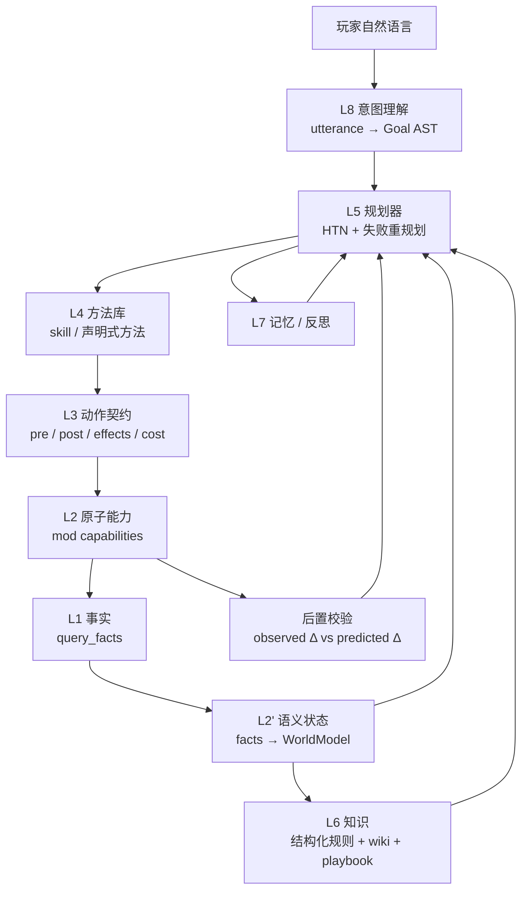

# 技术方案：StarCoPlay 游戏语义内核（Game Semantics Kernel）

> 目标：让 agent 从"能调工具"升级为"理解这款游戏"——用一层显式的游戏语义模型，
> 统一感知、能力契约、计划、知识与记忆，而不是把语义散落在 prompt、skill 脚本和 mod handler 里。

## 0. 元信息

- 状态：设计稿（未实现）
- 影响面：protocol / mod / agent / dsh-plugin
- 前置文档：`agent-l3-skill-composition-design.md`、`agent-l4-orchestration-planstate-design.md`、`protocol-agent-mod-capability-phase1-design.md`

## 1. TL;DR

现在的系统是"事实很丰富、能力很完整、语义很稀薄"：

- `query_facts.proto` 已经能描述树、作物、NPC、物品、任务等 20 多类实体；
- `capability.proto` 已经有命令生命周期和参数/结果；
- L3 有可测试的确定性 skill，L4 有 PlanState。

但**没有一个地方定义"这些事实在游戏里意味着什么"**：

- 没有谓词层（`tree is mature`、`can_chop`、`energy_ok`）——每个 skill 脚本自己拼；
- 没有动作契约（前置/后置/效果/代价）——所以无法验证、无法规划；
- 没有目标层——玩家一句话直接被映射到某个 skill；
- 知识是"查 wiki 文档"，不是"参与决策的规则"。

本方案引入 **Game Semantics Kernel (GSK)**，由四个可序列化的工件组成：

1. **Ontology**：实体 / 属性 / 关系 / 谓词的类型化定义；
2. **Contracts**：每个能力的声明式契约（前置、后置、效果、代价、失败模式、可观测项）；
3. **Semantic State**：由事实装配出的世界模型（含推断、置信度、新鲜度）；
4. **Goal & Plan**：目标 AST + HTN 方法库 + 规划器。

知识（RAG）、记忆、意图理解都建立在这四个工件之上。DSH 与 Python agent 共享同一套工件，
消除"两套大脑两套语义"。

## 2. 现状盘点

### 2.1 已经有的

| 层 | 现状 | 评价 |
|---|---|---|
| L0/L1/L2 | mod 暴露 16 个 V2 能力 + 二十余类 Fact | 事实模型质量高，是很好的地基 |
| L3 | `agent/v2_skills/builtin/*` 确定性 skill | 可测试，但是"命令式脚本"，语义不外露 |
| L4 | PlanState：done/active/remaining | 只维护显式任务序列，不推理 |
| 知识 | `agent/knowledge/wiki` 2.7MB + search_wiki/read_wiki | 关键词检索，未进入决策回路 |
| DSH | 13 个原生工具直连 mod | 与 Python 侧**重复实现**，能力更弱 |

### 2.2 缺什么（本方案要补的）

1. **谓词与推断**：`Tree.growth_stage >= 5 && Tool.is_axe && Stamina > 20` 这样的可复用判断。
2. **动作契约**：`chop_tree` 的 pre/post/effects/cost 写在数据里，而不是 C# 分支里。
3. **世界模型**：事实是"某一刻的切片"，缺少"我当前相信的世界"（含过期、推断、多人共享）。
4. **意图 → 目标**："帮我砍点树" → `Acquire(Wood, ~50, today)`，而不是直接猜一个 skill。
5. **规划**：目标 → 方法 → 原子动作，失败可重规划。
6. **知识的可执行化**：wiki 是散文，决策需要结构化规则（作物日历、掉落表、NPC 喜好）。
7. **单一事实来源**：同一玩法在 Python 和 DSH 各写一遍。

## 3. 设计原则

1. **语义显式化**：能写进 schema 的，不写进 prompt；能写进契约的，不写进代码分支。
2. **确定性优先**：已知玩法用确定性方法（HTN），LLM 负责意图、歧义和异常，不负责逐帧决策。
3. **可验证**：每个动作都有后置条件，执行后必须校验；校验失败要产生**类型化**的失败原因。
4. **单一大脑**：DSH 是前端适配器，不是第二个决策中心。
5. **渐进迁移**：每一阶段都能独立上线，不要求一次性重写。
6. **克制本体**：首版只做 ~8 类实体、~15 个谓词、~10 个契约，够用即止。

## 4. 分层架构



### 4.1 层职责

| 层 | 职责 | 不做什么 |
|---|---|---|
| L1 事实 | 只读、稳定、带 `observed_at` 的游戏切片 | 不推断、不改写 |
| L2' 语义状态 | 装配世界模型、推断谓词、标记过期 | 不发起动作 |
| L3 契约 | 声明能力的前置/后置/效果/代价 | 不写玩法流程 |
| L4 方法库 | 已知玩法的确定性编排（现 L3 skill） | 不决定"该不该做" |
| L5 规划 | 目标分解、排序、失败重规划 | 不直接调 mod |
| L6 知识 | 结构化规则 + 散文检索 + 剧本 | 不做实时决策 |
| L7 记忆 | 情景记忆、失败案例、玩家偏好 | 不做规则推理 |
| L8 意图 | 语言 → 目标，歧义澄清 | 不做规划 |

## 5. 核心数据结构

### 5.1 本体（Ontology）

首版范围（对应已有 Fact）：

```yaml
entities:
  Player:   {attributes: [tile, energy, max_energy, gold, tool, inventory, buffs]}
  Tree:     {attributes: [tile, growth_stage, health, stump, has_moss, has_seed]}
  Crop:     {attributes: [tile, seed, phase, watered, ready, dead]}
  Animal:   {attributes: [tile, kind, friendship, fed, produce_ready]}
  Npc:      {attributes: [name, hearts, gifts_today, schedule]}
  Item:     {attributes: [id, name, category, stack, quality]}
  Tile:     {attributes: [terrain, passable, occupied, watered]}
  Location: {attributes: [name, exits, season, weather]}
  Quest:    {attributes: [id, status, objectives]}

predicates:
  - can_chop(player, tree)      # axe 在手 && energy >= cost && adjacent passable
  - is_mature(tree)             # growth_stage >= 5 && !stump
  - is_stump(tree)              # stump == true
  - is_ready(crop)              # phase == harvestable
  - needs_water(crop)           # !watered && !rainy_tomorrow
  - is_passable(tile)           # terrain walkable && !occupied
  - has_item(player, item)      # inventory contains
  - energy_sufficient(player, cost)
  - in_season(crop, season)
```

谓词是**纯函数**：`predicate(world_state, args) -> bool`，可单测、可缓存。

### 5.2 动作契约（Action Contract）

契约是能力与规划器之间的唯一接口。示例：

```yaml
capability: chop_tree
version: 2
params:
  tree: {type: EntityRef, of: Tree}
  clear_stump: {type: bool, default: false}
pre:
  - is_mature(tree)
  - has_tool(player, "axe")
  - energy_sufficient(player, cost.energy)
  - reachable(player, tree, adjacent: true)
effects:
  world:
    - tree.stump = true
    - tree.health = 0
  drops:
    - item: Wood, qty: "3-6", quality: normal
    - item: Sap,  qty: "0-1"
    - item: Seed, qty: "0-1", chance: 0.05
  player:
    - energy -= cost.energy
    - inventory += drops.collected
cost:
  energy: "strikes * 3"
  time:  "strikes * 0.6s"
post:
  - tree.stump == true
  - inventory.delta(Wood) >= 0   # 允许 0（可能掉落未捡）
failure_modes:
  - NO_AXE: {when: "!has_tool(player,'axe')", recover: "equip axe"}
  - NOT_MATURE: {when: "!is_mature(tree)", recover: "skip"}
  - NO_ENERGY: {when: "energy < cost", recover: "eat / sleep"}
observability:
  - dropped_items
  - collected_items
  - inventory_delta
  - stumps_left
```

关键点：

- **effects 是规划器的世界模型输入**，可以前向模拟；
- **post 是执行后的校验**，失败产生类型化原因；
- **cost 进入调度**（能量/时间预算）；
- **failure_modes 带 recover 建议**，让 LLM 或规划器知道下一步。

### 5.3 语义状态（Semantic State）

```python
@dataclass
class WorldModel:
    tick: int
    player: PlayerView
    entities: dict[EntityId, EntityView]
    derived: dict[PredicateKey, bool]
    staleness: dict[EntityId, int]   # 距上次观测的 tick
    confidence: dict[EntityId, float]
```

装配规则：

1. 事实到达 → 写入 `entities`，记录 `observed_at`；
2. 动作完成 → 按契约 `effects` 做**乐观更新**，同时标记相关实体为 stale；
3. 下一步规划前 → 对即将操作的实体做**按需重观测**（不是全量 observe）；
4. 推断谓词 → 按需计算并缓存，输入变化即失效。

这一步的价值：把"每步都 observe 全图"变成"只在必要时刷新"，既省 token 又让 LLM 看到的是结构化世界，而不是一坨 JSON。

### 5.4 目标与计划（Goal / Plan）

```yaml
# 玩家："帮我砍点树，够做 20 个箱子就行"
goal:
  type: Acquire
  item: Wood
  qty: 120
  deadline: today
  constraints: [energy_positive]
```

```yaml
# HTN 方法示例
method: acquire_item_via_gather
  applies_when: [item in gatherable]
  subtasks:
    - FindSource(item) -> [tree, rock, forage]
    - Repeat(until: inventory.qty(item) >= qty):
        - chop_tree(tree) / mine_rock(node) / forage(tile)
        - collect_drops(radius: 3)
    - VerifyInventory(item, qty)
```

规划器形态建议：**HTN 为主 + LLM 兜底**。

- HTN 方法库覆盖已知玩法（砍树、浇水、收菜、喂动物、睡觉、送礼）；
- 遇到方法库没有的新情况，交给 LLM 生成候选子任务，但**必须命中已有契约**才能执行；
- 失败时用 `failure_modes.recover` 进入重规划，而不是让 LLM 自由发挥。

### 5.5 知识（Knowledge）——RAG 的正确位置

三层，按"结构化程度"排序，而不是一律 embedding：

| 层 | 内容 | 形态 | 用途 |
|---|---|---|---|
| K0 结构化规则 | 作物日历/价格/掉落表/NPC 喜好/合成配方 | SQLite 或 JSON 表 | 规划器直接查询，无需 LLM |
| K1 契约知识卡 | 每个能力的"正常玩家怎么做/常见坑" | 短 Markdown，随契约加载 | 注入决策上下文 |
| K2 散文 wiki | 现有 `knowledge/wiki` | 关键词 + 向量混合检索 | 长尾问答、解释 |

检索策略：

- 规划前：查 K0（"木头够不够"）+ K1（"砍树的注意事项"）；
- 执行失败：查 K2（"为什么砍不动这棵树"）；
- 闲聊：查 K2。

明确不做：把 2.7MB wiki 无差别塞进 prompt；用向量检索替代结构化表。

### 5.6 记忆（Memory）

- **情景记忆**：`(goal, plan, actions, outcome, failure_reason)`，用于回放与评估；
- **语义记忆**：本存档的稳定事实（箱子在哪、哪块地种了什么、NPC 喜好是否已知）；
- **反思**：失败案例定期归纳成"经验条目"，进入 K1 知识卡。

## 6. 关键流程：一句话到执行

```text
"帮我砍点树"
  → L8 意图：Acquire(Wood, ~50)  [歧义：数量？→ 用默认值并说明]
  → L5 规划：读 Semantic State（附近树、斧头、体力、时间）
      → 选方法 acquire_item_via_gather
      → 子任务：tree#12 → tree#9 → ...
  → L3 契约校验：can_chop(tree#12) == true
  → L4 方法：navigate → face → equip(axe) → strike × N → 校验倒伏 → 捡取
  → 后置校验：predicted Δ vs observed Δ
      → 一致：更新 WorldModel，继续
      → 不一致：typed failure → 重规划（换树 / 先吃饭 / 报告玩家）
  → 计划完成：say "砍倒 3 棵，木头 +12，剩 2 个树桩"
```

## 7. 与星露谷的贴合点（为什么不是通用 agent 框架）

| 游戏机制 | 架构上的对应 |
|---|---|
| 昼夜/体力 | `cost` 与 `deadline` 是一等公民；规划器做预算，不是事后发现 |
| 季节/天气 | `WorldModel.season/weather` 参与谓词（`in_season`、`needs_water`） |
| 日程（动物、浇水、睡觉） | K1 playbook：`daily_routine` 作为可复用的 HTN 根方法 |
| 社交（好感、送礼） | `Npc` 实体 + `gift_preference` 结构化表 |
| 经济（出货箱、商店） | `Item.price`、`ship_items` 契约的 effects |
| 联机双人 | `WorldModel` 支持多玩家视角；契约里区分"我"与"玩家" |
| 节日/事件 | 游戏事件 → 触发目标（`on_event(festival)`） |

## 8. 消除"两套大脑"

当前 DSH 直连 mod，Python 侧另有一套 skill。两条路必然漂移（砍树就是例子）。

建议：

- **一个编排服务（Python）**承载 GSK：语义状态、契约、规划、知识、记忆；
- **DSH 变成薄客户端**：`starcoplay_task`（提交目标）、`starcoplay_observe`（取语义状态摘要）、`starcoplay_say`；
- 低级工具仍保留，用于调试与一次性动作；
- 好处：能力只实现一次；DSH 的"快"来自本地 route 与流式反馈，不受影响。

过渡期可以让 DSH 继续直连，但**契约与谓词从同一份 schema 生成**，先保证语义一致。

## 9. 迁移路线（每阶段可独立上线）

| 阶段 | 内容 | 产出 | 风险 |
|---|---|---|---|
| A | 契约标注：为现有 13 个能力写 pre/post/effects（YAML），生成校验器 | 不改变行为，执行后多一层校验与类型化失败 | 低 |
| B | 语义状态装配器：facts → WorldModel + 谓词 | 新增 `observe_semantic`，skill 逐步改用 | 中 |
| C | 意图 → 目标：规则 + LLM 混合解析 | 新路由层，A/B 对比成功率 | 中 |
| D | HTN 方法库 + 规划器（先覆盖 5 个玩法） | 规划器上线，LLM 兜底 | 高，需评估 |
| E | 知识结构化（K0）+ 能力知识卡（K1）+ 记忆 | 决策质量提升 | 低 |
| F | 单大脑改造：DSH 接编排服务 | 删除重复实现 | 高，需回归 |

建议顺序：A → B → E（知识与语义状态可以并行）→ C → D → F。

## 10. 评估

没有评估就没有"更聪明"。v1 已落地在 [`eval/`](../eval/README.md)：

- **场景集**：44 个场景（37 可执行 + 7 规格）。`skill` 模式评估单动作语义，
  `goal` 模式评估目标分解（Acquire / Water / Sleep / Composite），支持 routing、llm、agent 三种策略；
- **执行方式**：确定性仿真世界 + 真实 `SkillContext`，不依赖真实游戏与模型；
- **指标**：世界终态（树桩/掉落/背包）、命令数、挥砍次数、体力与游戏时间消耗；
- **状态**：`passed` / `gap`（已知缺陷）/ `failed`（回归）/ `skipped`（规格）；
- **基线**（2026-10-26）：37 passed，0 gap，0 failed。

`goal` 模式已接入确定性 `GoalRouter` 与 LLM 规划器（同一 Policy 接口，可做 A/B 对比），
CI 同时跑 routing 与 scripted 回放。后续方向：接完整 `DeliberativeLoop`、真实 trace 回放、方差与成本汇总。

## 11. 取舍与风险

**不做什么**

- 不做通用 agent 框架：本体和契约必须贴着星露谷；
- 不把确定性 skill 换成 LLM 规划：LLM 负责"做什么"，HTN 负责"怎么做"；
- 不做大而全的本体：首版 8 实体 / 15 谓词 / 10 契约，用起来再扩；
- 不追求"全自动游玩"：目标仍是"玩家说什么能做对"。

**风险**

- 契约维护成本：用 proto 注解 + 代码生成降低；
- 规划器爆炸：限制深度与分支，HTN 方法必须有限；
- 双轨期不一致：DSH 与 Python 共用 schema，CI 校验；
- 过度推断：Semantic State 必须保留 `confidence` 与 `staleness`，宁可重观测。

## 12. 开放问题

1. 契约用 proto 注解还是独立 YAML registry？（建议 YAML + CI 校验）
2. HTN 方法用代码还是声明式？混合是否可接受？
3. 语义状态放 agent 进程还是独立服务？（多实例/联机需要考虑）
4. 意图解析用规则 + 小模型，还是直接大模型？（成本 vs 稳定）
5. 知识结构化到什么粒度？先做作物/掉落/礼物三张表是否够？
