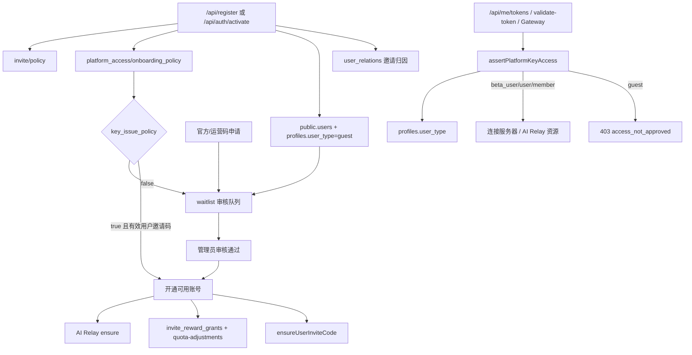

# 技术方案：平台邀请、审核与资源准入后端改造

---

## 0. 元信息

| **字段** | **内容** |
| --- | --- |
| **文档状态** | 🟡 Draft |
| **作者** | @Codex |
| **创建日期** | 2026-06-11 |
| **最后更新** | 2026-06-12 |
| **Reviewers** | @待指定 |
| **关联链接** | [AI Relay / NewAPI 可执行设计](./ai-relay-newapi-executable-design.md)、[模板](./模版.md) |

---

## 1. TL;DR

本方案把“邀请码关系”、“管理员审核”和“连接服务器 key/AI Relay 资源准入”拆成三件事。
当前登录逻辑保持原样；默认注册后不能获取或使用连接服务器 key。
后续资源充足时，管理员可在系统配置里调整“注册后是否直接开通 key/资源”，无需改登录链路。
邀请归因在注册成功后即可写入 `user_relations`；用户是否成为 `beta_user` 只由审核/准入策略决定，奖励仍只在用户达到可用账号状态后发放。
改动跨 Supabase、Platform Web API、Backend/Gateway 鉴权、AI Relay quota 和管理员审核流程，必须分阶段上线。

---

## 2. 背景与问题

当前邀请、审核、注册和 key 发放混在一起，导致几个实际风险：

- `/api/register` 带邀请码注册会直接把 `profiles.user_type` 升为 `beta_user`，并返回 `platform_token`。
- Supabase auth trigger 会给所有 auth 用户生成 `public.users.platform_token`，后续 trigger 又镜像到 `platform_tokens`。
- `/api/me/tokens` 的 `POST/DELETE` 已经挡了 guest，但 `GET` 没挡；`/api/validate-token`、`internal-auth`、Gateway `TokenAuthenticator` 也还没有统一检查 `profiles.user_type`。
- 管理员 waitlist 审批当前和“选择/消耗邀请码”耦合，和“资源有限，需要审批后才能拿 key”的产品边界冲突。
- `invite_codes.used_count/max_uses` 目前承担了过多业务事实，和“每个可用用户一个长期邀请码，名额不由邀请码消耗次数决定”的目标冲突。
- `/api/register` 当前对所有注册路径（含 guest 无邀请码注册）都会调用 AI Relay ensure，给未审核用户创建 relay 账户并发放初始额度（`initial_user_quota_usd`），与“审核后才开通资源”的边界冲突。

现在必须解决，是因为邀请注册会直接影响连接服务器 key 和 AI Relay / NewAPI 资源消耗。如果不先收紧资源准入，再做邀请奖励，后续会出现“未审核用户已经能用资源”或“奖励发放早于真实开通”的问题。

---

## 3. 目标与非目标 ⭐

### Goals（必达）

- 所有 `guest` 用户在默认 `manual_review` 模式下都不能获取、创建、验证或使用连接服务器 key，覆盖 `/api/me/tokens`、`/api/validate-token`、`internal-auth`、Gateway token 鉴权和 SSE query token。
- `guest` 用户在注册阶段不创建 AI Relay 账户和密钥；AI Relay 账户、token key 与初始额度只在可用账号开通流程中创建。`/api/me/ai-relay` 等 relay 用户入口同样受准入门禁。
- 管理员可通过 `system_configs` 修改 `platform_access/onboarding_policy`，控制注册后是否直接开通 key/资源。
- 邀请关系以 `user_relations` 为归因事实源，每个用户最多 1 条关系；它不代表资源准入，也不决定用户是否为 `beta_user`。
- `invite.policy.per_user_limit` 按注册成功后的 `user_relations` 归因关系数统计，不等审核通过后才占名额。
- 用户邀请码奖励以 `invite_reward_grants` 为产品账本，给被邀请人与直接邀请人各 20 积分，且同一用户/同一邀请关系重复执行不会重复发奖；官方/运营码不触发奖励。
- 管理员审核通过后执行同一套“开通可用账号”流程：升级 user_type、ensure AI Relay、发奖励、生成用户邀请码。
- 只有已开通 key/资源的 `beta_user/user/member` 才能拥有、展示和分享自己的用户邀请码；`guest` 不能继续邀请别人。

### Non-Goals（明确不做）

- ❌ 不做多级邀请奖励。`A/B/C` 中 A 这种上级链路第一版不发奖励。
- ❌ 不新增平台钱包或第二套积分余额；积分仍写入 AI Relay / NewAPI quota。
- ❌ 不把邀请码当成资源准入凭证；邀请码只表示来源关系和邀请资格。
- ❌ 不重做前端注册页视觉和文案；前端只做必要状态兼容。
- ❌ 不在第一版启用 `key_issue_policy=allow_all_registered`，只预留配置语义。
- ❌ 不在第一版新增完整管理员身份体系；当前后台仍基于 `ADMIN_SECRET`，审批审计先记录为 admin/system 来源。
- ❌ 不补发历史邀请奖励；确有需要时走人工补偿。
- ❌ 不清理历史已生成 token 数据；第一版只保证新资源入口受准入门禁控制。
- ❌ 不新增独立 `platform_access_grants` 表；第一版继续用 `profiles.user_type` 表达 key/资源开通状态。
- ❌ 不提供注册后自助补绑邀请码接口；特殊个案由管理员人工处理。

---

## 4. 方案概述

**核心一句话**：注册创建账号、待审核申请和邀请归因关系；现有登录逻辑不变，key/资源准入由 `platform_access/onboarding_policy` 控制，邀请奖励只在可用账号开通后幂等触发。

**系统图**：



---

## 5. 方案详解

### 5.1 模块 A：资源准入策略

**子问题**：注册后是否可以直接拿 key/资源，必须可运营配置，同时不改变现有登录逻辑。

**关键决策**：新增 `platform_access/onboarding_policy`，和 `invite/policy` 分离。邀请策略只管邀请关系、名额和奖励；准入策略只管 key/资源是否自动开通。

默认配置：

```json
{
  "mode": "manual_review",
  "key_issue_policy": "approval_required",
  "key_access_user_types": ["beta_user", "user", "member"]
}
```

配置读取规则：

- 登录逻辑保持现状，不由本方案新增配置控制。
- `key_issue_policy` 控制注册成功后是否直接开通 key/资源：
  - `approval_required`：必须管理员审核后才允许 key，默认值。
  - `allow_invited_registered`：带有效 `type='user'` 用户邀请码注册后直接执行可用账号开通流程。
  - `allow_all_registered`：所有注册成功用户直接执行可用账号开通流程，第一版预留，不建议 prod 启用。
- 官方/运营码不受 `allow_invited_registered` 自动开通影响；它沿用现有 waitlist 流程，审核通过后发送注册/激活邮件。
- `allow_all_registered` 代码分支可以实现，但 prod 系统配置界面第一版不直接开放；如必须开放，需要二次确认并提示资源成本风险。
- 配置缺失或 JSON 无法解析时，key 准入 fail closed 到 `approval_required`，避免误放资源。

### 5.2 模块 B：数据事实源

**子问题**：当前 `invite_codes.used_count` 和 `profiles.referrer_user_id` 都不足以做长期邀请归因事实。

**关键决策**：新增 `user_relations` 作为邀请树事实源，新增 `invite_reward_grants` 作为奖励账本。

`user_relations`：

| 字段 | 说明 |
| --- | --- |
| `user_id` | 被邀请/当前用户，主键，每人最多 1 条关系 |
| `inviter_user_id` | 直接邀请人，可空 |
| `invite_code` | 使用的邀请码，仅做审计 |
| `lineage_path` | 不可变 `user_id` 链路，例如 `A/B/C` |
| `depth` | 链路深度 |
| `created_at` | 关系创建时间 |

约束：

- `inviter_user_id != user_id`。
- 无邀请码注册、官方/运营码申请后激活，或历史补数无法可靠解析邀请人时，用户作为根节点写入 `lineage_path=user_id`。
- `type='user'` 的用户邀请码必须有 `owner_user_id`；缺失 owner 视为无效邀请码并直接失败。
- `type='official'` 的官方/运营码允许 `owner_user_id=null`；它只表示 waitlist 运营渠道来源，不产生邀请人、不占任何用户的邀请名额、不触发邀请奖励。
- 用户注册成功后即可写入 `user_relations`；这条记录只表示“谁邀请了谁”，不表示审核通过、资源开通或奖励已发。
- `user_relations` 创建后普通用户不可改；第一版不允许用户注册成功后再自助补绑邀请码或替换邀请人。
- 用户是否成为 `beta_user` 由 `platform_access/onboarding_policy` 和管理员审核决定，不由邀请码或 `user_relations` 决定。
- `per_user_limit` 按注册成功后的归因关系数统计：`count(user_relations where inviter_user_id = owner_user_id)`。
- 名额并发控制：复用现有 `consumeInviteCode` 的 CAS 机制作为并发闸门——`type='user'` 码的 CAS 条件改为 `used_count < invite/policy.per_user_limit`（官方码仍用自身 `max_uses`），原子占位，避免两个并发注册同时通过名额检查；注册失败路径沿用现有 `refundInviteCode` 补偿。`used_count` 自此只是并发计数器，名额事实仍以 `user_relations` 为准，二者可对账修复。
- 被邀请用户即使后续被拒绝、未开通 key 或仍在审核中，也已经占用邀请人的邀请名额；管理员拒绝不释放该名额。
- 历史用户补数时，无法可靠解析邀请人的记录按根节点处理，默认不补发历史奖励。

`invite_reward_grants`：

只在 `user_relations.inviter_user_id IS NOT NULL` 的用户邀请关系上创建。官方/运营码申请和无邀请码注册不创建奖励记录。

| 字段 | 说明 |
| --- | --- |
| `idempotency_key` | 幂等键，唯一 |
| `invitee_user_id` | 被邀请人 |
| `inviter_user_id` | 直接邀请人 |
| `invite_code` | 审计字段 |
| `reward_target` | `invitee` 或 `inviter` |
| `credits` | 第一版固定 20 |
| `status` | `pending/succeeded/failed` |
| `ai_relay_adjustment_key` | 对应 AI Relay quota adjustment 幂等键 |
| `error` | 失败原因 |

幂等键：

```text
invitee_bonus:<invitee_user_id>
inviter_bonus:<inviter_user_id>:<invitee_user_id>
```

积分换算：

- 平台“积分”与 NewAPI quota 的换算口径已存在：`1 积分 = 500,000 NewAPI quota`（`NEWAPI_QUOTA_POINTS_PER_CREDIT`，见 `platform/backend/modules/ai_relay_account/service.py`），LLM 引擎页的余额/流水展示均按此换算。
- 奖励发放调用 `POST /internal/ai/relay/quota-adjustments` 时传**原始 quota**：`quota = credits × 500,000`（20 积分 = 10,000,000 quota），`mode=add`。
- 不使用 `quota_usd` 入参——它依赖 NewAPI `quota_per_unit` 汇率，与界面积分口径可能漂移；传原始 quota 保证用户界面上的积分精确 +20。

### 5.3 模块 C：注册、激活与管理员审核流程

**子问题**：当前有三条路径会改变用户资格，必须统一到同一套开通逻辑。

**关键决策**：抽出 `approveUserAccess` / `openPlatformAccess` 服务，所有路径只决定“是否调用它”，不各自实现升级、发奖、ensure AI Relay。

注册路径（含 guest 无邀请码注册与带码注册）**移除现有的 `ensureAIRelayAccountBestEffort` 调用**；AI Relay 账户、密钥与初始额度只在可用账号开通流程中创建。

用户邀请码注册：

1. 规范化邀请码。
2. 校验 `invite/policy.enabled`。
3. 解析 `invite_codes.type`、`owner_user_id`、`disabled`、`expires_at`、`used_count/max_uses`。
4. 如果邀请码不存在、已禁用、已过期或已达到自身使用上限，直接返回错误；不降级为普通注册。
5. 如果是 `type='user'`，必须有 `owner_user_id`，并通过 `used_count` CAS 原子占用一个邀请名额（上限取 `invite/policy.per_user_limit`），失败返回 `invite_limit_reached`；后续任何注册失败路径必须 refund。
6. 创建 auth 用户和 public user，默认 profile 为 `guest`。
7. 幂等写入 `user_relations`，记录邀请归因。
8. 创建或关联 waitlist 申请，记录 `invite_code_used` 和申请来源。
9. 读取 `platform_access/onboarding_policy`。
10. 登录逻辑保持现状。
11. 按 `key_issue_policy` 决定是否立即执行可用账号开通流程；默认不开放 key。

官方/运营码申请：

1. 沿用现有 waitlist 审核流程，不改造成自动开通或直接发 key。
2. 校验官方码是否存在、已禁用、已过期或已达到自身使用上限。
3. `type='official'` 允许 `owner_user_id=null`，不检查 `per_user_limit`，不产生奖励。
4. 创建或更新 waitlist 申请，记录 `invite_code_used` 和申请来源。
5. 管理员审核通过后，发送注册/激活邮件。
6. 用户完成 `/api/auth/activate` 后，再调用可用账号开通流程并置为 `registered`。
7. 官方/运营码不受 `key_issue_policy=allow_invited_registered` 影响。
8. `/api/register` 不为官方码做特殊封堵：在新注册流程下，官方码注册自然降级为 guest 待审核 + 根节点归因（无邀请人、无奖励、不自动开通）。运营通过不发放官方码规避该入口，后续不需要时整体注销官方码链路。

注册无邀请码：

1. 创建 auth 用户和 public user，profile 为 `guest`。
2. 创建或关联 waitlist 申请。
3. 默认待审核；第一版不因为普通注册自动开通 key。

管理员审核：

1. 管理员在 waitlist / 用户审核列表点“通过”。
2. 后端读取用户、profile、waitlist 和可选邀请来源。
3. 如果该 waitlist 已关联现有 auth 用户，调用可用账号开通流程，成功后将 waitlist 置为 `registered`。
4. 如果该 waitlist 还没有 auth 用户，先将 waitlist 置为 `approved`，发送设置密码邮件；用户完成 `/api/auth/activate` 后再调用可用账号开通流程并置为 `registered`。

waitlist 状态语义：

- `pending`：待审核，用户尚未获得资源准入。
- `rejected`：已拒绝，用户仍为 `guest`，不能获取或使用 key。
- `approved`：匿名 waitlist 申请已审核通过，但用户还没有完成账号激活；此状态不代表资源已开通。
- `registered`：账号存在且可用账号开通流程已成功执行；此状态才代表资源已开通。
- `unknown`：历史脏数据兜底状态，只允许管理员重新归类到 `pending/rejected` 或按人工核查结果处理。

可用账号开通流程：

1. `profiles.user_type` 从 `guest` 升级为 `beta_user`。
2. 确认 `user_relations` 已存在；没有邀请码或历史数据无法解析时，按根节点关系补齐。
3. `PUT /internal/ai/relay/users/{user_id}/ensure`。
4. 如果存在直接邀请人，幂等写入两条 `invite_reward_grants`；官方/运营码和无邀请码注册跳过奖励。
5. 对奖励记录调 `POST /internal/ai/relay/quota-adjustments` 发放积分。
6. 幂等生成用户自己的长期邀请码。
7. 记录 `events`：`platform_access.approved`、`invite.relation_created`、`invite.reward_grant_succeeded/failed`。

### 5.4 模块 D：key 与连接服务器硬门禁

**子问题**：只隐藏前端按钮不够，未审核用户仍可能通过 token 表或旧接口访问资源。

**关键决策**：新增统一准入 helper：`assertPlatformKeyAccess(userId)`。登录逻辑不改，只收紧 key/连接服资源入口。

必须覆盖的入口：

- `platform/web/src/app/api/me/tokens/route.ts`
  - `GET`、`POST`、`DELETE` 都检查 `key_access_user_types`。
- `platform/web/src/app/api/validate-token/route.ts`
  - 不再只查 `users.platform_token`，改查 token 归属用户后检查 user_type。
- `platform/web/src/lib/internal-auth.ts`
  - `getPlatformTokenForUser` 返回 token 前检查 user_type，避免 `/api/me/session/current` 和 `/api/me/session/stream` 替 guest 透传。
- `platform/backend/common/auth/token_authenticator.py`
  - SQL 路径从只查 `platform_tokens` 改为 join `profiles`。
  - Supabase fallback 路径查到 user_id 后继续查 `profiles.user_type`。
- Gateway `?token=` SSE 入口
  - 继续允许 query token，但同样受 `TokenAuthenticator` 阻断。
- `platform/web/src/app/api/me/ai-relay/route.ts`
  - AI Relay 账户/积分/用量查询入口同样接 `assertPlatformKeyAccess`，guest 返回 `access_not_approved`。
  - 存量已为 guest 创建的 relay 账户第一版不立即注销，由入口门禁阻断；后续运营批量清理。

允许矩阵：

| 用户类型 | 登录 | 编辑 waitlist | 获取/创建 key | 连接服务器 | AI Relay 资源 | 邀请别人 |
| --- | --- | --- | --- | --- | --- | --- |
| `guest` | 保持现状 | 是 | 否 | 否 | 否 | 否 |
| `beta_user` | 保持现状 | 否 | 是 | 是 | 是 | 是 |
| `user` | 保持现状 | 否 | 是 | 是 | 是 | 是 |
| `member` | 保持现状 | 否 | 是 | 是 | 是 | 是 |

### 5.5 模块 E：邀请码策略

**子问题**：用户邀请码要长期可用，但邀请人数要由系统配置控制，同时不能让未审核用户扩散邀请链。

**关键决策**：`invite_codes` 继续保留，但它只是凭证表；`used_count/max_uses` 不再作为用户邀请名额的最终事实，`used_count` 仅保留为并发占位计数（CAS 闸门，见 5.2），与 `user_relations` 可对账。用户邀请码只发给已开通 key/资源的 `beta_user/user/member`，不发给 `guest`。官方/运营码继续作为无奖励 waitlist 审核渠道存在，是否发布新官方码由管理员控制。

`invite/policy` 默认：

```json
{
  "enabled": true,
  "per_user_limit": 3,
  "invitee_bonus_credits": 20,
  "inviter_bonus_credits": 20,
  "auto_issue_user_invite_code": true,
  "user_invite_code_format": {
    "kind": "readable",
    "prefix": "SC",
    "random_length": 8
  }
}
```

表结构调整：

- `invite_codes.max_uses` 改为可空，`NULL` 表示邀请码本身不限次数。
- `type='user' AND owner_user_id IS NOT NULL` 增加唯一索引，确保每个可用用户第一版只有一个长期邀请码。
- `type='official'` 允许 `owner_user_id=NULL`，仍可继续使用 `disabled/expires_at/used_count/max_uses` 做运营控制。
- `ensureUserInviteCode(userId)` 只在可用账号开通流程后执行；注册成功但仍是 `guest` 时不生成、不展示、不允许分享用户邀请码。
- 邀请码输入做 trim、NFKC、横杠归一和大写归一。
- 用户邀请码是否超额按注册归因关系数判断：`count(user_relations where inviter_user_id = owner_user_id)`；官方/运营码不占任何用户的邀请名额。

### 5.6 模块 F：管理员审核与系统配置

**子问题**：后台已经有系统配置页，审核逻辑不应要求管理员选择邀请码。

**关键决策**：

- 管理员 waitlist 审批 UI 去掉“发放邀请码/选择邀请码”依赖。
- 审核通过按钮语义改为“开通资源/内测资格”，不再表达为“发放邀请码”。
- 系统配置页继续使用现有 `/api/admin/configs`，维护 `platform_access/onboarding_policy` 和 `invite/policy`。
- 审核通过行为是“开通内测资格”，不是“发邀请码”。
- 因当前后台只有 `ADMIN_SECRET`，审批审计先记录 `source=admin_secret`；后续如果有管理员身份，再补 `approved_by_user_id`。

### 5.7 接口契约

| **接口** | **输入** | **输出** | **错误码** | **幂等性** |
| --- | --- | --- | --- | --- |
| `POST /api/register` | email、password、user invite_code?、apply_reason? | `user_id`、email、`resource_status=pending_review/key_enabled` | `invalid_invite_code`、`invite_limit_reached`、`email_already_registered` | 用户邀请码注册；按 email/auth 唯一，重复邮箱返回 409；带用户邀请码失败不降级为普通注册 |
| `POST /api/waitlist` | email、profile fields、official invite_code? | waitlist 申请 | `invalid_invite_code`、`invite_limit_reached`、`email_already_registered` | 沿用现有 waitlist 申请；官方/运营码只作为申请来源 |
| `POST /api/waitlist/check` | email 等 waitlist 查询字段 | `matched`、waitlist_id、invite_code? | `not_found`、`not_approved` | 沿用现有审核后注册/激活入口 |
| `POST /api/auth/activate` | verification token、password | `user_id`、email、`status` | `token_expired`、`token_already_used`、`access_not_approved` | token 只能使用一次 |
| `POST /api/admin?action=waitlist_update_status` | waitlist id、status | waitlist 状态、开通结果；有账号通过后返回 `registered`，无账号通过后返回 `approved` | `invalid_transition`、`invite_limit_reached`、`ai_relay_unavailable` | 对已开通用户重复 approve 返回已有状态 |
| `GET/POST/DELETE /api/me/tokens` | JWT 或 platform_token | token 列表/新 token/删除结果 | `unauthorized`、`access_not_approved` | GET 幂等；POST 创建新 token |
| `POST /api/validate-token` | platform_token | valid、user_id、nickname | `invalid_token`、`access_not_approved` | 幂等 |
| `GET /api/me/session/current` | JWT 或 platform_token | 当前连接状态 | `access_not_approved`、`platform_token_unavailable` | 幂等 |
| `GET /api/me/ai-relay` | JWT | relay 账户/积分/用量 | `unauthorized`、`access_not_approved` | 幂等 |
| Gateway `/api/v1/sessions/*` | Bearer token 或 query token | session/stream | `missing_token`、`invalid_token`、`access_not_approved` | 幂等读取 |
| `PUT /internal/ai/relay/users/{user_id}/ensure` | email、display_name | relay account 绑定 | `NEWAPI_UNAVAILABLE`、`SYNC_FAILED` | 按 user_id 幂等 |
| `POST /internal/ai/relay/quota-adjustments` | user_id、quota_usd、idempotency_key | quota 调整结果 | `DUPLICATE_REQUEST`、`NEWAPI_SYNC_FAILED` | 按 idempotency_key 幂等 |

### 5.8 状态机/数据流

用户资源准入状态：

```text
guest_pending_review
  -> guest_rejected
  -> beta_user_key_enabled
  -> user_key_enabled
  -> member_key_enabled
```

第一版不新增独立枚举列，使用现有组合表达：

- `profiles.user_type='guest'` + `waitlist.status='pending'` = 待审核。
- `profiles.user_type='guest'` + `waitlist.status='rejected'` = 已拒绝。
- `profiles.user_type='guest'` + `waitlist.status='approved'` = 匿名申请已通过，等待设置密码激活；仍不可使用 key。
- `profiles.user_type in ('beta_user','user','member')` = 可用账号。
- `waitlist.status='registered'` = 该审核记录已完成账号激活和资源开通。

邀请奖励状态：

```text
pending -> succeeded
pending -> failed -> pending(retry) -> succeeded
```

---

## 6. 备选方案 ⭐

| **方案** | **描述** | **优势** | **劣势** | **为什么没选** |
| --- | --- | --- | --- | --- |
| **方案 A（采用）** | 复用 waitlist 做审核队列，使用 `profiles.user_type` 做第一版准入事实，新增 `platform_access/onboarding_policy` | 改动最小，能马上封住 guest key；兼容现有后台和 profile | 审计能力较弱，`profiles.user_type` 仍承担资格和套餐两类语义 | 当前资源有限，先收紧准入；审计增强放后续 |
| 方案 B | 新增 `platform_access_grants` 表作为资源准入事实源 | 权限模型最干净，可审计、可撤销、可多资源维度授权 | 需要改所有鉴权查询和后台页面，工期明显增加 | 第一版目标是安全收口和邀请奖励，不扩大到完整授权系统 |
| 方案 C | 审核通过继续发邀请码，用户拿码后再激活 | 贴近当前代码，改动少 | 和“邀请码不是准入凭证”冲突，管理员操作复杂，容易误认为发码等于开通 | 已明确不采用 |
| 方案 D | 注册用户全部自动获得 key | 转化路径最短 | 当前服务器和 NewAPI 资源不足，风险最大 | 只作为未来 `key_issue_policy=allow_all_registered` 配置模式 |

---

## 7. 风险与权衡 ⭐

| **风险** | **影响范围** | **触发条件** | **缓解措施** |
| --- | --- | --- | --- |
| 漏掉某个 token 入口，guest 仍可用资源 | 连接服、AI Relay 成本 | 只改 `/api/me/tokens`，没改 Gateway/validate/internal-auth | 做统一 `assertPlatformKeyAccess`，按入口列测试 |
| 配置误改导致自动放开 | 新注册用户资源消耗 | 管理员把 `key_issue_policy` 改成 `allow_all_registered` | prod UI 第一版不直接开放该选项；如开放需二次确认，并监控注册到 key 的转化量和 NewAPI 成本 |
| 官方码被大量传播 | 审核队列膨胀，潜在资源压力 | 管理员发布了无使用上限或长期有效的官方码 | 默认仍需审核；官方码可通过 `disabled/expires_at/max_uses` 控制，是否发布由管理员决定 |
| AI Relay ensure 成功但奖励失败 | 用户余额不一致 | NewAPI quota adjustment 超时或失败 | `invite_reward_grants.status=failed`，后台重试 |
| 邀请关系写错后难以修复 | 邀请树和奖励 | 邀请码 owner 变化、历史数据不完整 | `user_relations` 写后普通用户不可改；历史不可靠数据按根节点处理 |
| 被拒绝用户仍占邀请名额 | 邀请人名额消耗 | 被邀请人注册成功但审核被拒或长期未开通 | 这是已确认产品规则；管理员可人工处理特殊个案 |
| 旧用户/老 token 被误挡 | 存量用户无法连接 | profile 缺失或 user_type 没补齐 | 上线前补齐 profiles；存量 profile 已通过迁移设为 `beta_user` |
| waitlist 重复记录导致审核错对象 | 管理后台 | 同邮箱多次申请 | 注册和审核用 email + user_id 关联，新增 lower(email) 查询索引，UI 显示关联用户 |
| `used_count` 与 `user_relations` 漂移 | 邀请名额判断 | refund 补偿失败或人工改库 | 名额事实以 `user_relations` 为准，提供对账脚本按需校正 `used_count` |

**关键权衡**：第一版选择“用 `platform_access/onboarding_policy` 决定注册后的 key/资源准入，再用 `profiles.user_type` 表示已开通账号类型”，是为了快速封住未审核 key 的安全洞，同时不重做完整授权系统。代价是 user_type 仍然承担部分资格语义，长期如果要支持资源包、封禁、按功能授权，应升级为独立 `platform_access_grants`。

另一个权衡是“登录逻辑不动，只控制 key/资源开通”。这能把改动范围收回邀请系统和资源准入，避免牵动现有 Auth 流程。

---

## 8. 失败模式与容错

| **组件** | **失败场景** | **影响** | **降级/容错策略** | **监控指标** |
| --- | --- | --- | --- | --- |
| `system_configs` | 配置缺失/JSON 错误 | 自动审核判断不可用 | 默认 `manual_review`，guest 不放行；记录 error event | config read failures |
| Supabase Auth trigger | auth 用户创建了但 public.users 缺失 | 注册不一致 | 注册接口返回 500，记录 CRITICAL，不发奖励 | `user_creation_inconsistent` |
| waitlist 创建 | 注册成功但审核记录失败 | 用户无法被审核 | 返回 pending 但记录告警；后台补建 waitlist | waitlist create failures |
| AI Relay ensure | NewAPI 不可用 | 开通后资源账户缺失 | 不回滚用户开通，标记待补偿任务 | ensure failure rate |
| quota adjustment | 奖励发放失败 | 用户积分未到账 | 不阻塞审核通过；`invite_reward_grants=failed`，后台重试 | failed reward grants |
| Gateway 鉴权 | DB 查询失败 | 无法连接服务器 | fail closed，返回 401/503，不放行 guest | auth backend errors |
| 邮件激活 token | token 过期/重复使用 | 用户无法设置密码 | 返回明确错误，允许重新发审核邮件 | token expired/used count |

---

## 9. 测试计划 + DoD

### 测试计划

| **测试类型** | **覆盖范围** | **关键用例** |
| --- | --- | --- |
| 单元测试 | policy parser、invite code normalize、relation builder、reward idempotency、access guard | 配置缺失默认 manual；guest 被拒；beta_user 放行；用户码奖励幂等；官方码不创建奖励；并发占名额 CAS 只放行 limit 个 |
| 集成测试 | `/api/register`、`/api/auth/activate`、管理员审核、`/api/me/tokens`、`/api/me/ai-relay` | 默认注册后无 key；guest 注册不创建 AI Relay 账户；审核后可获取 key 且 relay 账户已 ensure；`key_issue_policy=allow_invited_registered` 时用户邀请码注册后自动开通 key；官方码仍进入 waitlist 且无奖励；GET tokens / ai-relay 拒未开通用户 |
| Gateway 测试 | `TokenAuthenticator` asyncpg + Supabase fallback | guest token 401；beta_user token 200；query token SSE 同样阻断 |
| E2E 测试 | 注册到审核到连接 | 默认 guest 拿不到 key；管理员审核后能生成 key 并连接 |
| 回归测试 | 旧用户与旧 token | 存量 beta_user 的默认 token 仍可用；profile 缺失按异常处理 |

### Definition of Done

- [ ] `platform_access/onboarding_policy` 和 `invite/policy` 默认配置迁移已落库，管理员系统配置页可编辑。
- [ ] key/token 入口接入 `assertPlatformKeyAccess`；登录逻辑保持现状。
- [ ] `user_relations` 和 `invite_reward_grants` 迁移完成，关系和奖励写入幂等。
- [ ] 注册、激活、管理员审核三条路径都调用同一套开通服务。
- [ ] `key_issue_policy` 的默认值、用户邀请码注册直开、全部注册直开预留分支在测试环境验证通过；prod UI 不直接开放 `allow_all_registered`。
- [ ] AI Relay ensure 和 quota adjustment 失败会留下可重试记录。
- [ ] 存量用户 backfill 完成，旧 beta_user token 未被误挡。
- [ ] 管理后台不再要求审核时选择邀请码，审核通过按钮表达为“开通资源/内测资格”。
- [ ] `guest` 不会生成、展示或分享用户邀请码；`beta_user/user/member` 开通后幂等生成长期邀请码。
- [ ] 注册路径不再调用 AI Relay ensure；guest 注册后无 relay 账户、无初始额度；`/api/me/ai-relay` 拒绝 guest。
- [ ] 邀请奖励按 `quota = credits × 500,000` 发放，LLM 引擎页积分余额精确 +20。
- [ ] 官方/运营码沿用现有 waitlist 审核和注册/激活邮件流程，不产生邀请人、不占用户邀请名额、不创建奖励记录，也不受 `allow_invited_registered` 自动开通影响。

---

## 10. 上线计划

### 阶段划分

| **阶段** | **范围** | **验证内容** | **回滚条件** |
| --- | --- | --- | --- |
| 阶段 1：只加配置和表 | `system_configs`、`user_relations`、`invite_reward_grants`、索引 | 迁移可重复执行；后台能看到配置 | 迁移失败或锁表超时 |
| 阶段 2：接入 key 门禁 | `/api/me/tokens`、`validate-token`、`internal-auth`、Gateway | guest 全部 403/401；存量 beta_user 正常 | 存量用户大量无法连接 |
| 阶段 3：注册改为待审核 | `/api/register`、前端状态兼容 | 用户邀请码注册不再默认返回可用 key，进入 waitlist；注册路径移除 AI Relay ensure；响应不再返回 `platform_token`；官方码继续走 waitlist 审核 | 注册失败或 waitlist 缺失 |
| 阶段 4：管理员开通统一服务 | waitlist 审核、AI Relay ensure、邀请码生成 | 审核后能连接，失败可补偿 | 审核成功率异常下降 |
| 阶段 5：邀请奖励 | `invite_reward_grants`、quota adjustment | 新邀请奖励正确发放，`user_relations` 只作为归因输入 | 奖励重复/漏发比例异常 |
| 阶段 6：可选自动开通灰度 | `key_issue_policy=allow_invited_registered` 仅 test/dev 或小范围 prod | 有用户邀请码的注册用户自动开通 key/资源；官方码和无邀请码仍进审核 | NewAPI 成本或连接实例异常增长 |

### 数据迁移

- 新增 `platform_access/onboarding_policy`，默认 `manual_review`。
- 新增 `invite/policy` 或补齐缺失环境配置。
- 新增 `user_relations`，存量 `beta_user/user/member` 默认作为根节点补齐；能可靠从 `users.invite_code_used -> invite_codes.owner_user_id` 解析且非自邀请时，可补直接关系。
- 新增 `invite_reward_grants`，默认不对历史邀请补发奖励，避免未确认成本。
- 不清理历史已生成 token 数据；后续统一由 key/连接服资源入口门禁决定是否放行。
- 存量 guest 已创建的 AI Relay 账户不立即注销，由入口门禁阻断，后续运营批量清理。
- `invite_codes.max_uses` 改为可空；用户邀请码 `max_uses=NULL`（名额闸门走 `used_count < per_user_limit` CAS）。
- 给 `waitlist.email` 增加 lower(email) 查询索引，用于审核和重复申请定位。

### 回滚方案

- 阶段 1 表和配置新增不影响旧逻辑，回滚代码即可；表保留。
- 阶段 2 如果误挡存量用户，临时回滚 key 门禁代码；不要把 guest 加入 `key_access_user_types`。
- 阶段 3 如果注册转化异常，回滚注册逻辑到旧流程，但保持 Gateway 门禁，避免 guest 用资源。
- 阶段 4/5 如果奖励异常，关闭 `invite/policy.enabled` 或暂停奖励 worker；保留 `invite_reward_grants` 供人工补偿。
- 注册后直开 key 出问题时，把 `key_issue_policy` 改回 `approval_required` 即可停止新用户自动开通。

---

## 11. 影响评估

| **维度** | **评估** |
| --- | --- |
| **业务影响** | 默认减少未审核用户资源消耗；后续可配置恢复注册后直接开通 key |
| **用户范围** | 所有新注册用户、所有使用连接服务器 key 的用户、管理员 waitlist 审核人员 |
| **工程工时** | 约 5-8 人天：数据迁移 1 天，门禁 1-2 天，注册/审核改造 2 天，奖励与测试 1-3 天 |
| **长期维护成本** | 中等；第一版复用 user_type，不拆 `platform_access_grants`；后续资源授权复杂化时再评估 |
| **依赖人/团队** | 后端、Platform Web、Gateway/Agent、运营管理员、NewAPI/AI Relay 配置维护者 |

---

## 12. 已确认决策

| **决策点** | **结论** | **备注** |
| --- | --- | --- |
| `allow_all_registered` 是否 prod 可选 | 第一版代码预留，prod UI 不直接开放或必须二次确认 | 资源充足后再放开 |
| `allow_invited_registered` 适用范围 | 只适用于 `type='user'` 用户邀请码 | 官方/运营码仍走 waitlist 审核和注册/激活邮件 |
| 历史邀请关系是否补发奖励 | 不补发 | 确有需要时人工补偿 |
| 是否记录具体审批人 | 第一版不做管理员身份体系 | 暂用 `source=admin_secret` |
| 是否拆 `platform_access_grants` | 不拆 | 继续用 `profiles.user_type` 表达 key/资源开通 |
| 被拒/未开通用户是否占邀请名额 | 占，拒绝不释放 | 以注册成功后的 `user_relations` 为准 |
| 谁能拥有/分享用户邀请码 | 只有已开通 key/资源的 `beta_user/user/member` | `guest` 不能生成、展示或分享邀请码 |
| 官方/运营码是否保留 | 保留为 waitlist 审核渠道 | `owner_user_id=null` 合法，不产生邀请人和奖励；是否发布新码由管理员控制；不受 `allow_invited_registered` 自动开通影响 |
| 带用户邀请码注册但邀请码无效/超额 | 直接失败 | 不降级为普通注册，返回 `invalid_invite_code` 或 `invite_limit_reached` |
| 注册后是否可自助补绑邀请码 | 不允许 | 特殊个案管理员人工处理 |
| 历史已生成 token 是否清理 | 不清理 | 暂不处理历史数据 |
| 奖励失败是否阻塞审核 | 不阻塞 | 写失败账本，后台重试 |
| 管理后台审核入口 | 沿用 waitlist 审核页，去掉邀请码选择依赖 | 审核通过语义改为开通资源/内测资格 |
| guest 注册是否创建 AI Relay 账户 | 不创建 | register 路径移除 `ensureAIRelayAccountBestEffort`；ensure 仅在可用账号开通流程执行 |
| 存量 guest 的 relay 账户 | 不立即注销 | 由 `/api/me/ai-relay` 等入口门禁阻断；后续运营批量清理 |
| 邀请名额并发控制 | 复用 `invite_codes.used_count` CAS | user 码上限取 `invite/policy.per_user_limit`；`user_relations` 为事实，可对账 |
| 积分与 quota 换算 | 1 积分 = 500,000 NewAPI quota | 奖励传原始 `quota = credits × 500,000`，不用 `quota_usd`，与 LLM 引擎页展示口径一致 |
| `/api/register` 响应是否保留 `platform_token` | 移除 | 现有注册页不消费该字段（仅未被引用的 `EmailSignupForm` 使用，属死代码）；guest 的 token 也会被门禁挡住 |
| 官方码在 `/api/register` 的行为 | 不特殊封堵 | 新流程下自然降级为 guest 待审核 + 根节点归因；运营不发放官方码，后续整体注销该链路 |

---

## 13. Action Items

- @后端Owner 完成 `platform_access/onboarding_policy` 读取 helper 与 `assertPlatformKeyAccess`（DDL：2026-06-13）
- @后端Owner 完成 Supabase 迁移：`user_relations`、`invite_reward_grants`、invite code 索引与 max_uses 调整（DDL：2026-06-14）
- @PlatformWebOwner 改造 `/api/register`、`/api/auth/activate`、`/api/admin` 审核路径（DDL：2026-06-16）
- @GatewayOwner 改造 `TokenAuthenticator` 并补 guest token 回归测试（DDL：2026-06-16）
- @QAOwner 跑通 `approval_required` 和“用户邀请码 `allow_invited_registered`”两套 E2E（DDL：2026-06-17）
- @运营Owner 确认审核状态文案和后台操作口径（DDL：2026-06-14）

---

## 14. 参考资料

- [AI Relay / NewAPI 可执行设计](./ai-relay-newapi-executable-design.md)
- [系统配置表迁移](../platform/supabase/migrations/20260522000001_system_configs.sql)
- [邀请码表迁移](../platform/supabase/migrations/20260512100000_invite_codes.sql)
- [waitlist 状态迁移](../platform/supabase/migrations/20260512100300_waitlist_status.sql)
- [platform_tokens 同步迁移](../platform/supabase/migrations/20260525000002_platform_tokens_auto_sync.sql)
- [当前资源准入配置迁移](../platform/supabase/migrations/20260611000000_platform_access_onboarding_policy.sql)

---

## 📋 提交评审前自检清单

- [x] **TL;DR ≤ 5 行**，且第一段就讲了“做什么”
- [x] **Goals 可量化**，且 Non-Goals ≥ 2 条
- [x] **方案概述含一张系统图**（不是只有文字）
- [x] **第 5 节代码片段 + 文件路径 + 目录树总长 ≤ 30%**
- [x] **Alternatives ≥ 2 个**，每个有“为什么没选”
- [x] **Risks ≥ 3 条**诚实负面后果（不是泛泛“考虑了风险”）
- [x] **DoD 可勾选验证**，不是模糊描述
- [ ] **陌生人测试**：找 1 个不在本项目的同事读 5 分钟，他能复述结论吗？

---

## 变更历史

| **日期** | **修改人** | **变更内容** |
| --- | --- | --- |
| 2026-06-11 | @Codex | 按技术方案模板重写，补齐目标、架构、接口、风险、失败模式、测试、上线与回滚 |
| 2026-06-12 | @Codex | 评审修订：注册路径移除 AI Relay ensure（guest 不建 relay 账户）；`/api/me/ai-relay` 接门禁；名额并发改用 `used_count` CAS 闸门；明确积分换算（1 积分 = 500,000 quota，奖励传原始 quota）；确认 register 响应移除 `platform_token`；官方码注册入口不特殊封堵 |
