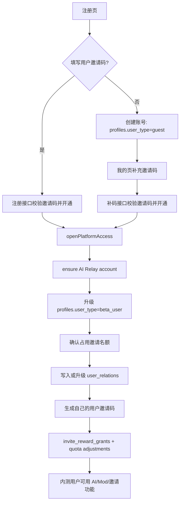

# 技术方案：邀请码开通与游客补码链路改造

---

## 0. 元信息

| 字段 | 内容 |
| --- | --- |
| 文档状态 | Draft |
| 作者 | Codex |
| 创建日期 | 2026-06-24 |
| 最后更新 | 2026-06-25 |
| Reviewers | @待定 |
| 关联链接 | `docs/platform-invite-backend-design.md`、`platform/web/src/lib/register-handler.ts`、`platform/web/src/app/(platform)/(console)/me/page.tsx` |

---

## 1. TL;DR

本方案把“有效用户邀请码”定义为内测开通凭证：注册页邀请码可选，无邀请码用户可注册并登录为游客；有用户邀请码的注册用户在注册接口成功时直接开通，邮箱确认后登录即可看到内测权限。游客可在“我的”补充用户邀请码，补码成功才升级为 `beta_user`、创建 AI Relay 账户、生成自己的邀请码、发放双方积分并扣邀请名额。审核链路不再面向新用户，现有 waitlist/activate 仅作为 legacy 兼容入口处理。前端同时调整注册页、我的页邀请模块和未设置搭子性格时的空状态。

---

## 2. 背景与问题

线上排查显示，当前生产配置 `platform_access/onboarding_policy.key_issue_policy` 仍为 `approval_required`。因此用户即使通过 `type="user"` 的邀请码注册，也会先被写成 `guest`，不会自动调用 `openPlatformAccess`。典型现象是 rotap 使用 yecan 的邀请码完成注册，但仍没有 AI Relay account，在“我的”页也因为 guest 分支不请求 persona、appearance、invitations 等数据，看不到已设置的搭子相关信息。

当前代码还有几个与目标链路冲突的点：

- 注册页仍有“申请参与内测”和申请理由，暗示人工审核仍存在。
- 无邀请码注册会创建空的 `user_relations` 根关系；现有 `ensureUserRelation` 使用 `ignoreDuplicates: true`，后续补邀请码无法覆盖为真实邀请关系。
- 邀请码目前是先 `consumeInviteCode` 再注册，失败再 refund；目标规则要求“只有完整开通成功才扣邀请次数”。
- `/api/me/invite-code` 只有 `GET`，且仅对非 guest 返回自己的邀请码；没有游客补码接口。
- 邀请记录昵称读取 `users.nickname`，不是实时优先读取 `profiles.nickname`，可能显示 stale 的 `user***`。

---

## 3. 目标与非目标

### Goals

- 100% 支持无邀请码注册并登录为 guest；guest 无法获取 AI Relay 账户、平台 token 使用权和 Mod 链接密钥。
- 100% 支持用户邀请码注册后自动开通：注册接口成功时执行开通，邮箱确认后登录即为内测用户。
- 100% 支持 guest 在“我的”补充用户邀请码或从邀请链接进入注册自动填充邀请码；补码成功后立即获得完整内测权益。
- 邀请次数只在完整开通成功后扣除；开通失败不占名额、不写成功邀请关系、不发奖励。
- 邀请奖励按 `invite_reward_grants` 幂等补发；缺失账本时自动创建，已有成功账本不重复发放。
- “我的”页邀请记录中的被邀请人昵称随被邀请人修改自动更新，优先展示 `profiles.nickname`。
- 注册页按产品标注调整：新增邀请码输入、删除“申请参与内测”、同意书改弹窗、底部登录入口居中。
- 非 guest 但未设置搭子性格时，“我的”页搭子名片/性格区域显示空栏和提示“快去设置搭子的性格吧！”。

### Non-Goals

- 不支持官方/运营码在新注册或游客补码链路中自动开通；官方码仅作为 legacy 数据兼容。
- 不重做完整权限系统；第一版仍以 `profiles.user_type` 表达内测资源准入。
- 不把 guest 加入 `key_access_user_types`。
- 不在邮箱确认回调里开通资源；邮箱确认只影响能否登录，资源开通发生在注册接口或补码接口。
- 不允许用户在已经建立真实邀请关系后自助更换邀请人。

---

## 4. 方案概述

**核心一句话**：用户邀请码是开通凭证，但只有 `openPlatformAccess` 全链路成功后才算邀请成功并扣名额；没有邀请码的用户可以登录为 guest，并在“我的”补码开通。



---

## 5. 方案详解

### 5.1 注册链路

注册页保留邮箱、密码、确认密码、邀请码、同意勾选。邀请码字段为可选，只接受邀请码字符串，不需要用户手动粘贴邀请链接；邀请链接继续通过 `?ref=` 自动填充该字段。

后端注册逻辑改为：

1. 无邀请码：创建 Supabase Auth 用户和 public user，写 `profiles.user_type='guest'`，允许登录，但不创建 AI Relay 账户，不发奖励，不扣邀请名额。
2. 有邀请码：只接受有效 `type='user'` 的邀请码；注册账号成功后调用新的开通编排服务。
3. 开通失败：账号仍保留为 guest；邀请名额不扣，真实邀请关系不写，用户可登录后在“我的”重新补码。
4. 开通成功：返回 `resource_status='key_enabled'`，并确保邮箱确认后用户登录即看到内测身份。

这里要重构现有 `consumeInviteCode` 的使用方式。当前注册在创建账号前 consume，目标规则要求改为“先校验可用，开通成功后确认占用”。建议新增两段式接口：

- `peekUserInviteCode(code)`：只读校验 code 是否有效、是否 user code、owner 是否存在、是否未超名额。
- `commitUserInviteUse(code, inviteeUserId)`：在开通关键步骤成功后 CAS 扣名额，并返回 owner 信息。

如果短期不想拆原函数，也可以新增 `consumeInviteCodeAfterOpen`，但不要在注册前调用旧 `consumeInviteCode`。

### 5.2 游客补码链路

新增接口建议为 `POST /api/me/invite-code/claim`。

输入：

```json
{
  "invite_code": "SC-XXXX-XXXX"
}
```

行为：

1. 鉴权当前用户。
2. 读取 `profiles.user_type`，只允许 `guest` 调用；已开通用户返回幂等成功或 `already_opened`。
3. 规范化邀请码，只接受 `type='user'`。
4. 拒绝自邀请。
5. ensure AI Relay account。
6. 升级 `profiles.user_type='beta_user'`。
7. CAS 扣邀请名额。
8. 如果 `user_relations` 不存在则插入真实关系；如果存在空根关系则升级为真实关系；如果已有真实关系则拒绝。
9. 确保当前用户拥有自己的用户邀请码。
10. 幂等发放邀请奖励。
11. 返回最新 profile、invite status 和 open result，前端刷新“我的”页状态。

空根关系升级规则：

- 允许：无关系，或 `inviter_user_id IS NULL AND invite_code IS NULL`。
- 拒绝：已有非空 `inviter_user_id` 或非空 `invite_code`。
- 升级后不可再自助变更。

### 5.3 开通编排服务

建议把注册开通和补码开通统一到一个服务，例如：

`openPlatformAccessByUserInvite({ user_id, email, display_name, invite_code, waitlist_id?, source })`

该服务不要直接复用当前 `openPlatformAccess` 的全部顺序，因为当前 `openPlatformAccess` 先 `ensureUserRelation` 再发奖，但目标要求扣名额和写关系都必须发生在关键开通成功后。推荐顺序：

1. `peekUserInviteCode`，拿到 `owner_user_id`。
2. `ensureAIRelayAccount`，失败则终止。
3. `profiles` upsert 为 `beta_user`，失败则终止。
4. `commitUserInviteUse` CAS 扣名额，失败则尝试把 profile 回滚为 guest 或标记 repair 状态。
5. `attachUserRelationFromGuestRoot` 写入真实关系。
6. `ensureUserInviteCode` 给新内测用户发自己的邀请码。
7. `grantInviteRewardsForUser` 幂等发奖。

跨 Supabase 和 AI Relay 无法做一个真正数据库事务，因此必须用幂等和可修复状态控制：

- AI Relay ensure 幂等，以 user_id 作为事实。
- 奖励账本已有 idempotency key。
- 邀请名额 commit 必须 CAS。
- 失败日志要记录 source、user_id、invite_code、阶段和错误。

### 5.4 奖励与积分补齐

现有 `grantInviteRewardsForUser` 的幂等账本可以保留，但调用前必须保证 `user_relations.inviter_user_id` 已经正确写入。补码成功或注册开通成功后统一调用。

如果发现某个已开通用户有真实邀请关系但奖励账本缺失，可以在开通接口的幂等路径里补齐；但不对 guest 自动修复历史邀请码，也不把 `users.invite_code_used` 当作成功邀请事实。

奖励成功标准：

- 被邀请人账本：`invitee_bonus:<invitee_user_id>` 为 `succeeded`。
- 邀请人账本：`inviter_bonus:<inviter_user_id>:<invitee_user_id>` 为 `succeeded`。
- AI Relay quota adjustment 接口返回成功。

### 5.5 AI/Mod 门禁

保留现有 `getPlatformKeyAccess` 机制，不把 guest 加入允许列表。需要复测这些入口：

- `/api/me/tokens` 的 `GET/POST/DELETE`
- `/api/me/ai-relay` 的 `GET/POST/PATCH`
- `/api/validate-token`
- `internal-auth`
- Gateway `TokenAuthenticator`

平台 token 表可能已有 guest 的 token 行，但资源准入以 `profiles.user_type` 为准。前端不应向 guest 展示 token 区域。

### 5.6 “我的”页前端

`guest` 视图：

- 显示游客状态。
- 显示“补充邀请码”输入框和提交按钮。
- 支持错误提示：邀请码无效、名额已满、不能邀请自己、开通失败请稍后重试。
- 不显示访问令牌、AI Relay、搭子名片、邀请链接、邀请记录。

非 guest 视图：

- 显示访问令牌。
- 显示邀请链接，同时显示真实邀请码，二者都可复制。
- 拉取邀请记录和 persona。
- 判断 persona 是否已设置。若未设置，只把搭子名片和性格相关区域替换为空栏提示“快去设置搭子的性格吧！”，保留 token 和邀请模块。

persona 已设置判断：

- `persona` 存在，并且 `style_summary` 有值，或 `custom_flavor.length > 0`，或 `core_preferences` 有完整有效维度，或 `profile.relationship_type` 有值。
- 不能只看 `profile.display_name` 或 appearance。

邀请记录昵称：

- `getUserInviteReferrals` 增加读取 `profiles.user_id,nickname`。
- 展示优先级：`profiles.nickname` > `users.nickname` > `users.email` > `user_id` 短码。

### 5.7 注册页前端

按标注调整：

- 新增邀请码输入框，放在密码区下方或注册按钮前，label 为“邀请码（选填）”。
- URL 中 `?ref=`、`?invite_code=`、`?inviteCode=`、`?code=` 继续自动填充邀请码。
- 删除“申请参与内测”勾选框和申请理由 textarea。
- 删除原同意书下拉展开阅读模块。
- 保留“我已阅读并同意”勾选框；其中《数据收集与知情同意书》文字可点击，打开 modal 弹窗展示原同意书内容。
- 注册按钮仍依赖同意勾选。
- 底部只保留居中的“已有账号？登录”。

### 5.8 legacy 审核链路

新用户链路不再依赖 waitlist 审核。保留旧入口只为了兼容线上已有数据：

- `/api/auth/activate` 可保留，但不作为新注册主路径推广。
- 后台 `waitlist_update_status` 可保留给历史用户，不再作为邀请码注册用户的标准开通路径。
- 注册页和“我的”页不再展示“待审核/申请参与内测”的产品语义。

### 5.9 历史异常数据处理

对于 rotap 这类“填过邀请码但仍为 guest”的历史账号，按产品规则还原成纯 guest 语义：

- 不自动开通。
- 如果旧流程已扣邀请名额，要退回。
- 如果已有真实 `user_relations` 但用户仍是 guest，清成空根关系或删除关系。
- 保留 `users.invite_code_used` 作为审计字段，但前端补码不把它当成功邀请。

该处理建议做成一次性只读审计脚本 + 人工确认后的修复脚本，先在本地/测试环境验证 SQL 影响行数，再考虑线上执行。

### 5.10 接口契约

| 接口 | 输入 | 输出 | 错误码 | 幂等性 |
| --- | --- | --- | --- | --- |
| `POST /api/register` | `email,password,invite_code?` | `user_id,email,resource_status` | `invalid_invite_code`,`invite_limit_reached`,`email_already_registered`,`open_access_failed` | 同邮箱唯一；开通阶段幂等 |
| `POST /api/me/invite-code/claim` | `invite_code` | `profile,open_access,invite_status` | `not_guest`,`invalid_invite_code`,`invite_limit_reached`,`self_invite`,`relation_already_bound`,`open_access_failed` | 对已开通用户返回已开通；对失败不扣名额 |
| `GET /api/me/invitations` | auth | 邀请码、邀请链接数据、邀请记录 | `access_not_approved` | 读幂等 |
| `GET /api/me/persona` | auth | `profile,persona` | `persona_access_denied` | 读幂等 |

---

## 6. 备选方案

| 方案 | 描述 | 优势 | 劣势 | 为什么没选 |
| --- | --- | --- | --- | --- |
| 方案 A（采用） | 注册时或补码时直接开通，成功后才扣邀请名额 | 用户路径清晰；符合“邀请码=开通凭证”；失败不占名额 | 需要重构邀请码 consume 顺序和补码接口 | 作为目标方案 |
| 方案 B | 注册时只记录邀请码，邮箱确认后开通 | 语义上更贴近“邮箱激活后开通” | 当前 email-confirmed 是静态页；需要新增 finalize 逻辑，时序复杂 | 复杂度高，故障面大 |
| 方案 C | 继续保留审核，只把 prod 配置改为 `allow_invited_registered` | 改动小，现有代码部分支持 | 仍保留申请/审核心智，不支持游客补码完整闭环 | 不符合“审核废弃” |
| 方案 D | 自动修复 guest 上已有 `users.invite_code_used` | 可自动处理 rotap 类历史数据 | 与“失败不扣名额、不算成功邀请”规则冲突 | 用户已明确不要自动修复 |

---

## 7. 风险与权衡

| 风险 | 影响范围 | 触发条件 | 缓解措施 |
| --- | --- | --- | --- |
| 跨系统开通部分成功 | 用户状态、AI Relay、邀请名额不一致 | AI Relay 成功后 Supabase 更新失败，或名额 commit 失败 | 分阶段记录日志，开通服务幂等，提供 repair 脚本 |
| 邀请名额并发超扣 | 邀请人名额和邀请记录错误 | 多个用户同时使用同一邀请码 | `commitUserInviteUse` 必须使用数据库 CAS |
| 奖励重复或漏发 | NewAPI 额度不一致 | 重试、网络超时、账本写入失败 | 保留 `invite_reward_grants` idempotency key，失败状态可重试 |
| 历史数据污染新链路 | 邀请记录显示错误，guest 无法补码 | 旧流程留下真实关系但用户仍 guest | 上线前跑历史审计；异常行单独修复 |
| guest 误拿资源 | 成本和安全风险 | 错误放宽 `key_access_user_types` 或接口漏检 | 保留现有门禁测试；禁止把 guest 加入允许列表 |
| 前端状态切换不完整 | 补码成功后仍显示 guest UI | claim 成功后未刷新 profile/invitations/persona | claim 成功后统一重拉 profile，并按 user_type 重新加载数据 |

**关键权衡**：本方案选择“注册成功时开通，而不是邮箱确认回调开通”，是为了避免把业务开通绑到 Supabase 邮件确认页和浏览器 session 时序上。用户体感仍然是确认邮箱后登录即内测用户。代价是未确认邮箱的账号也可能已有 AI Relay 绑定，但用户无法登录使用，风险可控。

---

## 8. 失败模式与容错

| 组件 | 失败场景 | 影响 | 降级/容错策略 | 监控指标 |
| --- | --- | --- | --- | --- |
| Supabase Auth | `createUser` 失败 | 注册失败 | 不扣邀请名额，返回明确错误 | register error rate |
| AI Relay ensure | backend/NewAPI 不可用 | 开通失败，用户保持 guest | 不扣名额；提示稍后重试 | ensure failure count |
| 邀请名额 commit | CAS 失败 | 开通不能完成 | 返回名额已满；记录 repair 事件 | invite commit conflict |
| user_relations | 空根升级失败 | 奖励无法发放 | 开通接口失败或进入 repair 队列 | relation update failures |
| quota adjustment | 奖励发放失败 | 积分未到账 | 账本标 failed，后台重试 | failed reward grants |
| 前端 claim | 请求超时 | 用户不确定是否成功 | 重新拉 profile 判断状态；按钮可重试 | claim timeout rate |

---

## 9. 测试计划 + DoD

### 测试计划

| 测试类型 | 覆盖范围 | 关键用例 |
| --- | --- | --- |
| 单元测试 | 邀请码 normalize、peek/commit、空根关系升级、persona 已设置判断 | 无邀请码注册为 guest；用户码注册开通；官方码拒绝；空根关系可升级；真实关系不可覆盖 |
| 集成测试 | `/api/register`、`/api/me/invite-code/claim`、`/api/me/tokens`、`/api/me/invitations` | guest 不能拿 token；补码成功后能拿 token；开通失败不扣名额；奖励账本幂等 |
| E2E 测试 | 注册页、“我的”页、补码成功状态切换 | 邀请链接自动填邀请码；无邀请码注册后登录为 guest；我的页补码后变内测；未设置 persona 显示空栏提示 |
| 数据迁移测试 | 历史异常审计和修复 | rotap 类 guest + invite_code_used 不自动开通；异常关系可清理；used_count 可对账 |

### Definition of Done

- [x] `POST /api/register`：无邀请码注册可登录为 guest；用户码注册成功后开通为 `beta_user`。
- [x] `POST /api/me/invite-code/claim`：guest 补用户码成功后开通；失败不扣名额。
- [x] 官方/运营码在注册和补码链路中不会自动开通。
- [x] guest 对 token、AI Relay、Gateway token auth 仍被拒绝。
- [x] 邀请奖励账本在重复调用时不重复发放。
- [x] 邀请记录昵称优先使用 `profiles.nickname`，用户改昵称后邀请人侧能看到更新。
- [x] 注册页按标注完成：邀请码输入、无申请内测、同意书弹窗、底部登录居中。
- [x] “我的”页未设置 persona 时显示“快去设置搭子的性格吧！”，但 token 和邀请模块正常显示。
- [ ] 历史异常数据审计脚本在本地/测试环境输出影响行数，不直接写线上。

---

## 10. 上线计划

### 阶段划分

| 阶段 | 范围 | 验证内容 | 回滚条件 |
| --- | --- | --- | --- |
| 阶段 1：本地实现和测试 | 新服务、接口、前端状态 | 单元/集成测试通过，本地完整跑通无邀请码、用户码、补码三条路径 | 测试失败或出现 guest 可拿资源 |
| 阶段 2：测试环境灰度 | 测试 Supabase + 测试 AI Relay | 真实邮箱确认、补码、奖励、邀请记录昵称 | open access 失败率高于 5% |
| 阶段 3：线上只读审计 | 只跑历史异常查询 | 输出 guest + invite_code_used、guest +真实 relation、used_count 漂移 | 查询结果异常或无法解释 |
| 阶段 4：线上发布 | 全量新链路 | 新注册和补码成功率，AI Relay ensure 和奖励失败率 | guest 误拿资源、奖励重复、名额超扣 |

### 数据迁移

需要新增或修改：

- 邀请码只读校验和成功 commit 的数据库函数或服务函数。
- 空根关系升级 SQL/函数。
- 历史异常审计脚本。
- 可选：历史异常修复脚本，必须人工确认后执行。

### 回滚方案

- 关闭前端补码入口。
- 将注册页有邀请码的自动开通临时降级为 guest 注册。
- 保持 `key_access_user_types` 不含 guest。
- 奖励异常时暂停 `grantInviteRewardsForUser` 调用，保留账本待修复。
- 若名额 commit 逻辑异常，暂停用户码注册和补码入口，保留无邀请码 guest 注册。

---

## 11. 影响评估

| 维度 | 评估 |
| --- | --- |
| 业务影响 | 用户邀请码路径从“可能待审核”变为“成功即开通”；无邀请码用户可先进入产品但无法用资源 |
| 用户范围 | 新注册用户、当前 guest 用户、已有内测用户邀请记录展示 |
| 工程工时 | 预计 4-7 人日：后端 2-3、前端 1-2、测试/数据审计 1-2 |
| 长期维护成本 | 中等；继续复用 `profiles.user_type` 和 `invite_reward_grants`，但新增两段式邀请码 commit 需要维护 |
| 依赖团队 | Platform Web、Platform Backend/AI Relay、Supabase 数据库、运营确认历史修复口径 |

---

## 12. 未解决问题 Open Questions

| 问题 | 需要谁输入 | 决定截止日期 |
| --- | --- | --- |
| 历史异常修复是否允许直接改线上 `used_count` 和 `user_relations` | 运营/负责人 | 上线前 |
| claim 成功后是否要发送“开通成功”邮件 | 产品/运营 | 上线前 |
| legacy waitlist 后台入口是否隐藏，还是仅标注 legacy | 产品/运营 | 上线前 |

---

## 13. Action Items

- @Platform 后端：实现用户邀请码 peek/commit、补码接口、空根关系升级函数，DDL：2026-06-27。
- @Platform 前端：调整注册页和“我的”页，DDL：2026-06-27。
- @QA：补充注册、补码、门禁、奖励、昵称更新测试，DDL：2026-06-28。
- @运营/负责人：确认历史异常修复清单和执行窗口，DDL：2026-06-28。

---

## 14. 参考资料

- `docs/platform-invite-backend-design.md`
- `platform/web/src/lib/register-handler.ts`
- `platform/web/src/lib/platform-access-open.ts`
- `platform/web/src/lib/invite-rewards.ts`
- `platform/web/src/lib/user-relations.ts`
- `platform/web/src/lib/user-invite.ts`
- `platform/web/src/app/(platform)/(console)/me/page.tsx`
- `platform/web/src/app/(platform)/register/page.tsx`
- `platform/web/src/app/api/me/tokens/route.ts`
- `platform/backend/common/auth/token_authenticator.py`

---

## 提交评审前自检清单

- [x] TL;DR 小于 5 行，第一段说明做什么。
- [x] Goals 可验证，Non-Goals 至少 2 条。
- [x] 方案概述包含系统图。
- [x] 方案详解以模块和接口为主，没有堆代码。
- [x] Alternatives 至少 2 个，并说明为什么不选。
- [x] Risks 至少 3 条，包含负面后果和缓解措施。
- [x] DoD 可勾选验证。
- [ ] 找 1 个不在本项目的同事读 5 分钟，确认能复述结论。

---

## 变更历史

| 日期 | 修改人 | 变更内容 |
| --- | --- | --- |
| 2026-06-24 | Codex | 初版 |

---

## 15. 补充方案：用户头像预设配置

### 15.1 目标口径

本补充方案用于改造 `/me` 页面头像链路：用户头像不再使用搭子像素人预览，也不允许上传图片；用户只能从管理员上架的预设头像中选择。用户的选择继续保存到现有 `profiles.avatar_url` 字段，不新增用户头像表。管理员后续通过配置维护“可选头像列表”，上架范围限制为现有静态资源路径 `/assets/icons/*.png`。

核心规则：

- 用户选择结果保存为 `profiles.avatar_url = preset.src`。
- 头像候选列表由 `system_configs` 管理，建议使用 `domain="profile"`、`config_key="avatar_presets"`。
- 候选头像只允许来自 `/assets/icons/*.png`，本期不支持后台上传文件。
- 前端和后端都必须校验 `avatar_url` 是否在当前 enabled preset 列表中。
- 如果用户当前头像不在 enabled 列表中，页面显示默认头像，并提示用户重新选择。
- guest 也允许选择头像；头像属于基础资料，不属于 AI/Mod 内测资源。

### 15.2 数据与配置

不新增用户数据表，继续复用：

- `profiles.avatar_url text`：保存用户当前头像路径。

新增系统配置 seed：

| 字段 | 值 |
| --- | --- |
| domain | `profile` |
| config_key | `avatar_presets` |
| environment | `dev` / `test` / `prod` |
| status | active |
| value_type | json |

配置结构：

```json
{
  "enabled": true,
  "items": [
    {
      "id": "the_player",
      "src": "/assets/icons/The_Player_Icon.png",
      "label": "玩家",
      "enabled": true,
      "order": 10
    }
  ]
}
```

默认头像候选先使用当前仓库已有 `platform/web/public/assets/icons/*.png` 中的 20 个：

- `/assets/icons/The_Player_Icon.png`
- `/assets/icons/Forester.png`
- `/assets/icons/Junimo_Icon.png`
- `/assets/icons/SMAPI_mascot.png`
- `/assets/icons/Marriage_Icon.png`
- `/assets/icons/Multiplayer_Icon.png`
- `/assets/icons/Achievements_Icon.png`
- `/assets/icons/Bundle_Icon.png`
- `/assets/icons/Quests_Icon.png`
- `/assets/icons/Golden_Walnut.png`
- `/assets/icons/Quality_Sprinkler.png`
- `/assets/icons/Health.png`
- `/assets/icons/Energy.png`
- `/assets/icons/Cinder_Shard.png`
- `/assets/icons/Sweet_Pea.png`
- `/assets/icons/Dandelion.png`
- `/assets/icons/Apple_Sapling.png`
- `/assets/icons/Corn.png`
- `/assets/icons/Book_of_Mysteries.png`
- `/assets/icons/ShippingBox.png`

如果配置缺失、被禁用、JSON 解析失败、items 为空，则代码使用同一份默认 preset 列表兜底，保证 `/me` 页面可用。

### 15.3 后端接口与校验

新增接口：

| 接口 | 输入 | 输出 | 权限 | 说明 |
| --- | --- | --- | --- | --- |
| `GET /api/me/avatar-presets` | auth header | `{ items: AvatarPreset[] }` | 登录用户，guest 可用 | 读取 enabled preset 列表；配置异常时返回默认列表 |

`AvatarPreset`：

```ts
interface AvatarPreset {
  id: string;
  src: string;
  label: string;
}
```

修改 profile 保存逻辑：

- 影响位置：`platform/web/src/lib/me-profile-handler.ts` 或现有 `PATCH /api/me/profile` 的业务 handler。
- 当 PATCH body 包含 `avatar_url` 时，读取 `profile/avatar_presets`。
- 只允许保存当前 enabled preset 的 `src`。
- `src` 还必须满足静态路径约束：以 `/assets/icons/` 开头，以 `.png` 结尾，且不包含 `..`、协议头、query/hash。
- 如果配置异常，使用默认 preset 列表校验。
- `nickname`、`preferences` 的现有逻辑不变。

错误建议：

| 场景 | status | reason |
| --- | --- | --- |
| 未登录 | 401 | `invalid_token` |
| avatar_url 不在候选列表 | 422 | `invalid_avatar_preset` |
| profile 保存失败 | 500 | `profile_update_failed` |

### 15.4 `/me` 页面改造

影响文件：

- `platform/web/src/app/(platform)/(console)/me/page.tsx`

改动：

- SECTION 1 头部左侧 `CharacterRenderer scale={5}` 替换为圆形用户头像按钮。
- EDIT MODE 里的 `CharacterRenderer scale={4}` 替换为圆形用户头像按钮。
- 点击头像打开头像选择弹窗。
- 弹窗使用网格展示 presets，不做搜索/分组。
- 保存头像时必须通过 `createClient().auth.getSession()` 获取 access token，并手动带 `Authorization: Bearer <access_token>` 调 `PATCH /api/me/profile`。
- 保存成功后本地更新 `profile.avatar_url` 并关闭弹窗。
- 保存失败时显示轻量错误提示，不静默失败。
- `{profile.nickname || "未命名农场主"}` 改为 `{profile.nickname || "未设置用户名"}`。

展示逻辑：

- `avatarPresets` 来自 `GET /api/me/avatar-presets`，接口失败时用本地默认列表兜底。
- `currentAvatarUrl` 计算规则：如果 `profile.avatar_url` 命中 enabled presets，则显示该头像；否则显示默认头像 `avatarPresets[0]` 并提示“当前头像不可用，请重新选择”。
- 选择器只允许点击当前 enabled presets。

### 15.5 管理员上架流程

管理员上架头像分两步：

1. 将图片文件放入 `platform/web/public/assets/icons/*.png` 并随前端部署上云。
2. 在后台系统配置中编辑 `profile/avatar_presets`，新增一条 item，例如：

```json
{
  "id": "quality_sprinkler",
  "src": "/assets/icons/Quality_Sprinkler.png",
  "label": "优质洒水器",
  "enabled": true,
  "order": 210
}
```

本期不支持管理员在后台上传图片文件。若未来需要上传，需要新增资产上传、存储、审核和 CDN 缓存策略，另行设计。

### 15.6 测试计划

| 测试类型 | 用例 |
| --- | --- |
| 单元测试 | avatar preset 配置解析；非法 src 过滤；配置缺失 fallback 默认列表；PATCH 非候选 avatar_url 返回 `invalid_avatar_preset` |
| 集成测试 | `GET /api/me/avatar-presets` 对 guest/beta_user 均可用；`PATCH /api/me/profile` 能保存 enabled preset；保存 disabled/未知 preset 被拒 |
| 前端手测 | `/me` view mode 头像显示和保存；编辑资料模式头像同步；刷新后头像仍在；配置接口失败时默认头像可用 |
| 类型检查 | `cd platform/web && npx tsc --noEmit` 零错误 |

### 15.7 DoD

- [x] `system_configs` 已 seed `profile/avatar_presets` 到 dev/test/prod。
- [x] `GET /api/me/avatar-presets` 返回 enabled presets，配置异常时返回默认列表。
- [x] `PATCH /api/me/profile` 服务端拒绝非 preset 的 `avatar_url`。
- [x] `/me` view/edit 两处都使用圆形用户头像，不再使用 `CharacterRenderer` 做用户头像。
- [x] 用户只能从网格中选择头像，不能上传、不能输入 URL。
- [x] 当前头像不可用时显示默认头像并提示重新选择。
- [x] 默认昵称文案已改为“未设置用户名”。
- [x] `npx tsc --noEmit` 通过。

### 15.8 风险与回滚

| 风险 | 影响 | 缓解 |
| --- | --- | --- |
| 配置写坏导致头像列表为空 | 用户无法选择头像 | 前后端共用默认 preset fallback |
| 前后端候选列表不一致 | 前端能选但后端拒绝 | 抽共享默认 preset 模块；接口返回作为前端事实源 |
| 管理员配置了不存在的图片路径 | 前端显示 broken image | 后端/配置解析过滤非 `/assets/icons/*.png`，上线前人工检查资源存在 |
| 历史 avatar_url 不在新列表 | 用户头像变默认 | 页面提示重新选择，不自动写库 |

回滚方式：

- 前端隐藏头像选择入口，继续显示默认头像。
- 后端保留 `avatar_url` 校验；如校验误伤，可临时只允许默认 preset。
- 配置异常时恢复 `profile/avatar_presets` 为 seed 默认值。
