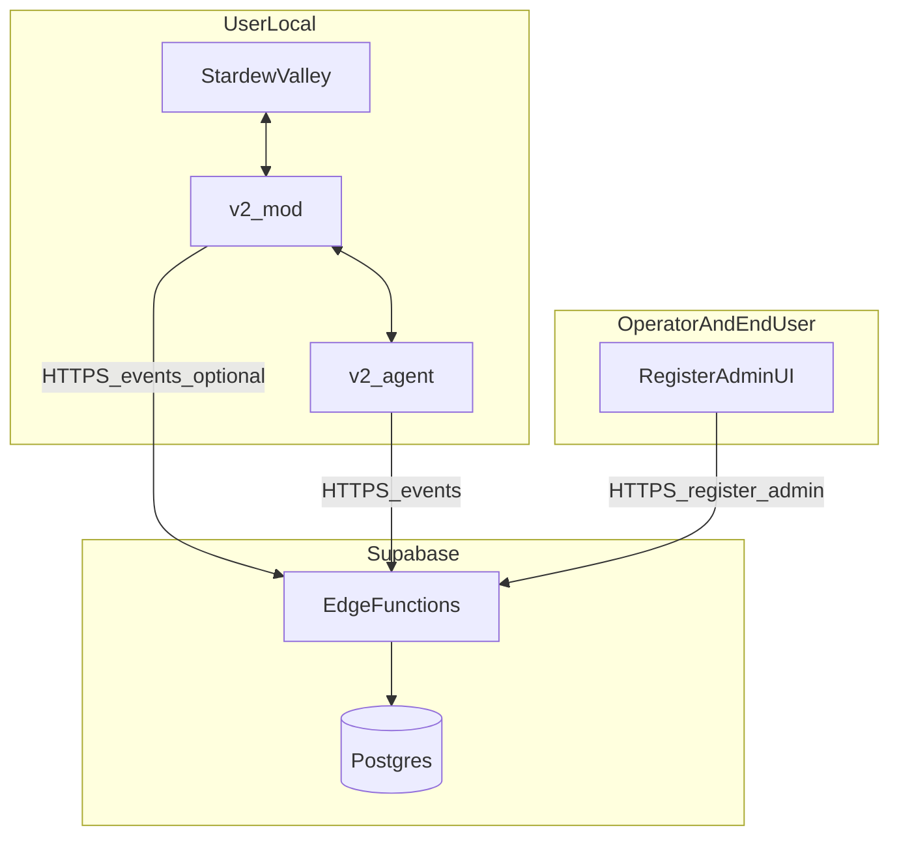
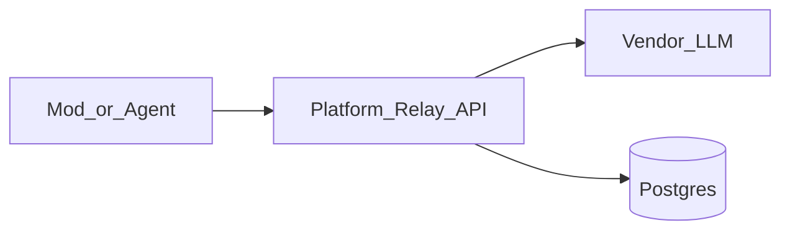

# StarCoPlay 中心化平台（platform）

本目录承载 **StarCoPlay 中心化中台** 的设计与后续实现入口，与产品简报 [docs/中台任务.md](../docs/中台任务.md) 对齐。仓库内与之配合的客户端侧为 [v2/mod](../v2/mod)（游戏 Mod）与 [v2/agent](../v2/agent)（本地 Agent）；`platform/` 负责用户、事件采集、邀请、模型中转与看板所依赖的 **服务端数据与 API**。

---

## 1. 在单仓中的定位


| 模块 | 职责 |
|------|------|
| [v2/mod](../v2/mod) | 游戏内感知与执行、与 Agent 通信；可配置 `platform_token`、平台上报/中转地址 |
| [v2/agent](../v2/agent) | LLM 调用与编排；**埋点 SDK（`telemetry.py`）在此实现与集成** |
| **platform/** | PostgreSQL 权威存储；对外 HTTP API（优先由 Supabase Edge Functions 承载）；注册/管理/看板/中转的 **服务端** |

**边界**：客户端与平台之间的 **唯一强契约** 为事件上报 JSON 格式（见下文「接口契约」）。平台不实现 `telemetry.py` 源码；平台保证按契约 **校验、鉴权、落库**。

**目标架构（WS 集中化）**：Mod ——单条 WebSocket—— Cloud Server（Agent Worker + Platform DB）。控制面走 WS，**遥测** 由 Agent Worker 通过服务角色凭证 **内部写 `events` 表**，不再经公网 HTTP。详细规划见 [v2/docs/platform-wss-centralization-plan.md](../v2/docs/platform-wss-centralization-plan.md)。

---

## 2. 业务目标与阶段

演进路线与简报一致：

| 阶段 | 时间（简报） | 核心能力 |
|------|----------------|----------|
| Phase 1 | 4/2 → 4/15 | 用户注册、数据采集、邀请系统、模型中转、数据看板 |
| Phase 2 | 4 月下旬 | Agent 云端托管、记忆云存储、人设管理 |
| Phase 3 | 未来 | 订阅计费、多游戏、开放 API |

**产品里程碑**：

- **4/8**：邀请制内测（首批 30～40 人，偏技术向）
- **4/15**：Phase 1 完整交付（更泛化的安装与配置体验）

**待定项（README 不填死具体厂商/数字）**：大模型厂商选择、内测每日 token 免费额度 `X`、注册落地页与 [landing/](../landing/) 是否同域/子域（**产品待定**）。

---

## 3. 技术选型（已定）

- **Supabase**
  - **PostgreSQL**：用户、邀请、事件、用量等结构化与 JSON 字段存储。
  - **Edge Functions**：对外 HTTP（如 `POST /api/v1/events`、注册、邀请、OpenAI 兼容中转等），便于与 DB 在同一生态内集成与部署。
- **云 vs 自托管**：无论是 Supabase 官方云还是 **自托管 Supabase**，架构上均为「Postgres + Functions 网关 URL」；具体 **项目 URL、Anon/Service 角色、函数路由** 由部署环境注入（本地开发可用占位符，**不在文档中写 `.env` 内容**）。

简报中的「Next / FastAPI / Vercel」等为本目录确定 Supabase 方案前的备选，**实现以本 README 为准**。

---

## 3.5 域名与部署架构

| 域名 | 用途 | 部署位置 | 说明 |
|------|------|---------|------|
| `star-coplay.luosea.cn` | 前端（官网 + 管理后台 + API Routes） | Vercel（海外，中国加速节点） | Next.js，push 自动部署 |
| `<your-host>` | 后端 API（Gateway + Agent 托管 + WS） | 阿里云 ECS | 当前生产通过公网 IP 暴露，尚未挂独立域名 |

**当前生产方案**：前端部署在 Vercel，后端部署在阿里云 ECS，通过公网 IP `<your-host>` 暴露 HTTP API 和 WebSocket。后续如果补上独立后端域名，再切换为域名访问并配置 SSL。

**后端路由规范**：
- 当前健康检查：`http://<your-host>/api/ping`
- 当前业务接口：`http://<your-host>/api/v1/xxx`
- 当前 WebSocket：`ws://<your-host>/ws`

---

## 4. 逻辑架构



**模型中转**：Agent 只连接平台 System LLM relay，`LLM_RELAY_BASE_URL` 指向 `platform_ws` 的 `/api/v1/system`，`LLM_RELAY_API_KEY` 使用当前 session 的 `platform_token`。平台侧通过 NewAPI AI Relay 解析模型档位、转发实际渠道；账务/用量事实源保留在 NewAPI，路由排查走结构化文件日志。`ai.llm_call`、`ai.action`、`ai.error` 和 `error.*` 这类运行诊断事件不再写入 Supabase `events`。



---

## 5. Phase 1 功能模块（与简报对应）

| 周次 | 模块 | 说明 |
|------|------|------|
| Week 1 | 用户注册 | 邀请码校验 → 生成 `user_id`、`platform_token`；可选手机/微信；页末展示 token 写入 Mod 配置 |
| Week 1 | 数据采集 API | `POST /api/v1/events`，Bearer `platform_token`，批量事件入库 |
| Week 1 | 埋点 SDK | **实现位置：[v2/agent](../v2/agent)**；队列 flush、失败落盘 `telemetry_YYYYMMDD.jsonl`、补传 |
| Week 2 | 邀请系统 | 每用户 N 个一次性邀请码、消费标记、邀请链路与后台转化 |
| Week 2 | LLM 模型中转 | OpenAI 兼容 endpoint + 用量记录 + 内测额度（细则待定） |
| Week 2 | 数据看板 | DAU/时长/留存/动作分布/成本/对话频率/错误率等 |

---

## 6. 数据模型摘要

以下为 **领域模型**，表名与索引策略在落地迁移时确定。

**User**（简报）

- `user_id`（string，系统唯一）
- `platform_token`（string，鉴权）
- `nickname`（可选）
- `phone`（可选）
- `wechat`（可选）
- `invite_code_used`（string）
- `created_at`（datetime）
- `source`（string，如 `hackathon` / `kol` / `friend`）

**Invite**（Week 2）

- 邀请码、属主 `user_id`、是否已消费、消耗者引用（用于邀请树）
- 每用户可生成数量上限 N（简报 3～5）

**Event（事实表）**

- 与上报体一致：至少 `type`、`ts`、`session_id`、`data`（JSON，含各事件关键字段）
- 可选：`user_id`（由 token 解析）、`received_at`（服务端）、`raw` 备份策略按需

---

## 7. 接口契约（与 v2 的唯一强耦合）

**约定出处**：[docs/中台任务.md](../docs/中台任务.md) 第四节。

- **路径**：`POST /api/v1/events`（等价别名兼容旧端点 `POST /api/events`）
- **Header**：`Authorization: Bearer <platform_token>`，`Content-Type: application/json`
- **Body**：`{ "events": [ { "type", "ts", "session_id", "data", "client_event_id?" }, ... ] }`
- **响应**：`200 OK`，如 `{ "accepted": <数量> }`（与简报一致）

**离线优先**：4/8 前若平台未部署，Agent 侧可将 **相同 JSON 结构** 写入本地文件，平台可用后 **补传**。

**幂等**：`client_event_id` 由客户端生成（UUIDv4 建议）；平台侧以 `(user_id, client_event_id)` 去重（见 P2 唯一约束）。

**SDK / 后端切换**：`telemetry.track(event_type, data_dict)` 及落库行为由 **[v2/agent](../v2/agent)** 实现；当 `telemetry.backend = "internal"` 时 Agent 通过服务角色直写 `events` 表，`backend = "http"` 则回退到本 API。平台侧仅保证 API 与存储契约。

---

## 8. 事件类型清单（平台须可接收存储）

### 用户行为（session）

| type | 触发 | data 关键字段 | 看板侧价值 |
|------|------|----------------|------------|
| `session.start` | 启动游戏 | `mod_version`, `os`, `game_version` | DAU/MAU |
| `session.end` | 退出游戏 | `duration_min`, `total_actions`, `total_llm_calls` | 留存/粘性 |
| `session.heartbeat` | 每 5 分钟 | `timestamp` | 在线时长 |

### AI 行为（ai）

运行诊断类 AI 事件只用于本地计数和日志系统，不作为 Supabase `events` 的持久化事实源。持久化过滤契约见 `platform/shared/telemetry-event-policy.json`。

| type | 触发 | data 关键字段 |
|------|------|----------------|
| `ai.llm_call` | 每次 LLM | 本地计数 / 日志系统；不写入 `events` |
| `ai.action` | 执行动作 | 本地计数 / 日志系统；不写入 `events` |
| `ai.dialogue` | 对话 | `is_player_initiated`, `response_latency_ms` |
| `ai.error` / `error.*` | 出错 | 日志系统；不写入 `events`，避免持久化 stack trace |

### 游戏上下文（game）

| type | 触发 | data 关键字段 |
|------|------|----------------|
| `game.day_summary` | 游戏日结束 | `game_day`, `season`, `tasks_done`, `income` |
| `game.feature_use` | 功能使用 | `feature`, `frequency` |

---

## 9. 核心看板指标（计算口径）

产品和会话指标仍以 `events` 为主；AI 中转账务、用量和路由排查不要再从运行类 `events` 推导：

| 指标 | 计算方式 |
|------|----------|
| DAU / WAU / MAU | `session.start` 按日/周/月对 `user_id` 去重 |
| 平均会话时长 | `session.end` 的 `duration_min` 均值 |
| 次日/7 日留存 | 注册后第 N 日是否存在 session |
| AI 动作分布 | 使用日志系统或 session 汇总计数；不再依赖 `events.ai.action` |
| 人均 LLM 成本 | NewAPI 账务/调用明细为事实源 |
| 对话频率 | `ai.dialogue` 次 / session |
| 崩溃率 | 日志系统和 session 汇总计数；不再依赖 `events.ai.error` |

---

## 10. 安全与鉴权

- **`platform_token`**：用于 `POST /api/v1/events` 与 **平台中转模式** 下对标 OpenAI 的 `api_key` 位（简报）。
- **邀请码**：内测期统一或按活动发放；**不得在文档中写真实密钥**。
- **管理后台**：需独立于匿名注册流量的鉴权（具体机制实现时定：例如仅服务角色/运维账号、IP 限制等）。

---

## 11. 与会话相关的里程碑检查点（简报）

| 日期 | 检查项 |
|------|--------|
| 4/4 | 用户注册 API 可调通，能生成 token |
| 4/6 | 数据采集 API 可接收事件并入库 |
| 4/7 | 埋点 SDK（`telemetry.py`）交付联调（Agent 侧） |
| 4/8 | 注册页面上线，内测用户可注册 |
| 4/11 | 邀请系统完成 |
| 4/13 | 模型中转 API 可用 |
| 4/15 | 数据看板可用 |

---

## 12. 仓库目录规划（实施后补充）

当前仅 **文档入口**；接入 Supabase CLI 后建议逐步出现（**以实际初始化结果为准**）：

- `supabase/migrations`：SQL 迁移
- `supabase/functions`：Edge Function 源码（按函数分子目录）

未初始化前 **不预置空壳文件**，避免与团队选定的 CLI 版本不一致。

---

## 13. 运维与扩展（摘要）

- **备份**：以 Postgres 快照/连续备份策略为准（云控制台或自托管运维手册）。
- **RLS**：若对 PostgREST 暴露表，需按行级安全评估；若 **仅 Functions + service_role 写库** ，可弱化对直连表的暴露。
- **函数版本**：Edge Function 部署应可回滚；重要变更前保留上一版本路由。
- **Phase 2**：Agent 云端、记忆云、人设管理 — 本文档仅列方向，实现另行设计。

---

## 14. 与根 README、Vercel 的关系

- 根 [README.md](../README.md) 描述整仓模块划分；**中台细节以本文件为准**。
- 仓库内可能存在 [.vercel](../.vercel) 等其它托管痕迹；**中台 API 以 Supabase Functions + Postgres 为主叙述**，不与 Vercel 强绑定。

---

## 15. 本地一键起栈（开发联调）

一键启动 Supabase、Next 平台 Web、WS Gateway 三个终端：

```powershell
pwsh -ExecutionPolicy Bypass -File v2\scripts\start_local_stack.ps1
```

或手工按顺序启动：

```powershell
cd platform ; npx supabase start
cd platform\web ; npx next dev
$env:STARCOPLAY_PLATFORM_URL = 'http://127.0.0.1:3000' ; python v2\platform_ws\scripts\run_local.py
```

默认端口：

- Supabase Studio: `http://127.0.0.1:54323`
- Next 注册页: `http://localhost:3000/register`
- 实时看板: `http://localhost:3000/dashboard`
- WS Gateway: `ws://127.0.0.1:8765/ws`
- Gateway HTTP/SSE: `http://127.0.0.1:8766`

**联调链路**：
1. `/register` 拿到 `platform_token` → 复制到游戏内 GMCM「平台 Token」字段并打开 AI 控制。
2. 启动 Stardew + SMAPI，Mod 以 WS 连接 Gateway，`hello.platform_token` 被 Gateway 校验。
3. 首条游戏消息触发 `AgentSessionWorker` 拉起 per-session `DeliberativeLoop + WSBridge`，LLM 调用走 `platform_ws` HTTP API `:8766/api/v1/system/chat/completions`（`LLM_RELAY_BASE_URL` 注入）。relay 将路由结果写入结构化文件日志，账务/调用明细以 NewAPI 为准，运行诊断事件不写入 Supabase `events`。
4. 关闭游戏/断开连接 → Gateway `draining → destroyed` → `on_session_end` 钩子触发 `handle.stop()` 清理 Agent。

## 16. Agent 运行模式与生命周期

- **Legacy FileBridge 模式**（`python v2/agent/main.py`）：单进程、本地 FileBridge 双环，仅做调试/回退使用。
- **WS Gateway 模式（默认）**：每次 Mod 建立 WS 连接后由 Gateway 内的 `AgentSessionWorker` spawn `agent/session_runner.py`，按 session 拉起 `build_agent(bridge, config, llm_overrides=...)`。
  - `llm_overrides.api_base` 来自 `LLM_RELAY_BASE_URL`，默认是本机 `platform_ws` 的 `/api/v1/system`；`api_key` = 当前 session 的 `platform_token`。Agent 不再读取 `OPENAI_API_BASE` / `OPENAI_API_KEY` 直连旧供应商。
  - `telemetry.platform_token` 同源注入；配合 `telemetry.backend=internal`（DSN 可用时）可绕过公网直写 `events` 表。
  - Session `destroyed` 时 `handle.stop()` 停止 EventRelay / DeliberativeLoop / Telemetry。
  - MVP：同一进程内多 session 共享模块级状态，**建议单进程单 session**；多租户隔离由上层 spawn 或容器化承担。
